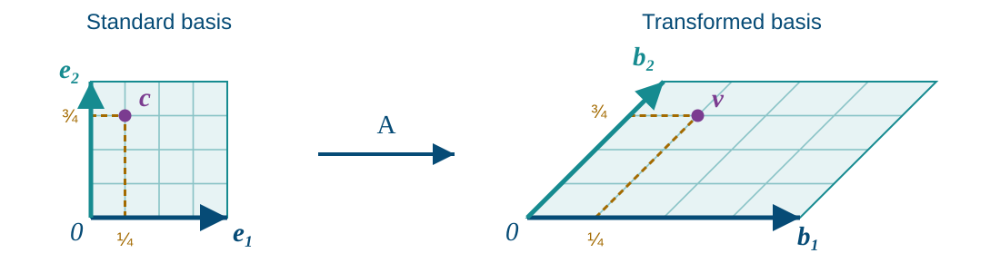
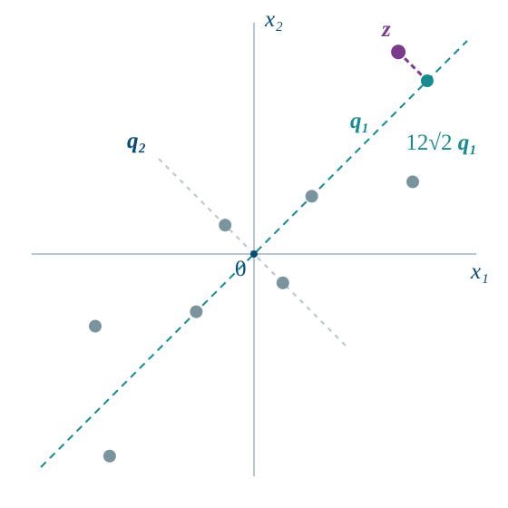

# Course Map {.deck-course-map}

::: {.columns}
::: {.column width="38%"}
<h3>Course decks</h3>

::: {style="font-size: 0.86em;"}
- [Why Linear Algebra?]()
- [Systems and Matrices]()
- [Inverses]()
- [Matrix Transformations]()
- [Determinants]()
- [Euclidean Spaces]()
- [Vector Spaces and Span]()
- [Bases and Coordinates](){.current-deck aria-current="page"}
- [Matrix Spaces and Rank]()
- [Eigenvalues]()
- [Inner Products]()
- [Special Topics]()
:::
:::

::: {.column width="4%"}
:::

::: {.column width="58%"}
<h3>In this deck</h3>

::: {style="text-align:center;"}
Basis (coordinates use the listed order): $\mathcal{B}=\{1,t,t^2\}$

::: {.diagram-flow role="group" aria-label="The coordinates 2, minus 3, and 5 in the ordered basis 1, t, t squared determine the polynomial p of t equals 2 minus 3t plus 5t squared. The coordinate column and polynomial are different kinds of objects."}

Coordinates in $\mathcal{B}$ $[p]_{\mathcal{B}}=\begin{bmatrix}2\\-3\\5\end{bmatrix}$

$\longrightarrow$

Vector in $\mathbb{P}_2$ $p(t)=2\cdot1-3\cdot t+5\cdot t^2$

:::

:::

::: {style="font-size: 0.9em;"}
- [Why Span, Bases, and Coordinates?](#why-span-bases-and-coordinates)
- [Independence and Bases](#independence-and-bases)
- [Bases and Unique Representations](#bases-and-unique-representations)
- [Dimension: Why Basis Size Is Fixed](#dimension-and-coordinates)
- [Coordinates and Their Arithmetic](#coordinates-in-a-chosen-basis)
- [Transformations and Change of Basis](#changing-coordinate-systems)
- [Applications and Extensions](#applications-and-extensions)
- [Big Ideas](#big-ideas)
:::
:::
:::

::: {.notes}
The polynomial is the vector in this example; the column contains its
coordinates in the basis {1,t,t^2}, in the listed order. We use braces for
bases; for coordinates, the displayed order matters. Its first entry multiplies 1,
its second multiplies t, and its third multiplies t^2. In R^n with the standard
basis, a vector and its coordinate column look identical. Here the different
kinds of objects make the distinction visible: coefficients together with the
chosen basis determine the polynomial.
:::

# Why Span, Bases, and Coordinates? {#why-span-bases-and-coordinates}

Which vectors can we build, and how can we describe each one uniquely?

A transformed grid motivates the question; definitions and proofs make the answer reliable

- [From building vectors to giving them addresses](#from-building-vectors-to-giving-them-addresses)
- [The questions that organize this deck](#the-questions-that-organize-this-deck)
- [A square becomes a parallelogram](#a-square-becomes-a-parallelogram)

## From building vectors to giving them addresses {#from-building-vectors-to-giving-them-addresses data-state="goldborder"}

Choose vectors $\vct{b}_1,\ldots,\vct{b}_k$ in $V$; write $\vct{c}=[c_1,\ldots,c_k]^\top$

| Concept | Notation | What it does |
|---|---|---|
| [Linear combination]{.alert} | $c_1\vct{b}_1+\cdots+c_k\vct{b}_k=[\vct{b}_1\ \cdots\ \vct{b}_k]\vct{c}$ | Builds one vector from chosen weights |
| [Span]{.alert} | $\operatorname{span}\{\vct{b}_1,\ldots,\vct{b}_k\}$ | Collects all vectors we can build |
| [Linear independence]{.alert} | $c_1\vct{b}_1+\cdots+c_k\vct{b}_k=[\vct{b}_1\ \cdots\ \vct{b}_k]\vct{c}=\vct{0}$ $\implies c_1=\cdots=c_k=0\quad(\vct{c}=\vct{0})$ | Makes the formula for building unique |
| [Basis]{.alert} | $\mathcal{B}=\{\vct{b}_1,\ldots,\vct{b}_k\}$ | Builds every vector in $V$ uniquely |
| [Dimension]{.alert} | $\dim V=k$ for a basis $\mathcal{B}$ | Counts basis vectors and coordinates |
| [Coordinates]{.alert} | $[\vct{v}]_{\mathcal{B}}=[c_1,\ldots,c_k]^\top$ | Records the weights as an address |

::: {.key-point}
Spanning gives [existence]{.alert}; independence gives [uniqueness]{.alert}
:::

::: {.notes}
This is a motivation preview; the next sections develop the definitions and
proofs. One fixed coefficient list builds one vector; varying the coefficients
builds all the vectors in the span. Independence makes the coefficients unique
for each vector we can build; a basis adds existence for every vector in V.
A list always spans its own span; being a basis for a specified V
additionally requires that this span equal V. If two coefficient lists build
the same vector, subtracting their combinations produces a nontrivial zero
combination. Conversely a nontrivial zero combination changes coefficients
without changing the vector. A vector and its coordinate list are different
objects, even when both are displayed as columns.
:::

## The questions that organize this deck {#the-questions-that-organize-this-deck}

We want to replace a vector by numbers without losing what it means

| Question | How we will answer it | Concept |
|---|---|---|
| Can different coefficient lists give the same vector? | [Subtract two representations to test whether their coefficients must agree](#why-test-only-the-zero-vector) | Independence |
| Can every vector have one address? | [Combine existence from spanning with uniqueness from independence](#a-basis-balances-reach-and-economy) | Basis |
| How many coordinates are needed? | [Prove that every basis of the same space has the same number of vectors](#dimension-counts-vectors-in-any-basis) | Dimension |
| Why compute with coordinates? | [Show that adding and scaling coordinate columns matches adding and scaling vectors](#why-coordinate-arithmetic-works) | Coordinate arithmetic |
| Why do linear maps have matrices? | [Use linearity to build every output from the images of the basis vectors](#why-the-basis-images-determine-the-matrix) | Matrix representation |

::: {.key-point}
Each example illustrates one of these questions; each proof explains why the method works
:::

## A square becomes a parallelogram {#a-square-becomes-a-parallelogram}

[The same map]{.alert} transforms the shape and the basis vectors

\begin{gather*}
\mat{A}=\begin{bmatrix}2&1\\0&1\end{bmatrix},\qquad
\vct{b}_1=\mat{A}\vct{e}_1=\begin{bmatrix}2\\0\end{bmatrix},\qquad
\vct{b}_2=\mat{A}\vct{e}_2=\begin{bmatrix}1\\1\end{bmatrix}
\end{gather*}

{fig-alt="The unit square with its standard basis and point c equals (one quarter, three quarters) maps under A to a parallelogram with edge vectors b1 equals (2,0) and b2 equals (1,1). The transformed grid locates v equals (five quarters, three quarters) using the same weights." width="86%" .nostretch}

$$
\vct{c}=\begin{bmatrix}1/4\\3/4\end{bmatrix}
\quad\longmapsto\quad
\vct{v}=\mat{A}\vct{c}=\tfrac14\vct{b}_1+\tfrac34\vct{b}_2
=\begin{bmatrix}5/4\\3/4\end{bmatrix}
$$

::: {.notes}
Recall the basis-image interpretation from Matrix Transformations. Both panels
use the same scale in both coordinate directions. Grid lines and the
highlighted point are transformed by the same A as the edge vectors. The
square and parallelogram are bounded patches, not subspaces. Restricting the
weights to [0,1] fills these patches; arbitrary real weights fill the plane.
A singular map may collapse a direction, so it need not preserve a basis.
:::

---

### Unique addresses need independent directions {#unique-addresses-need-independent-directions}

Keep $\vct{b}_1=[2,0]^\top$, $\vct{b}_2=[1,1]^\top$, and
$\mathcal{B}=\{\vct{b}_1,\vct{b}_2\}$

::: {.exitem}
$\exstar$
Can we reach every vector in $\reals^2$ uniquely using $\vct{b}_1$ and $\vct{b}_2$?
Solve the coefficient system below for arbitrary $x,y\in\reals$; is there exactly one solution?

:::

$$
\underbrace{\begin{bmatrix}2&1\\0&1\end{bmatrix}}_{[\vct{b}_1\ \vct{b}_2]}
\begin{bmatrix}c_1\\c_2\end{bmatrix}
=\begin{bmatrix}x\\y\end{bmatrix}
$$

::: {.key-point}
Reaching every vector uniquely means $\mathcal{B}$ is a [basis]{.alert} for $\reals^2$
:::

For our vector, the coordinates in this basis are

$$
\vct{v}=\begin{bmatrix}5/4\\3/4\end{bmatrix},
\qquad
[\vct{v}]_{\mathcal{B}}=\begin{bmatrix}1/4\\3/4\end{bmatrix}
$$

$\vct{b}_1^\top\vct{b}_2=2\ne0$: a basis need not be orthogonal

::: {.notes}
For any target [x,y]^T, matching components gives 2c1+c2=x and c2=y.
Thus c2=y and c1=(x-y)/2 exist and are unique for every real x,y.
Equivalently, the basis matrix [[2,1],[0,1]] has determinant 2, so every
right-hand side has exactly one solution. Every vector is reached (spanning)
and the coefficients are unique (independence). This establishes B as a
basis of R^2 before the next slide introduces a third, redundant generator.
For the fixed target v=[5/4,3/4]^T, the formula gives c1=1/4 and c2=3/4.
The two directions are not orthogonal; orthogonality is not part of the
basis requirement. The square/parallelogram coefficient bounds describe
patches only; the two edge directions form a basis of the whole plane,
not a vector-space basis of the bounded parallelogram.
:::

---

### An extra direction makes coefficient lists nonunique {#an-extra-direction-makes-coefficient-lists-nonunique}

Keep $\vct{b}_1=[2,0]^\top$, $\vct{b}_2=[1,1]^\top$, and the same
$\vct{v}=[5/4,3/4]^\top$

Add $\vct{b}_3=\vct{b}_1+\vct{b}_2=[3,1]^\top$

::: {.exitem}
$\exstar$
Find two different coefficient lists for the same $\vct{v}$
Both lists must satisfy $\vct{v}=c_1\vct{b}_1+c_2\vct{b}_2+c_3\vct{b}_3$

:::

::: {.key-point}
For a coordinate system, $\vct{b}_3$ is [redundant]{.alert}: it adds no new direction and makes coefficient lists nonunique
:::

::: {.notes}
Two lists are [1/4,3/4,0]^T and [0,1/2,1/4]^T. Since b3=[3,1]^T,
both reconstruct v=[5/4,3/4]^T. More generally [1/4-s,3/4-s,s]^T works
for every real s; adding a multiple of the zero relation -b1-b2+b3=0
changes the coefficients without changing v. The original pair is a basis,
so its coordinates are unique. The enlarged three-vector family is dependent
and has nonunique coefficient lists; these are not coordinates in a basis.
The span remains R^2, but the exercise focuses on losing uniqueness for a
fixed vector. Redundancy is unhelpful for obtaining unique coordinates;
the later frame extension discusses other reasons to retain it.
:::

# Independence and Bases

When can two coefficient lists build the same vector? 
The zero-vector test detects precisely that ambiguity

- [Independence means the zero vector has one construction](#independence-means-the-zero-vector-has-one-construction)
- [A homogeneous coefficient system detects independence](#a-homogeneous-coefficient-system-detects-independence)
- [Dependence identifies a redundant generator](#dependence-identifies-a-redundant-generator)

## Independence means the zero vector has one construction {#independence-means-the-zero-vector-has-one-construction}

Vectors $\vct{v}_1,\ldots,\vct{v}_k$ are [linearly independent]{.alert} when

$$
c_1\vct{v}_1+\cdots+c_k\vct{v}_k=\vct{0}
$$

forces

$$
c_1=\cdots=c_k=0
$$

They are [linearly dependent]{.alert} when some nonzero coefficient vector produces
the zero vector

::: {.key-point}
Why test only zero? Subtract two constructions of the same vector
:::

---

### Why test only the zero vector? {#why-test-only-the-zero-vector}

Put the vectors into $\mat{V}=[\vct{v}_1\ \cdots\ \vct{v}_k]$ 
The product $\mat{V}\vct{c}$ forms their linear combination, even for functions or matrices

Compare two coefficient columns $\vct{c}$ and $\vct{d}$ for the same vector:

$$
\mat{V}\vct{c}=\mat{V}\vct{d}
\quad\Longleftrightarrow\quad
\mat{V}(\vct{c}-\vct{d})=\vct{0}
$$

- [Independent]{.alert}: $\vct{c}-\vct{d}=\vct{0}$, so the two lists agree
- [Dependent]{.alert}: if $\mat{V}\vct{z}=\vct{0}$ with $\vct{z}\ne\vct{0}$, then $\mat{V}(\vct{c}+\vct{z})=\mat{V}\vct{c}$

::: {.key-point}
One homogeneous test controls uniqueness for every vector in the span

Spanning is the separate question of which vectors are reachable
:::

::: {.notes}
The product Vc means the linear combination of the listed vectors with
coefficient column c. This notation works for abstract vectors as well as
numerical columns. Independence says that Vz=0 forces z=0. Apply that to
z=c-d for uniqueness. Conversely, a nonzero null vector z changes the
coefficient list from c to c+z without changing the represented vector.
:::

---

### Example: independent Fourier modes {#worked-example-independent-fourier-modes}

Are $1$ and $e^{2\pi\sqrt{-1}\,t}$ independent over $\mathbb{C}$ on $[0,1]$?

Suppose $a+be^{2\pi\sqrt{-1}\,t}=0$ for every $t\in[0,1]$

$$
\begin{array}{rcl}
t=0&:&a+b=0\\
t=\tfrac12&:&a-b=0
\end{array}
\quad\implies\quad a=b=0
$$

Only the trivial combination gives the zero function, so the two modes are
independent

---

### Are two Fourier modes independent? {#are-two-fourier-modes-independent}

::: {.exitem}
$\exstar$
Are $e^{2\pi\sqrt{-1}\,t}$ and $e^{-2\pi\sqrt{-1}\,t}$ linearly independent over $\mathbb{C}$ on $[0,1]$?
Set their linear combination equal to zero for every $t$; evaluate at $t=0$ and $t=\tfrac14$
Repeat for $1$ and $e^{4\pi\sqrt{-1}\,t}$, choosing two useful values of $t$

:::

::: {.notes}
For $e^{2\pi\sqrt{-1}\,t},e^{-2\pi\sqrt{-1}\,t}$: at $t=0$, $a+b=0$;
at $t=\tfrac14$, $\sqrt{-1}\,a-\sqrt{-1}\,b=0$, so $a=b=0$.
For $1,e^{4\pi\sqrt{-1}\,t}$: at $t=0$, $a+b=0$; at $t=\tfrac14$,
$a-b=0$, so again
$a=b=0$.
:::

---

## A homogeneous coefficient system detects independence {#a-homogeneous-coefficient-system-detects-independence}

For coordinate vectors, place the candidates into columns:

$$
\mat{V}=
\begin{bmatrix}
\vct{v}_1&\cdots&\vct{v}_k
\end{bmatrix}
$$

Then

$$
c_1\vct{v}_1+\cdots+c_k\vct{v}_k=\vct{0}
\quad\Longleftrightarrow\quad
\mat{V}\vct{c}=\vct{0}
$$

Only $\vct{c}=\vct{0}$ solves this system exactly when every column has a [pivot](#pivots-organize-elimination)

::: {.key-point}
The familiar homogeneous system answers the abstract independence question
:::

---

### Test independence with a coefficient system {#test-independence-with-a-coefficient-system}

Take $\vct{u}_1=[1,1,0]^\top$, $\vct{u}_2=[1,0,1]^\top$, and
$\vct{u}_3=[2,1,1]^\top$

::: {.exitem .lettered}
$\exstar$
Place the vectors in columns and solve $\mat{U}\vct{c}=\vct{0}$
Are these three vectors independent? Give a nonzero coefficient list if they are dependent
Which vector can you remove without changing their span?
Replace $\vct{u}_3$ by $[2,1,2]^\top$ and test independence again

:::

::: {.notes}
The original columns have u3=u1+u2, so [1,1,-1]^T gives zero. All
solutions are [-s,-s,s]^T. Removing u3 leaves the same span; either of the
other two can also be removed using the same relation. With the replacement
third column, the determinant is -1, so every column has a pivot and the
only zero combination is trivial. Use elimination if students prefer it.
:::

---

## Dependence identifies a redundant generator {#dependence-identifies-a-redundant-generator}

In a dependence relation, choose a vector with a nonzero coefficient and put it last

Write the reordered list as $[\mat{U}\ \vct{w}]$, with $\mat{U}$ containing the other vectors:

$$
[\mat{U}\ \vct{w}]
\begin{bmatrix}\vct{c}\\d\end{bmatrix}=\vct{0},
\qquad d\ne0
$$

Solve for the last vector:

$$
\vct{w}=\mat{U}\!\left(-\frac{\vct{c}}{d}\right)
$$

Removing $\vct{w}$ preserves the span: the other columns already build it

Conversely, $\vct{w}=\mat{U}\vct{a}$ gives the nontrivial zero-combination
$\mat{U}\vct{a}-\vct{w}=\vct{0}$

::: {.key-point}
A dependence relation is a certificate of redundancy
:::

# Bases and Unique Representations

How do we keep every vector reachable while removing redundant generators? 
A basis gives both existence and uniqueness

- [A basis balances reach and economy](#a-basis-balances-reach-and-economy)
- [Elimination extracts a basis from a spanning set](#elimination-extracts-a-basis-from-a-spanning-set)

## A basis balances reach and economy {#a-basis-balances-reach-and-economy}

A finite set

$$
\mathcal{B}=\{\vct{b}_1,\ldots,\vct{b}_n\}
$$

is a [basis]{.alert} for $V$ when

1. $\mathcal{B}$ spans $V$
2. $\mathcal{B}$ is linearly independent

For coordinates, use the basis vectors in the order listed

Spanning guarantees existence of coefficients

Independence guarantees uniqueness of coefficients

::: {.key-point}
Every vector has one coefficient list in a chosen ordered basis
:::

---

### Independence makes coordinates unique {#independence-makes-coordinates-unique}

For a basis $\mathcal{B}$ of $V$, write $\mat{B}=[\vct{b}_1\ \cdots\ \vct{b}_n]$

Spanning supplies coefficients; suppose one vector has two coefficient lists

$$
\vct{v}=\mat{B}\vct{c}=\mat{B}\vct{d}
$$

Subtract the two representations

$$
\mat{B}(\vct{c}-\vct{d})=\vct{0}
\quad\implies\quad \vct{c}=\vct{d}
$$

Linear independence forces the two coefficient lists to agree

::: {.key-point}
A space can have many bases

Coordinates are unique once the ordered basis is fixed
:::

---

## Elimination extracts a basis from a spanning set {#elimination-extracts-a-basis-from-a-spanning-set}

The retained vectors must span the same space and be independent

For vectors in $\reals^m$:

1. place the spanning vectors into columns: $\mat{A}=[\vct{b}_1\ \cdots\ \vct{b}_k]$
2. reduce to [row echelon form]{.alert}: $\mat{U}=[\vct{u}_1\ \cdots\ \vct{u}_k]$
3. identify the pivot column numbers in $\mat{U}$: the columns containing the first nonzero entry from the left in each nonzero row
4. keep the corresponding original columns $\vct{b}_j$ from $\mat{A}$

::: {.key-point}
Row operations preserve dependence relations among columns but change the
columns themselves
:::

---

### Why the original pivot columns work {#why-the-original-pivot-columns-work}

Let $\mat{U}$ be any row echelon form of $\mat{A}$; row operations are reversible, so

$$
\mat{A}\vct{c}=\vct{0}
\quad\Longleftrightarrow\quad
\mat{U}\vct{c}=\vct{0}
$$

1. In the nonzero rows, the pivot columns form an upper-triangular matrix with nonzero diagonal: they are independent
2. Back substitution writes every other column of $\mat{U}$ as a combination of its pivot columns
3. Reversible row operations transfer independence and the column relations back to $\mat{A}$

::: {.key-point}
The original pivot columns are independent and span every original column
:::

::: {.notes}
Suppose U has r nonzero rows, with pivot columns j1<...<jr. Restrict those
columns to the first r rows: the resulting r-by-r matrix is upper triangular
with a nonzero diagonal. It is invertible by back substitution. Hence the
pivot columns are independent. Every other column has zeros below row r;
solve the triangular system for its first r entries to express it as a
combination of pivot columns. Reversibility preserves all homogeneous
column relations in both directions, including those supported only on
pivot columns, so both properties transfer to the corresponding original
columns. This proves the procedure using row echelon form. If r=0, all
columns are zero and the empty basis spans the zero column space.
:::

---

### Example: remove redundant generators {#example-remove-redundant-generators}

Let $W$ be the span of the columns of $\mat{V}$

$$
\mat{V}=[\vct{v}_1\ \vct{v}_2\ \vct{v}_3\ \vct{v}_4]
=\begin{bmatrix}1&2&0&1\\0&0&1&1\\1&2&1&2\end{bmatrix}
\;\xrightarrow{R_3\leftarrow R_3-R_1-R_2}\;
\begin{bmatrix}1&2&0&1\\0&0&1&1\\0&0&0&0\end{bmatrix}
$$

The first and third columns are pivot columns

$$
\vct{v}_4=\vct{v}_1+\vct{v}_3,
\qquad \vct{v}_2=2\vct{v}_1
$$

Remove $\vct{v}_4$ and $\vct{v}_2$ without changing the span

$$
W=\operatorname{span}\{\vct{v}_1,\vct{v}_2,\vct{v}_3,\vct{v}_4\}
=\operatorname{span}\{\vct{v}_1,\vct{v}_3\}
$$

::: {.key-point}
$\mathcal{B}=\{\vct{v}_1,\vct{v}_3\}$ still spans $W$

$a\vct{v}_1+b\vct{v}_3=\vct{0}$ forces $a=b=0$: independence completes the basis proof
:::

::: {.notes}
Subtract the first two rows from the third to obtain the displayed echelon
form. The second column is already a multiple of the first; the next pivot is
in column 3. Pivot columns need not be consecutive. The nonpivot columns
reveal the two dependence relations. The retained
columns span the original space because both removed vectors can be rebuilt
from them. They are independent: the first and second components of
$a\vct{v}_1+b\vct{v}_3=\vct{0}$ force $a=b=0$. Thus four generators become
a two-vector basis without losing any vector in W. The space is the plane
$z=x+y$, connecting back to the first deck's Course Map.
:::

---

### Different bases can describe the same span {#different-bases-can-describe-the-same-span}

Use the preceding generators of the plane $W=\{[x,y,z]^\top:z=x+y\}$

$$
\vct{v}_1=\begin{bmatrix}1\\0\\1\end{bmatrix},\quad
\vct{v}_2=\begin{bmatrix}2\\0\\2\end{bmatrix},\quad
\vct{v}_3=\begin{bmatrix}0\\1\\1\end{bmatrix},\quad
\vct{v}_4=\begin{bmatrix}1\\1\\2\end{bmatrix}
$$

::: {.exitem}
$\exstar$
A basis must span $W$ and be independent
Show that $\{\vct{v}_3,\vct{v}_4\}$ is another basis for $W$
Explain why $\{\vct{v}_1,\vct{v}_2\}$ is not a basis for $W$

:::

::: {.notes}
The first two components of a v3+b v4=0 force b=0, then a=0, so v3 and
v4 are independent. Since v1=v4-v3 and v2=2(v4-v3), they span W.
The pair v1,v2 is dependent because v2=2v1; it spans only a line in W.
A basis need not be unique. Independence makes a vector's coefficients
unique after an ordered basis has been chosen.
:::

# Dimension: Why Basis Size Is Fixed {#dimension-and-coordinates}

Different bases can look very different 
Why must their sizes agree, and when can counting replace a computation?

- [An independent list cannot outnumber a spanning list](#an-independent-list-cannot-outnumber-a-spanning-list)
- [Dimension counts vectors in any basis](#dimension-counts-vectors-in-any-basis)
- [Dimension turns two tests into one](#dimension-turns-two-tests-into-one)
- [Build a basis by adding or removing vectors](#build-a-basis-by-adding-or-removing-vectors)
- [Dimension depends on the scalar field](#dimension-depends-on-the-scalar-field)
- [Example: count monomials to find dimension](#worked-example-count-monomials-to-find-dimension)

## An independent list cannot outnumber a spanning list {#an-independent-list-cannot-outnumber-a-spanning-list}

Suppose $V=\operatorname{span}\{\vct{b}_1,\ldots,\vct{b}_n\}$,
$\vct{u}_1,\ldots,\vct{u}_r\in V$, and $r>n$

Each $\vct{u}_j$ is a combination of the $\vct{b}_i$, so for some $n\times r$ coefficient matrix $\mat{A}$,

$$
[\vct{u}_1\ \cdots\ \vct{u}_r]
=[\vct{b}_1\ \cdots\ \vct{b}_n]\mat{A}
$$

Since $r>n$, $\mat{A}\vct{c}=\vct{0}$ has a free variable, giving a solution $\vct{c}\ne\vct{0}$

Therefore

$$
[\vct{u}_1\ \cdots\ \vct{u}_r]\vct{c}
=[\vct{b}_1\ \cdots\ \vct{b}_n]\mat{A}\vct{c}
=\vct{0}
$$

::: {.key-point}
The nonzero coefficient list $\vct{c}$ gives a zero combination, so
the list $\vct{u}_1,\ldots,\vct{u}_r$ is [linearly dependent]{.alert}
:::

::: {.notes}
This uses only spanning and the earlier homogeneous-system pivot test.
There are at most n pivots in an n-by-r matrix, so r>n leaves a free
variable. No coordinates in a basis, dimension theorem, or rank-nullity
formula has been assumed. The b_i need not be independent: their only role
is to express every u_j. Column j of A lists the coefficients expressing
u_j in terms of the b_i. For abstract vectors, multiplying a bracketed list
by a coefficient column means taking its linear combination; no numerical
ambient coordinates are required. The contrapositive gives r<=n for an independent
list. For the zero space, every nonempty list is dependent and the empty
basis has size zero.
:::

## Dimension counts vectors in any basis {#dimension-counts-vectors-in-any-basis}

A space is [finite-dimensional]{.alert} if it has a finite basis

Let $\mathcal{B}$ be a basis with $n$ vectors; compare it with any other basis $\mathcal{C}$

- $\mathcal{C}$ cannot contain $n+1$ independent vectors, so it is finite
- $\mathcal{C}$ is independent and $\mathcal{B}$ spans: $|\mathcal{C}|\le n$
- $\mathcal{B}$ is independent and $\mathcal{C}$ spans: $n\le|\mathcal{C}|$

That common size is the [dimension]{.alert}:

$$
\dim(V)=n
$$

::: {.key-point}
Dimension belongs to the space, even though coordinates require a chosen basis
:::

---

### Familiar spaces: identify a basis, then count {#familiar-spaces-identify-a-basis-then-count}

Over $\reals$, exhibit a basis before assigning a dimension

| Space | Basis | Dimension |
|---|---|---|
| $\reals^n$ | Standard columns $\vct{e}_1,\ldots,\vct{e}_n$ | $n$ |
| $\mathbb{P}_k$ | Monomials $1,t,\ldots,t^k$ | $k+1$ |
| $\reals^{m\times n}$ | Single-entry matrices $\mat{E}_{ij}$ | $mn$ |

$\mat{E}_{ij}$ has a 1 in entry $(i,j)$ and zeros elsewhere

Our earlier $U=\{p\in\mathbb{P}_3:p(0)=0\}$ has basis $\{t,t^2,t^3\}$,
so $\dim(U)=3$

The zero space has the empty basis, so $\dim(\{\vct{0}\})=0$

::: {.key-point}
Dimension counts independent directions, not the number of vectors in the
space
:::

## Dimension turns two tests into one {#dimension-turns-two-tests-into-one}

Suppose $\dim(V)=n$ and $\vct{u}_1,\ldots,\vct{u}_n$ are exactly $n$ vectors in $V$

$$
\text{linearly independent}
\quad\Longleftrightarrow\quad
\text{spans}\ V
\quad\Longleftrightarrow\quad
\text{is a basis of}\ V
$$

The counting comparison also gives

- more than $n$ vectors: dependent, since a basis spans with $n$ vectors
- fewer than $n$ vectors: cannot span, since a basis has $n$ independent vectors

::: {.key-point}
First establish the dimension and check the list has exactly $n$ vectors

Then either independence or spanning completes the basis test
:::

---

### Why exactly n vectors make the two tests equivalent {#why-exactly-n-vectors-make-the-two-tests-equivalent}

Fix a basis $\mathcal{B}=\{\vct{b}_1,\ldots,\vct{b}_n\}$ of $V$, with scalar field $\mathbb{F}$ 
Write the candidates using the basis vectors:

$$
[\vct{u}_1\ \cdots\ \vct{u}_n]
=[\vct{b}_1\ \cdots\ \vct{b}_n]\mat{A},
\qquad \mat{A}\in\mathbb{F}^{n\times n}
$$

Uniqueness in $\mathcal{B}$ translates the two questions into systems:

| Question about the candidates | Equivalent question about $\mat{A}$ |
|---|---|
| Independent? | $\mat{A}\vct{c}=\vct{0}$ has only the zero solution: a pivot in every column |
| Span $V$? | $\mat{A}\vct{c}=\vct{d}$ is solvable for every $\vct{d}\in\mathbb{F}^n$: a pivot in every row |

::: {.key-point}
For a square matrix, a pivot in every column means a pivot in every row, and conversely
:::

::: {.notes}
For independence, [u1 ... un]c=[b1 ... bn]A c is zero exactly when
A c=0, because B is independent. For spanning, an arbitrary v=[b1 ... bn]d
has one coefficient list d in B; [u1 ... un]c=v exactly when A c=d. A square n-by-n
matrix has a pivot in every column iff it has n pivots iff every row has a
pivot. This proves both implications rather than assuming the basis-extension
theorem. All scalar entries and right-hand sides belong to the same field F,
including the usual choices R and C.
For n=0, the empty list is independent and spans the zero space.
:::

---

### Use dimension before computing {#use-dimension-before-computing}

Since $\dim(\mathbb{P}_3)=4$:

::: {.exitem .lettered}
$\exstar$
What can the dimension alone tell you?
Can three polynomials span $\mathbb{P}_3$?
Can five polynomials be linearly independent in $\mathbb{P}_3$?
If four polynomials are independent, what else follows?

:::

::: {.notes}
Three cannot span a four-dimensional space. Five must be dependent. Four
independent polynomials form a basis and therefore span $\mathbb{P}_3$.
:::

---

## Build a basis by adding or removing vectors {#build-a-basis-by-adding-or-removing-vectors}

Assume $V$ has a finite basis $\{\vct{b}_1,\ldots,\vct{b}_n\}$

[Start with a finite spanning list]{.alert}

Remove a redundant vector using a dependence relation; repeat until independent 
The span stays $V$, so the remaining list is a basis

[Start with an independent list]{.alert}

Consider $\vct{b}_1,\ldots,\vct{b}_n$ in turn; append each one outside the current span 
Appending such a vector preserves independence 
Afterward every $\vct{b}_j$ lies in the span, so the list spans $V$ and is a basis

::: {.key-point}
Trim while preserving reach; grow while preserving uniqueness
:::

::: {.notes}
Reduction terminates because the starting list is finite. For extension,
if w is outside the current span and sum c_j u_j+d w=0, then d cannot be
nonzero: solving for w would put it inside that span. Thus d=0 and all c_j=0
by the original independence. Only finitely many b_j are considered. Vectors
already in the span are skipped, so independence is preserved at every step;
all fixed basis vectors are in the final span, which therefore equals V.
The preceding counting comparison bounds every independent list by n.
Both constructions can finish at exactly n vectors, the size of every basis.
:::

---

### Why a new direction preserves independence {#why-a-new-direction-preserves-independence}

Let $\mat{U}=[\vct{u}_1\ \cdots\ \vct{u}_r]$ have independent columns, with
$\vct{w}\notin\operatorname{span}\{\vct{u}_1,\ldots,\vct{u}_r\}$

Test a zero combination in the enlarged list:

$$
[\mat{U}\ \vct{w}]
\begin{bmatrix}\vct{c}\\d\end{bmatrix}
=\mat{U}\vct{c}+d\vct{w}=\vct{0}
$$

If $d\ne0$, then

$$
\vct{w}=\mat{U}\!\left(-\frac{\vct{c}}{d}\right)
$$

This puts $\vct{w}$ in the span of the original columns: a contradiction

Thus $d=0$ and $\mat{U}\vct{c}=\vct{0}$; independence of the original columns forces $\vct{c}=\vct{0}$

::: {.key-point}
Adding a vector outside the span increases reach without losing uniqueness
:::

## Dimension depends on the scalar field {#dimension-depends-on-the-scalar-field}

The same set $\mathbb{C}$ can be viewed as two different vector spaces

| Scalars | A basis | Dimension |
|---|---|---|
| $\mathbb{C}$ | $\{1\}$ | $\dim_{\mathbb{C}}(\mathbb{C})=1$ |
| $\reals$ | $\{1,\sqrt{-1}\}$ | $\dim_{\reals}(\mathbb{C})=2$ |

Over $\mathbb{C}$, any $z$ is the scalar multiple $z\cdot1$

Over $\reals$, write $z=a+b\sqrt{-1}$ with two real coefficients

::: {.exitem}
$\exstar$
Find the dimensions of $\mathbb{C}^2$ over $\mathbb{C}$ and over $\reals$
:::

::: {.notes}
This extends the earlier scalar-field discussion and previews Anton Section
5.3 rather than adding a Chapter 4 reading requirement. The dimensions of
C^2 are 2 over C and 4 over R. A real basis is
{(1,0),(sqrt(-1),0),(0,1),(0,sqrt(-1))}. Independence and spanning must always
refer to the chosen scalar field. When the field is not shown in our later
real examples, it is R.
:::

## Example: count monomials to find dimension {#worked-example-count-monomials-to-find-dimension}

In $\mathbb{P}_2(\reals^2)$, total degree is at most two: add the $x$ and $y$ exponents

$$
\underbrace{1}_{0},
\qquad \underbrace{x,\ y}_{1},
\qquad \underbrace{x^2,\ xy,\ y^2}_{2}
$$

Every polynomial in the space is a unique linear combination of these six
monomials

They form a basis, so

$$
\dim(\mathbb{P}_2(\reals^2))=1+2+3=6
$$

::: {.key-point}
Count freely chosen coefficients after identifying a basis
:::

---

### Dimension beyond coordinate columns {#practice-dimension-beyond-coordinate-columns}

::: {.exitem .lettered}
$\exstar$
Find a basis and count its vectors; total degree adds the $x$ and $y$ exponents
$\mathbb{P}_3(\reals^2)$: list monomials by total degree
All upper-triangular $3\times3$ matrices
All symmetric $3\times3$ matrices
Could five symmetric $3\times3$ matrices span their entire space?

:::

::: {.notes}
For P_3(R^2), a basis is {1,x,y,x^2,xy,y^2,x^3,x^2y,xy^2,y^3}, so the
dimension is 1+2+3+4=10. Upper-triangular 3x3 matrices have six free entries;
the six corresponding single-entry matrices form a basis. Symmetric 3x3
matrices also have six free entries: three diagonal and three off-diagonal
pairs. Use three diagonal single-entry matrices and E_ij+E_ji for i<j.
Matching entries proves independence. Five cannot span this six-dimensional
space.
:::

# Coordinates and Their Arithmetic {#coordinates-in-a-chosen-basis}

A basis is now available: turn its unique coefficients into a usable description 
First justify coordinate arithmetic, then choose coordinates for different kinds of vectors

- [A basis gives every vector unique coordinates](#a-basis-gives-every-vector-unique-coordinates)
- [The coordinate map preserves linear combinations](#the-coordinate-map-preserves-linear-combinations)
- [Example: combine coordinate vectors](#worked-example-combine-coordinate-vectors)
- [Same vector, different coordinate columns](#same-vector-different-coordinate-columns)
- [Polynomial coefficients are coordinates in a chosen basis](#polynomial-coefficients-are-coordinates-in-a-chosen-basis)
- [Example: one line, two coordinate systems](#one-line-two-coordinate-systems)
- [Example: a basis of symmetric matrices](#worked-example-a-basis-of-symmetric-matrices)
- [Example: test a polynomial basis](#worked-example-test-a-polynomial-basis)

## A basis gives every vector unique coordinates {#a-basis-gives-every-vector-unique-coordinates}

A [basis]{.alert} $\mathcal{B}=\{\vct{b}_1,\ldots,\vct{b}_n\}$ spans $V$ and is independent

For $\vct{v}\in V$, spanning gives existence and independence gives uniqueness:

$$
\vct{v}=c_1\vct{b}_1+\cdots+c_n\vct{b}_n
$$

The [coordinate vector]{.alert} of $\vct{v}$ relative to $\mathcal{B}$ is

$$
[\vct{v}]_{\mathcal{B}}
=\begin{bmatrix}c_1\\\vdots\\c_n\end{bmatrix}
$$

::: {.key-point}
For coordinates, the [listed order matters]{.alert}: entry $j$ multiplies $\vct{b}_j$
:::

---

### We have been using the standard basis {#we-have-been-using-the-standard-basis}

In $\reals^2$, the [standard basis]{.alert} is

$$
\mathcal{E}=\left\{\vct{e}_1=\begin{bmatrix}1\\0\end{bmatrix},
\vct{e}_2=\begin{bmatrix}0\\1\end{bmatrix}\right\}
$$

Writing $\vct{x}=\begin{bmatrix}5\\1\end{bmatrix}$ has meant

$$
\vct{x}=5\vct{e}_1+1\vct{e}_2,
\qquad [\vct{x}]_{\mathcal{E}}=\begin{bmatrix}5\\1\end{bmatrix}
$$

In $\reals^n$, use $\mathcal{E}=\{\vct{e}_1,\ldots,\vct{e}_n\}$, where
$\vct{e}_j$ has a 1 in entry $j$ and zeros elsewhere

::: {.key-point}
Our familiar vector column is its coordinate vector in the standard basis
:::

---

## The coordinate map preserves linear combinations {#the-coordinate-map-preserves-linear-combinations}

For a basis $\mathcal{B}$ of an $n$-dimensional real vector space, define

$$
\vct{v}\longmapsto[\vct{v}]_{\mathcal{B}}\in\reals^n
$$

The column $[\vct{v}]_{\mathcal{B}}$ lists coefficients in this ordered basis, so

$$
[c\vct{u}+d\vct{v}]_{\mathcal{B}}
=c[\vct{u}]_{\mathcal{B}}+d[\vct{v}]_{\mathcal{B}}
$$

The coordinate map is one-to-one, onto, and preserves linear combinations

Such a map is a [linear isomorphism]{.alert}

It preserves linear combinations; ordinary coordinate lengths may change

::: {.key-point}
Every $n$-dimensional real vector space has the same linear structure as
$\reals^n$
:::

::: {.notes}
This is a statement about linear structure. The ordinary Euclidean length of
a coordinate column need not equal the original vector's length. For the
basis {[1,1]^T,[1,-1]^T}, b1 has length sqrt(2), while its coordinate column
[1,0]^T has Euclidean length 1. General coordinates preserve algebra;
geometry requires the inner product in those coordinates.
:::

---

### Why coordinate arithmetic works {#why-coordinate-arithmetic-works}

Put $\mat{B}=[\vct{b}_1\ \cdots\ \vct{b}_n]$, with
$\vct{c}=[\vct{u}]_{\mathcal{B}}$ and $\vct{d}=[\vct{v}]_{\mathcal{B}}$

Here $\mat{B}\vct{a}$ means $a_1\vct{b}_1+\cdots+a_n\vct{b}_n$,
even when the basis vectors are polynomials, functions, or matrices

$$
\alpha\vct{u}+\beta\vct{v}
=\alpha\mat{B}\vct{c}+\beta\mat{B}\vct{d}
=\mat{B}(\alpha\vct{c}+\beta\vct{d})
$$

Uniqueness makes these coefficients the coordinates of the result:

$$
[\alpha\vct{u}+\beta\vct{v}]_{\mathcal{B}}
=\alpha[\vct{u}]_{\mathcal{B}}+\beta[\vct{v}]_{\mathcal{B}}
$$

Every column $\vct{a}\in\reals^n$ reconstructs exactly one vector
$\mat{B}\vct{a}$; reading its coordinates returns $\vct{a}$

::: {.key-point}
Reconstruction and taking coordinates undo each other and preserve linear combinations
:::

---

## Example: combine coordinate vectors {#worked-example-combine-coordinate-vectors}

Use the polynomial basis $\mathcal{B}=\{1,1+t,t^2\}$

$$
p=2+3t+t^2,
\quad [p]_{\mathcal{B}}=[-1,3,1]^\top
$$

$$
q=1-t+2t^2,
\quad [q]_{\mathcal{B}}=[2,-1,2]^\top
$$

Compute in coordinates:

$$
[2p-q]_{\mathcal{B}}
=2[-1,3,1]^\top-[2,-1,2]^\top
=[-4,7,0]^\top
$$

Reconstruct: $-4(1)+7(1+t)+0t^2=3+7t=2p-q$

::: {.key-point}
Coordinate arithmetic uses coefficients in the chosen basis
:::

---

### Reconstruct after coordinate arithmetic {#practice-reconstruct-after-coordinate-arithmetic}

Keep $\mathcal{B}=\{1,1+t,t^2\}$ and suppose

$$
[p]_{\mathcal{B}}=[1,2,-1]^\top,
\qquad [q]_{\mathcal{B}}=[-2,1,3]^\top
$$

::: {.exitem .lettered}
$\exstar$
Coordinate entries multiply $1$, $1+t$, and $t^2$ in that order
Find $[p+2q]_{\mathcal{B}}$ without first expanding the polynomials
Reconstruct $p+2q$ as a polynomial in $t$
Why is its constant coefficient different from the first coordinate?

:::

::: {.notes}
The coordinate vector is [-3,4,5]^T, and the polynomial is
-3+4(1+t)+5t^2=1+4t+5t^2. Both 1 and 1+t contribute to the constant
coefficient. Directly, p=3+2t-t^2 and q=-1+t+3t^2, giving the same result.
:::

---

### Coordinate arithmetic preserves algebra, not lengths {#coordinate-arithmetic-preserves-algebra-not-lengths}

In $\reals^2$, use $\mathcal{B}=\{[1,1]^\top,[1,-1]^\top\}$

::: {.exitem .lettered}
$\exstar$
Separate linear structure from geometry
Suppose $[\vct{u}]_{\mathcal{B}}=[1,0]^\top$ and $[\vct{v}]_{\mathcal{B}}=[0,1]^\top$. Find $[2\vct{u}-\vct{v}]_{\mathcal{B}}$ and reconstruct $2\vct{u}-\vct{v}$
Compare the Euclidean lengths of $\vct{u}$ and $[\vct{u}]_{\mathcal{B}}$
Why does preserving linear combinations not guarantee preserving lengths?

:::

::: {.notes}
The coordinate calculation gives [2,-1]^\top. Reconstructing yields
2[1,1]^\top-[1,-1]^\top=[1,3]^\top. Here u=[1,1]^\top has Euclidean
length sqrt(2), whereas [u]_B=[1,0]^\top has Euclidean length 1.
The coordinate map preserves addition and scalar multiplication by matching
coefficients in a basis. Those algebraic properties impose no unit-length
or orthogonality requirement on the basis. In this example the two basis
vectors are orthogonal but have length sqrt(2), so the ordinary Euclidean
length of every coordinate column is smaller by that factor. A linear
isomorphism need not be an isometry; the latter term is optional enrichment.
:::

## Same vector, different coordinate columns {#same-vector-different-coordinate-columns}

For $\vct{x}=[5,1]^\top$, compare the standard basis
$\mathcal{E}=\{[1,0]^\top,[0,1]^\top\}$ with

$$
\mathcal{B}=\left\{\vct{b}_1=\begin{bmatrix}1\\1\end{bmatrix},
\vct{b}_2=\begin{bmatrix}1\\-1\end{bmatrix}\right\}
$$

The same vector has two descriptions:

$$
\vct{x}=5\vct{e}_1+1\vct{e}_2=3\vct{b}_1+2\vct{b}_2
$$

$$
[\vct{x}]_{\mathcal{E}}=\begin{bmatrix}5\\1\end{bmatrix},
\qquad [\vct{x}]_{\mathcal{B}}=\begin{bmatrix}3\\2\end{bmatrix}
$$

The brackets mean “coordinates of this vector in this basis”

The entries 3 and 2 are weights on $\vct{b}_1$ and $\vct{b}_2$, not the
standard horizontal and vertical components

::: {.key-point}
[Same vector]{.alert} at $(5,1)$; [different coordinates]{.alert} in a different basis
:::

---

### Read the basis label before the numbers {#practice-read-the-basis-label-before-the-numbers}

Use $\mathcal{E}=\{[1,0]^\top,[0,1]^\top\}$ and
$\mathcal{B}=\{[1,1]^\top,[1,-1]^\top\}$

::: {.exitem}
$\exstar$
Interpret each coordinate column
If $[\vct{u}]_{\mathcal{B}}=[1,0]^\top$, find $\vct{u}$ in standard coordinates
If $[\vct{v}]_{\mathcal{E}}=[1,0]^\top$, find $\vct{v}$. Is it the same vector as $\vct{u}$?
Reverse the listed order of $\mathcal{B}$ to get $\mathcal{B}'$. Find $[\vct{x}]_{\mathcal{B}'}$ for $\vct{x}=[5,1]^\top$

:::

::: {.notes}
The first column means u = 1 b1 + 0 b2 = [1,1]^T. The second means
v = 1 e1 + 0 e2 = [1,0]^T, a different vector despite identical coordinate
entries. With B' = {b2,b1} in the reversed order (the same underlying set),
x = 2 b2 + 3 b1, so its coordinates are [2,3]^T.
The jth coordinate multiplies the jth basis vector; their order matters.
:::

---

## Polynomial coefficients are coordinates in a chosen basis {#polynomial-coefficients-are-coordinates-in-a-chosen-basis}

For the standard polynomial basis

$$
\mathcal{E}=\{1,t,t^2\}
$$

the polynomial $p(t)=2-3t+5t^2$ has coordinates

$$
[p]_{\mathcal{E}}
=\begin{bmatrix}2\\-3\\5\end{bmatrix}
$$

For another basis, the same polynomial has another coordinate vector

::: {.key-point}
Choosing a basis converts abstract vectors into coordinate columns
:::

---

## Example: one line, two coordinate systems {#one-line-two-coordinate-systems}

Choose coordinates that match how a line is measured

High school algebra in $\mathbb{P}_1$: polynomials of degree at most one

:::: {.columns}
::: {.column width="47%"}
[Slope-intercept form]{.alert}

$$
p(x)=b+mx
$$

Basis $\mathcal{B}=\{1,x\}$, in that order

$$
[p]_{\mathcal{B}}=\begin{bmatrix}b\\m\end{bmatrix}
$$

Coordinates: intercept and slope
:::
::: {.column width="6%"}
:::
::: {.column width="47%"}
[Two-point form]{.alert} at $x=0,1$

$$
p(x)=y_0(1-x)+y_1x
$$

Basis $\mathcal{C}=\{1-x,x\}$, in that order

$$
[p]_{\mathcal{C}}=\begin{bmatrix}y_0\\y_1\end{bmatrix}
$$

Coordinates: $y_0=p(0)$ and $y_1=p(1)$
:::
::::

For $p(x)=2+3x=2(1-x)+5x$,

$$
[p]_{\mathcal{B}}=\begin{bmatrix}2\\3\end{bmatrix},
\qquad [p]_{\mathcal{C}}=\begin{bmatrix}2\\5\end{bmatrix}
$$

::: {.key-point}
Same line, different coordinates in different bases
:::

::: {.notes}
The familiar name for b+mx is slope-intercept form. It is point-slope form
based at x=0 after writing p(x)-b=m(x-0).
For C, 1-x has values 1,0 at x=0,1, while x has values 0,1. Thus the
weights are exactly the two sampled y values. Expanding gives b=y_0 and
m=y_1-y_0, so every polynomial of degree at most one has exactly one
representation in either listed basis. Constants and the zero polynomial
are included in P_1.
:::

---

### A third point gives redundant data {#a-third-point-gives-redundant-data}

Add the point at $x=2$ to the two-point description

$$
p(2)=y_0(1-2)+2y_1=2y_1-y_0
$$

For $p(x)=2+3x$, the three points are $(0,2)$, $(1,5)$, and $(2,8)$

- The first two values determine the line uniquely
- The third value must satisfy $y_2=2y_1-y_0$
- Arbitrary values at $x=0,1,2$ may require a [quadratic]{.alert}

::: {.key-point}
Three sampled values of a line cannot vary independently

&nbsp;

There is no basis of three polynomials in $\mathbb{P}_1$
:::

::: {.notes}
Compatible three-point data still specify one unique line. Redundant data
do not mean that several lines pass through the same two distinct x values.
Every polynomial in P_1 is determined by its two coefficients relative to
{1,x}; three such coefficient columns are dependent. Hence three linear
polynomials cannot form a basis of P_1. A three-node Lagrange basis instead
belongs to P_2; for collinear data, its quadratic terms cancel. The next
slide distinguishes fixed sample values from nonunique synthesis weights.
:::

---

### Three linear generators give many coefficient lists {#three-linear-generators-give-many-coefficient-lists}

Extend the two-point basis to the spanning family $\mathcal{G}=\{1-x,x,1\}$

It is dependent because

$$
(1-x)+x-1=0
$$

The same line has infinitely many representations, one for each $s\in\reals$:

$$
2+3x=(2-s)(1-x)+(5-s)x+s(1)
$$

For example,

$$
2(1-x)+5x+0(1)=1(1-x)+4x+1(1)
$$

::: {.key-point}
A basis gives [unique coordinates]{.alert}; redundant generators give [nonunique weights]{.alert}
:::

::: {.notes}
The three weights here are coefficients on the listed generators, not the
sample values p(0),p(1),p(2). Those values remain fixed at 2,5,8. Adding
s times the zero relation -(1-x)-x+1=0 changes the coefficient list without
changing the polynomial. This is the same redundancy seen in the earlier
extra-generator example; the later frame extension revisits it. The
two-point basis is enough to describe every line uniquely.
:::

---

### Coordinates and a third sample {#practice-coordinates-and-a-third-sample}

Use $\mathcal{B}=\{1,x\}$ and $\mathcal{C}=\{1-x,x\}$, in the listed order

::: {.exitem .lettered}
$\exstar$
A polynomial $p\in\mathbb{P}_1$ satisfies $p(0)=3$ and $p(1)=-1$
Find $[p]_{\mathcal{C}}$, reconstruct $p(x)$, and find $[p]_{\mathcal{B}}$
Predict $p(2)$; could the point $(2,-4)$ lie on this same line?
Find two different coefficient lists for $p$ in the redundant family $\{1-x,x,1\}$

:::

::: {.notes}
[p]_C=[3,-1]^T, so p=3(1-x)-x=3-4x and [p]_B=[3,-4]^T.
p(2)=-5, so (2,-4) does not lie on this line. In the three-generator
family, [3,-1,0]^T and [2,-2,1]^T both represent p. The sample values are
fixed, while these redundant-generator coefficients can vary. Do not call
the three-generator lists coordinates in a basis.
:::

---

## Example: a basis of symmetric matrices {#worked-example-a-basis-of-symmetric-matrices}

Review bases and dimension; the freely chosen entries become coordinates

For real symmetric $2\times2$ matrices ($\mat{A}^\top=\mat{A}$), use

$$
\mat{B}_1=\begin{bmatrix}1&0\\0&0\end{bmatrix},
\quad
\mat{B}_2=\begin{bmatrix}0&1\\1&0\end{bmatrix},
\quad
\mat{B}_3=\begin{bmatrix}0&0\\0&1\end{bmatrix}
$$

Every symmetric matrix has exactly one representation

$$
\begin{bmatrix}a&b\\b&d\end{bmatrix}
=a\mat{B}_1+b\mat{B}_2+d\mat{B}_3
$$

Thus $\mathcal{B}=\{\mat{B}_1,\mat{B}_2,\mat{B}_3\}$ spans the space and is
independent

$$
\mat{A}=\begin{bmatrix}2&-1\\-1&3\end{bmatrix}
\quad\implies\quad
[\mat{A}]_{\mathcal{B}}=\begin{bmatrix}2\\-1\\3\end{bmatrix}
$$

::: {.key-point}
The vector is a matrix; its coordinate vector is a column of coefficients
:::

---

### Bases for other matrix spaces {#practice-bases-for-other-matrix-spaces}

::: {.exitem .lettered}
$\exstar$
For real $2\times2$ matrices, build bases from the freely chosen entries
Find an ordered basis for all upper-triangular $2\times2$ matrices
In your basis, find the coordinates of $\begin{bmatrix}2&-1\\0&3\end{bmatrix}$
Find a basis for the skew-symmetric matrices: $\mat{A}^\top=-\mat{A}$
Explain why your lists both span and are independent

:::

::: {.notes}
Use E_11, E_12, E_22, where E_ij has a single 1 in entry (i,j), for the
upper-triangular space; coordinates are [2,-1,3]^T in that order.
A real skew-symmetric 2x2 matrix is [[0,b],[-b,0]], so the single matrix
[[0,1],[-1,0]] is a basis. Matching entries proves spanning and independence.
There are three upper-triangular basis matrices and one skew-symmetric basis
matrix, so the dimensions are three and one, respectively.
:::

## Example: test a polynomial basis {#worked-example-test-a-polynomial-basis}

Review the basis test; use the resulting basis to find coordinates

In $\mathbb{P}_2$, the polynomials in $t$ of degree at most two, take
$\mathcal{E}=\{1,t,1+t^2\}$

Its coefficient columns relative to $\{1,t,t^2\}$ form

$$
\begin{bmatrix}1&0&1\\0&1&0\\0&0&1\end{bmatrix}
$$

Three pivots: every coefficient vector is reached uniquely, so $\mathcal{E}$
spans $\mathbb{P}_2$ and is independent

For $p(t)=2+4t+3t^2$,

$$
p=-1(1)+4t+3(1+t^2),
\qquad [p]_{\mathcal{E}}=[-1,4,3]^\top
$$

---

### A basis question combines two tests {#a-basis-question-combines-two-tests}

In $\mathbb{P}_2$, consider

$$
\mathcal{B}=\{1+t,\ t+t^2,\ 1+t^2\}
$$

::: {.exitem}
$\exstar$
Does $\mathcal{B}$ span all of $\mathbb{P}_2$ and is it independent?
Form the matrix of coefficients relative to $\{1,t,t^2\}$
Test its columns for independence
If it is a basis, find $[2+4t]_{\mathcal{B}}$

:::

::: {.notes}
The coefficient matrix is
$\begin{bmatrix}1&0&1\\1&1&0\\0&1&1\end{bmatrix}$, whose determinant is
$2$. Thus the list is a basis. Solving gives coordinates $(3,1,-1)$ for
$2+4t$.
:::

---

### Two more polynomial basis tests {#two-more-polynomial-basis-tests}

In $\mathbb{P}_2$, consider

$$
\mathcal{C}=\{1+t,\ t+t^2,\ 1+2t+t^2\},
\qquad
\mathcal{D}=\{1+t,\ t+t^2,\ 1\}
$$

::: {.exitem}
$\exstar$
Use spanning and independence to decide which list is a basis of $\mathbb{P}_2$
For the basis, find the coordinates of $2+4t$

:::

::: {.notes}
Use the previous basis slide as the board example. $\mathcal{C}$ is dependent:
its third polynomial is the sum of its first two. $\mathcal{D}$ is a basis;
$2+4t=4(1+t)+0(t+t^2)-2(1)$, so the coordinates are $(4,0,-2)$.
:::

# Transformations and Change of Basis {#changing-coordinate-systems}

Two tasks: describe the same vector in a new basis, or apply a linear map 
Both use the same principle: determine the outputs of the input basis vectors

- [A basis matrix converts coordinates to standard form](#a-basis-matrix-converts-coordinates-to-standard-form)
- [Change of basis passes through the vector](#change-of-basis-passes-through-the-vector)
- [Transition columns describe the old basis in the new one](#transition-columns-describe-the-old-basis-in-the-new-one)
- [Example: change between polynomial bases](#two-coordinate-systems-describe-one-vector)
- [Transform coordinates to obtain output coordinates](#transform-coordinates-to-obtain-output-coordinates)
- [Coordinates turn transformations into matrix multiplication](#coordinates-turn-transformations-into-matrix-multiplication)
- [Differentiate using two chosen bases](#differentiate-using-two-chosen-bases)
- [Initial data map linearly to a solution function](#initial-data-map-linearly-to-a-solution-function)

The [companion notebook](https://github.com/fjhickernell/MATH332Fall2026/blob/main/notebooks/demonstrations/07-bases-dimension-and-coordinates.ipynb)
explores basis extraction and coordinate changes

## A basis matrix converts coordinates to standard form {#a-basis-matrix-converts-coordinates-to-standard-form}

For a basis $\mathcal{B}=\{\vct{b}_1,\ldots,\vct{b}_n\}$ of $\reals^n$, form

$$
\mat{P}_{\mathcal{B}}
=\begin{bmatrix}\vct{b}_1&\cdots&\vct{b}_n\end{bmatrix}
$$

The column $[\vct{x}]_{\mathcal{B}}$ lists coefficients multiplying these basis vectors

Independence makes $\mat{P}_{\mathcal{B}}$ invertible:

$$
\vct{x}=\mat{P}_{\mathcal{B}}[\vct{x}]_{\mathcal{B}},
\qquad
[\vct{x}]_{\mathcal{B}}=\mat{P}_{\mathcal{B}}^{-1}\vct{x}
$$

For the [standard basis]{.alert} $\mathcal{B}=\mathcal{E}=\{\vct{e}_1,\ldots,\vct{e}_n\}$,

$$
\mat{P}_{\mathcal{B}}=\mat{I}_n,
\qquad [\vct{x}]_{\mathcal{B}}=\vct{x}
$$

::: {.key-point}
[Basis vectors are the columns]{.alert}: multiply coordinates to rebuild the vector
:::

## Change of basis passes through the vector {#change-of-basis-passes-through-the-vector}

Let $\mathcal{B}$ and $\mathcal{C}$ be ordered bases of $\reals^n$

$\mat{P}_{\mathcal{B}}$ and $\mat{P}_{\mathcal{C}}$ contain their basis vectors as columns

$$
[\vct{x}]_{\mathcal{B}}
\quad\xrightarrow{\mat{P}_{\mathcal{B}}}\quad
\vct{x}
\quad\xrightarrow{\mat{P}_{\mathcal{C}}^{-1}}\quad
[\vct{x}]_{\mathcal{C}}
$$

[Change-of-basis matrix]{.alert}: first rebuild the vector, then read its new coordinates

$$
[\vct{x}]_{\mathcal{C}}
=\underbrace{\mat{P}_{\mathcal{C}}^{-1}\mat{P}_{\mathcal{B}}}_{
\text{transition from}\ \mathcal{B}\ \text{to}\ \mathcal{C}}
[\vct{x}]_{\mathcal{B}}
$$

::: {.key-point}
[Same vector, new description]{.alert}: only its coordinate column changes
:::

## Transition columns describe the old basis in the new one {#transition-columns-describe-the-old-basis-in-the-new-one}

Let $\mathcal{B}=\{\vct{b}_1,\ldots,\vct{b}_n\}$ and $\mathcal{C}$ be ordered
bases of the same finite-dimensional real vector space

Name the conversion matrix $\mat{Q}_{\mathcal{C}\leftarrow\mathcal{B}}$:

$$
[\vct{v}]_{\mathcal{B}}
\quad\xrightarrow{\mat{Q}_{\mathcal{C}\leftarrow\mathcal{B}}}\quad
[\vct{v}]_{\mathcal{C}}
$$

For $\vct{b}_j$, the input column is $\vct{e}_j$: 1 in entry $j$, 0 elsewhere

$$
\underbrace{\mat{Q}_{\mathcal{C}\leftarrow\mathcal{B}}\vct{e}_j}_{\text{column}\ j\ \text{of}\ \mat{Q}_{\mathcal{C}\leftarrow\mathcal{B}}}
=[\vct{b}_j]_{\mathcal{C}}
$$

So each column contains one old basis vector's new coordinates:

::: {.alert}
$$
\color{#007acc}\boxed{\mat{Q}_{\mathcal{C}\leftarrow\mathcal{B}}
=\begin{bmatrix}[\vct{b}_1]_{\mathcal{C}}&\cdots&[\vct{b}_n]_{\mathcal{C}}\end{bmatrix}}
$$
:::

For bases of $\reals^n$, this is $\mat{P}_{\mathcal{C}}^{-1}\mat{P}_{\mathcal{B}}$

::: {.key-point}
To build [column $j$]{.alert}, write $\vct{b}_j$ in basis $\mathcal{C}$ and record its coefficients
:::

## Example: change between polynomial bases {#two-coordinate-systems-describe-one-vector}

In $\mathbb{P}_2$, choose

$$
\mathcal{B}=\{1,1+t,t^2\},\qquad \mathcal{C}=\{1,t,t+t^2\}
$$

Write each $\mathcal{B}$ polynomial using the $\mathcal{C}$ polynomials, in their listed order:

| $\mathcal{B}$ polynomial | Expansion using $\mathcal{C}=\{1,t,t+t^2\}$ | $\mathcal{C}$-coordinate column |
|---|---|---|
| $1$ | $1(1)+0(t)+0(t+t^2)$ | $[1,0,0]^\top$ |
| $1+t$ | $1(1)+1(t)+0(t+t^2)$ | $[1,1,0]^\top$ |
| $t^2$ | $0(1)-1(t)+1(t+t^2)$ | $[0,-1,1]^\top$ |

Put these coefficient columns side by side:

$$
\mat{Q}_{\mathcal{C}\leftarrow\mathcal{B}}
=\begin{bmatrix}[1]_{\mathcal{C}}&[1+t]_{\mathcal{C}}&[t^2]_{\mathcal{C}}\end{bmatrix}
=\begin{bmatrix}1&1&0\\0&1&-1\\0&0&1\end{bmatrix}
$$

---

### Convert a polynomial and check both descriptions {#convert-a-polynomial-and-check-both-descriptions}

Use $\mathcal{B}=\{1,1+t,t^2\}$ and $\mathcal{C}=\{1,t,t+t^2\}$, in those orders

For $p(t)=2-3t+5t^2$, first find its $\mathcal{B}$-coordinates:

\begin{align*}
p(t)&=a(1)+b(1+t)+ct^2\\
&=(a+b)+bt+ct^2
\end{align*}

Matching coefficients gives $b=-3$, $c=5$, and $a=2-b=5$

Now convert the coordinate column:

$$
[p]_{\mathcal{C}}
=\underbrace{\begin{bmatrix}1&1&0\\0&1&-1\\0&0&1\end{bmatrix}}_{\mat{Q}_{\mathcal{C}\leftarrow\mathcal{B}}}
\underbrace{\begin{bmatrix}5\\-3\\5\end{bmatrix}}_{[p]_{\mathcal{B}}}
=\begin{bmatrix}5-3\\-3-5\\5\end{bmatrix}
=\begin{bmatrix}2\\-8\\5\end{bmatrix}
$$

::: {.key-point}
$2(1)-8t+5(t+t^2)=2-3t+5t^2=p$ 
New coordinates, same polynomial
:::

---

### Coordinates change with the basis {#coordinates-change-with-the-basis}

Keep $\vct{x}=[5,1]^\top$ and compare

$$
\mathcal{C}=\bigl\{[1,0]^\top,[1,1]^\top\bigr\},
\qquad
\mathcal{D}=\bigl\{[2,1]^\top,[1,1]^\top\bigr\}
$$

::: {.exitem}
$\exstar$
Find $[\vct{x}]_{\mathcal{C}}$ and $[\vct{x}]_{\mathcal{D}}$
Reconstruct $\vct{x}$ from each coordinate vector
Use basis vectors as columns of $\mat{P}_{\mathcal{C}}$ and $\mat{P}_{\mathcal{D}}$; check the change from $\mathcal{C}$ to $\mathcal{D}$ with $\mat{P}_{\mathcal{D}}^{-1}\mat{P}_{\mathcal{C}}$

:::

::: {.notes}
The preceding slide is the board example. Here
$[\vct{x}]_{\mathcal{C}}=[4,1]^\top$ and
$[\vct{x}]_{\mathcal{D}}=[4,-3]^\top$; both reconstruct
$\vct{x}=[5,1]^\top$. The transition matrix is
$\mat{P}_{\mathcal{D}}^{-1}\mat{P}_{\mathcal{C}}
=\begin{bmatrix}1&0\\-1&1\end{bmatrix}$, which sends $[4,1]^\top$
to $[4,-3]^\top$.
:::

---

### Build a polynomial transition matrix in the right direction {#build-a-polynomial-transition-matrix-in-the-right-direction}

In $\mathbb{P}_1$, use $\mathcal{B}=\{1,t\}$ and $\mathcal{C}=\{1-t,t\}$

::: {.exitem .lettered}
$\exstar$
Convert $\mathcal{B}$-coordinates to $\mathcal{C}$-coordinates
Find $[1]_{\mathcal{C}}$ and $[t]_{\mathcal{C}}$; use them as columns of $\mat{Q}_{\mathcal{C}\leftarrow\mathcal{B}}$
For $p(t)=3-2t$, find $[p]_{\mathcal{C}}$ by matrix multiplication and reconstruct $p$
Would the same matrix convert $\mathcal{C}$-coordinates back to $\mathcal{B}$-coordinates? Find the reverse matrix

:::

::: {.notes}
Since 1=(1-t)+t and t=0(1-t)+t, the transition columns are
[1,1]^\top and [0,1]^\top, so
$\mat{Q}_{\mathcal{C}\leftarrow\mathcal{B}}
=\begin{bmatrix}1&0\\1&1\end{bmatrix}$.
Multiplying [3,-2]^\top gives [3,1]^\top, and
3(1-t)+t=3-2t. The reverse matrix is
$\mat{Q}_{\mathcal{B}\leftarrow\mathcal{C}}
=\begin{bmatrix}1&0\\-1&1\end{bmatrix}$;
its columns are the B-coordinates of 1-t and t. It sends [3,1]^\top
back to [3,-2]^\top. The forward matrix would instead send [3,1]^\top
to [3,4]^\top, so the direction matters. Both matrices represent the
identity transformation with different input and output bases.
:::

## Transform coordinates to obtain output coordinates {#transform-coordinates-to-obtain-output-coordinates}

Let $T:V\to W$ be linear between real vector spaces, with ordered bases
$\mathcal{B}=\{\vct{b}_1,\ldots,\vct{b}_n\}$ of $V$ and
$\mathcal{C}=\{\vct{c}_1,\ldots,\vct{c}_m\}$ of $W$

Transform each input basis vector; put its output coordinates in a column:

$$
\mat{M}_{\mathcal{C}\leftarrow\mathcal{B}}
=\begin{bmatrix}[T(\vct{b}_1)]_{\mathcal{C}}&\cdots&[T(\vct{b}_n)]_{\mathcal{C}}\end{bmatrix}
\in\reals^{m\times n}
$$

Then transform any input coordinate column:

$$
\boxed{[T(\vct{v})]_{\mathcal{C}}
=\mat{M}_{\mathcal{C}\leftarrow\mathcal{B}}[\vct{v}]_{\mathcal{B}}}
$$

$\mathcal{C}$ describes the output space; $T$ need not reach every vector in $W$

::: {.key-point}
[Input coordinates in, output coordinates out]{.alert}: the bases determine what the entries mean

A change of basis is the special case $T=I$: the vector itself stays the same
:::

::: {.notes}
This explains the general rule before the differentiation application.
Linearity is the reason one matrix works for every input: if v=[b1 ... bn]a,
then T(v)=[T(b1) ... T(bn)]a. Taking C-coordinates gives the displayed
matrix product. There is one column per input basis vector and one row per
output basis vector. The matrix depends on T and on both listed bases.
The formula applies to finite-dimensional real spaces; complex spaces use
complex matrices. W is the codomain. The image T(V) is a subspace of W and
may be smaller; C can be a basis of all W, so surjectivity is not required.
Alternatively, choosing W=T(V) gives coordinates directly in a basis of
the image. Invertibility is not required either. For the identity map on
one space, the columns become [b_j]_C, exactly the preceding transition
matrix. The next deck connects this representation to rank and nullity.
:::

---

### Why the basis images determine the matrix {#why-the-basis-images-determine-the-matrix}

Let $\vct{a}=[\vct{v}]_{\mathcal{B}}$ 
Linearity carries the same coefficient column through $T$:

\begin{align*}
\vct{v}&=[\vct{b}_1\ \cdots\ \vct{b}_n]\vct{a}\\
T(\vct{v})&=[T(\vct{b}_1)\ \cdots\ T(\vct{b}_n)]\vct{a}
\end{align*}

Take coordinates in the output basis $\mathcal{C}$:

$$
[T(\vct{v})]_{\mathcal{C}}
=\underbrace{\begin{bmatrix}[T(\vct{b}_1)]_{\mathcal{C}}&\cdots&[T(\vct{b}_n)]_{\mathcal{C}}\end{bmatrix}}_{\mat{M}_{\mathcal{C}\leftarrow\mathcal{B}}}\vct{a}
=\mat{M}_{\mathcal{C}\leftarrow\mathcal{B}}[\vct{v}]_{\mathcal{B}}
$$

::: {.key-point}
One column for each input basis vector; one entry for each output basis vector

Linearity is why those columns determine every output
:::

## Coordinates turn transformations into matrix multiplication {#coordinates-turn-transformations-into-matrix-multiplication}

Return to the general matrix rule: differentiate the input basis to build its columns

Differentiation is a linear transformation $D:\mathbb{P}_3\to\mathbb{P}_2$,
$D(p)=p'$

$$
\text{Input basis:}\ \mathcal{B}=\{1,t,t^2,t^3\},\qquad
\text{output basis:}\ \mathcal{C}=\{1,t,t^2\}
$$

For $p(t)=2-3t+5t^2+4t^3$, transform its coordinates:

$$
\underbrace{\begin{bmatrix}0&1&0&0\\0&0&2&0\\0&0&0&3\end{bmatrix}}_{\mat{M}}
\underbrace{\begin{bmatrix}2\\-3\\5\\4\end{bmatrix}}_{[p]_{\mathcal{B}}}
=\underbrace{\begin{bmatrix}-3\\10\\12\end{bmatrix}}_{[D(p)]_{\mathcal{C}}}
$$

Reconstruct only when needed: $D(p)(t)=-3+10t+12t^2$

::: {.key-point}
For a linear map $T$ and fixed ordered bases:
$[T(\vct{v})]_{\mathcal{C}}=\mat{M}[\vct{v}]_{\mathcal{B}}$

Build $\mat{M}$ once; compute with coordinates —
[](#a-basis-turns-an-abstract-problem-into-a-matrix-problem)
:::

::: {.notes}
This is the computational payoff of coordinates, not merely a naming system.
P_3 consists of polynomials of degree at most three, including zero; P_2
has degree at most two. Differentiation preserves linear combinations.
Differentiate the ordered input basis: D(1)=0, D(t)=1, D(t^2)=2t,
D(t^3)=3t^2. Their coordinate columns in C form the 3-by-4 matrix M.
The constant coordinate is lost under differentiation; invertibility is not
required. The matrix is attached to the transformation AND the chosen input
and output bases; changing bases generally changes it. For any linear map
between finite-dimensional spaces, linearity lets us transform basis vectors
once and then act on coordinate columns. The following exercise practices
differentiation with nonstandard bases;
the next deck connects the representation to rank and nullity. This same
principle works for functions in a chosen finite-dimensional function space,
matrices, and other abstract vectors. For a general infinite-dimensional
space, a finite coordinate column may represent only a selected subspace or
approximation; no such restriction is needed for these polynomial spaces.
:::

## Differentiate using two chosen bases {#differentiate-using-two-chosen-bases}

Let $D:\mathbb{P}_2\to\mathbb{P}_1$ send $p$ to $p'$, with

$$
\mathcal{B}=\{1,1+t,t^2\},\qquad \mathcal{C}=\{1,1+t\}
$$

::: {.exitem .lettered}
$\exstar$
Compute the derivative through its coordinates
Find the $\mathcal{C}$-coordinates of $D(1)$, $D(1+t)$, and $D(t^2)$; form $\mat{M}_{\mathcal{C}\leftarrow\mathcal{B}}$
For $p(t)=2-3t+5t^2$, find $[p]_{\mathcal{B}}$, multiply by your matrix, and reconstruct $D(p)$
Why is the matrix $2\times3$? What does its zero first column tell you?

:::

::: {.notes}
The derivatives are 0, 1, and 2t. In C, 2t=-2(1)+2(1+t), so the
columns are [0,0]^\top, [1,0]^\top, and [-2,2]^\top:
$\mat{M}_{\mathcal{C}\leftarrow\mathcal{B}}
=\begin{bmatrix}0&1&-2\\0&0&2\end{bmatrix}$.
Since p=5(1)-3(1+t)+5t^2, [p]_B=[5,-3,5]^\top. The matrix product is
[-13,10]^\top, which reconstructs -13(1)+10(1+t)=-3+10t=p'.
The three columns correspond to the three input basis polynomials; the two
rows correspond to the two output basis polynomials. The first column is
zero because differentiation annihilates the constant input basis vector.
Every constant is sent to zero, so the map is not one-to-one, although it
reaches all P_1. A zero first column does not mean that all outputs have
zero constant term. Do not mistake [-13,10]^\top for ordinary monomial
coefficients: the output basis is {1,1+t}.
:::

## Initial data map linearly to a solution function {#initial-data-map-linearly-to-a-solution-function}

Can two numbers describe an entire motion? Initial data give a natural choice

Let $S_{\reals}$ be the real-valued solutions of $y''+y=0$ on $\reals$

[Given from differential equations]{.alert}: for every $a,b\in\reals$, this initial-value problem has exactly one solution

$$
y''+y=0,\qquad y(0)=a,\qquad y'(0)=b
$$

$$
T:\reals^2\longrightarrow S_{\reals},\qquad
\begin{bmatrix}a\\b\end{bmatrix}
\longmapsto y,\qquad y(t)=a\cos(t)+b\sin(t)
$$

The standard input basis maps to $\mathcal{B}=\{\cos(t),\sin(t)\}$:

$$
T\!\left(\begin{bmatrix}1\\0\end{bmatrix}\right)=\cos(t),
\qquad
T\!\left(\begin{bmatrix}0\\1\end{bmatrix}\right)=\sin(t)
$$

::: {.key-point}
[Input: two numbers]{.alert}; [output: an entire function]{.alert}
:::

::: {.notes}
This is the normalized undamped spring model. S_R consists of twice
continuously differentiable real-valued functions on R solving the equation.
It revisits the homogeneous-DE vector space from Vector Spaces and Span.
Check y'=-a sin(t)+b cos(t), y''=-y, y(0)=a, and y'(0)=b.
The standard uniqueness theorem for this constant-coefficient IVP gives
every solution this form; the focus is its linear structure, not a new
DE-solving method. An elementary real-valued uniqueness proof: the
difference z of solutions with the same initial data has zero initial data,
and (z^2+(z')^2)'=2z'(z+z'')=0. Thus its zero initial energy forces z=0.
Write T([1,0]^top) as the function cos, rather than its value at one t.
The t notation in the basis names those functions. Physical motion starts
at t=0; we define the solution space for all real t.
:::

---

### Initial conditions recover the coordinates {#initial-conditions-recover-the-coordinates}

For $y(t)=a\cos(t)+b\sin(t)$,

$$
y'(t)=-a\sin(t)+b\cos(t),\qquad
\begin{bmatrix}y(0)\\y'(0)\end{bmatrix}
=\begin{bmatrix}a\\b\end{bmatrix}=[y]_{\mathcal{B}}
$$

With $\vct{u},\vct{v}\in\reals^2$ and $c,d\in\reals$,

$$
T(c\vct{u}+d\vct{v})=cT(\vct{u})+dT(\vct{v})
$$

The inverse extracts the initial data:

$$
T^{-1}:y\longmapsto\begin{bmatrix}y(0)\\y'(0)\end{bmatrix},
\qquad
[T(\vct{u})]_{\mathcal{B}}=\mat{I}_2\vct{u}
$$

::: {.key-point}
$T$ is a linear isomorphism: $\dim(S_{\reals})=2$

[Identity coordinate matrix]{.alert}; the map itself sends columns to functions
:::

::: {.notes}
The input basis is the standard basis of R^2, and the output basis B lists
cos(t), sin(t) in that order. Spanning follows from the solution formula.
For independence, a zero combination evaluated at zero gives a=0;
differentiating and evaluating at zero gives b=0. Initial values provide
exactly the B-coordinate map, inverse to T. The matrix is identity because
images of the input basis vectors are precisely the output basis vectors.
T itself is not the identity on a single space. Linearity follows directly
from the solution formula or by adding solutions and their initial data,
then invoking uniqueness. For a=2,b=-1, y=2 cos(t)-sin(t) and [y]_B=[2,-1]^top.
:::

---

### Complex exponentials give another basis {#complex-exponentials-give-another-basis}

Allow complex-valued solutions: $S_{\mathbb{C}}=\{y:y''+y=0\}$ over $\mathbb{C}$

Two bases, with coordinates in the listed order:

$$
\mathcal{B}=\{\cos(t),\sin(t)\},\qquad
\mathcal{E}=\{e^{\sqrt{-1}\,t},e^{-\sqrt{-1}\,t}\}
$$

Euler's formulas give the transition columns:

$$
\cos(t)=\frac{e^{\sqrt{-1}\,t}+e^{-\sqrt{-1}\,t}}{2},
\qquad
\sin(t)=\frac{e^{\sqrt{-1}\,t}-e^{-\sqrt{-1}\,t}}{2\sqrt{-1}}
$$

::: {.key-point}
[Same solution space]{.alert}; Euler's formulas give the [change-of-basis columns]{.alert}
:::

::: {.notes}
The field change matters: the individual exponential functions are not
members of S_R. E is a complex basis of S_C, not a real basis of S_R.
Both B and E are bases of the two-dimensional complex solution space.
Extending T's domain to C^2 gives a complex-linear isomorphism onto S_C;
restricting a,b to R gives a real-linear map with image S_R.
For y=c_+ exp(sqrt(-1)t)+c_- exp(-sqrt(-1)t), initial conditions read
a=c_++c_- and b=sqrt(-1)(c_+-c_-). The inverse transition matrix is
[[1,1],[sqrt(-1),-sqrt(-1)]], and its product with the displayed matrix is I_2.
The transition columns are E-coordinates of cos and sin, exactly the general
rule developed earlier. The nonzero determinant verifies that E is a basis.
For real a,b, c_- is the conjugate of c_+; the functions are conjugates too,
so their sum is real. Conversely, real initial data force this relation.
For a=2,b=-1, [y]_E=[1+sqrt(-1)/2,1-sqrt(-1)/2]^top.
There is no four-real-parameter freedom for real-valued solutions.
:::

---

### Change the oscillator's coordinates, not its motion {#change-the-oscillators-coordinates-not-its-motion}

Use $i=\sqrt{-1}$, $\mathcal{B}=\{\cos(t),\sin(t)\}$ and
$\mathcal{E}=\{e^{it},e^{-it}\}$ in the complex solution space

[Cosine–sine coordinates to exponential coordinates]{.alert}

::: {.alert}
$$
[y]_{\mathcal{E}}
=\underbrace{\color{#007acc}\boxed{\frac12\begin{bmatrix}1&-i\\1&i\end{bmatrix}}}_{\mat{Q}_{\mathcal{E}\leftarrow\mathcal{B}}}
\underbrace{\begin{bmatrix}a\\b\end{bmatrix}}_{[y]_{\mathcal{B}}}
=\begin{bmatrix}c_+\\c_-\end{bmatrix}
$$
:::

[Reverse direction]{.alert}: recover the initial position and velocity

$$
[y]_{\mathcal{B}}
=\underbrace{\boxed{\begin{bmatrix}1&1\\i&-i\end{bmatrix}}}_{\mat{Q}_{\mathcal{B}\leftarrow\mathcal{E}}}
[y]_{\mathcal{E}},\qquad
\mat{Q}_{\mathcal{B}\leftarrow\mathcal{E}}=\mat{Q}_{\mathcal{E}\leftarrow\mathcal{B}}^{-1}
$$

For $y(t)=2\cos(t)-\sin(t)$:
$[y]_{\mathcal{B}}=[2,-1]^\top\longmapsto[y]_{\mathcal{E}}=[1+i/2,1-i/2]^\top$

::: {.key-point}
[Same function, different coefficients]{.alert}; real initial data give conjugate exponential coefficients
:::

::: {.notes}
The first transition column is [cos]_E=[1/2,1/2]^top; the second is
[sin]_E=[-i/2,i/2]^top. Hence c_+=(a-ib)/2 and c_-=(a+ib)/2.
Conversely, a=c_++c_- and b=i(c_+-c_-), obtained from y(0) and y'(0).
Multiplying the two displayed matrices in either order gives I_2.
For a=2,b=-1, c_+=1+i/2 and c_-=1-i/2; the reverse product gives
[2,-1]^top. This changes only the description of the same solution y,
not the motion or its initial data. The matrix of the solution map T in
standard input coordinates and output basis B is I_2; changing its output
basis to E changes that matrix to Q_(E<-B). Both bases here belong to S_C
over C. Real-valued solutions correspond to conjugate coefficient pairs,
not arbitrary independent complex coefficients.
:::

---

### A critically damped spring: find the solution map {#a-critically-damped-spring-find-the-solution-map}

An idealized car spring and shock absorber, with normalized coefficients:

$$
y''+2y'+y=0,\qquad y(0)=a,\qquad y'(0)=b
$$

Let $S_d$ be its real-valued solution space on $\reals$, with basis

$$
\mathcal{D}=\{e^{-t},te^{-t}\}
$$

::: {.exitem .lettered}
$\exstar$
Repeat the undamped construction
Verify that both basis functions solve the equation and are independent
Write $y(t)=c_1e^{-t}+c_2te^{-t}$; find $c_1,c_2$ from the initial data
Define $U:\reals^2\to S_d$ from initial data to the solution; explain why it is a linear isomorphism

:::

::: {.notes}
The damping term is 2y', not 2y. This is m y''+c y'+k y=0 with
m=k=1 and c=2, so c^2=4mk: critical damping. A car's spring and shock
absorber motivate the idealized model, without asserting a vehicle's
actual damping ratio. The characteristic polynomial is (r+1)^2.
Both e^(-t) and t e^(-t) solve the equation. Dividing a zero combination
by e^(-t) gives c_1+c_2 t=0 for every t, hence independence.
The displayed basis may be taken as given; the task is to verify its
solutions/independence, then use coordinates rather than learn DE methods.
Initial-value uniqueness establishes that it spans all S_d.
For y=(c_1+c_2 t)e^(-t), y'=(c_2-c_1-c_2 t)e^(-t).
Thus y(0)=c_1=a, y'(0)=c_2-c_1=b, and c_2=a+b.
U maps [a,b]^top to y(t)=[a+(a+b)t]e^(-t).
This is linear in a,b, bijective, and has inverse y -> [y(0),y'(0)]^top.
Thus dim(S_d)=2. The basis functions tend to zero as t tends to infinity;
critical damping is the threshold between oscillatory and overdamped
motion. Avoid claiming that every initial condition prevents crossing
equilibrium: some initial velocities can cause one crossing.
:::

---

### Choose output coordinates for the damped motion {#choose-output-coordinates-for-the-damped-motion}

Keep $U:\reals^2\to S_d$ and $\mathcal{D}=\{e^{-t},te^{-t}\}$

::: {.exitem .lettered}
$\exstar$
The input basis is the standard basis of $\reals^2$
Find the $\mathcal{D}$-coordinates of $U([1,0]^\top)$ and $U([0,1]^\top)$; form the matrix representing $U$
Use those two output functions as a new basis $\mathcal{F}$; what matrix now represents $U$?
For $a=1$, $b=0$, give $y(t)$, $[y]_{\mathcal{D}}$, and $[y]_{\mathcal{F}}$

:::

::: {.notes}
U([1,0]^top)=(1+t)e^(-t), with D-coordinates [1,1]^top.
U([0,1]^top)=t e^(-t), with D-coordinates [0,1]^top.
The matrix with standard input basis and output basis D is
[[1,0],[1,1]], sending [a,b]^top to [a,a+b]^top.
F={(1+t)e^(-t),t e^(-t)} is a basis, since the matrix is invertible or
because an isomorphism maps a basis to a basis. With output basis F,
[U(u)]_F=I_2 u: the same transformation has identity coordinate matrix.
For a=1,b=0, y=(1+t)e^(-t), [y]_D=[1,1]^top, [y]_F=[1,0]^top.
The inverse D-coordinate matrix [[1,0],[-1,1]] recovers the initial data.
The function and transformation stay fixed while the coordinate columns
and representing matrices change. Keep these answers in presenter notes.
:::

# Applications and Extensions {#applications-and-extensions}

What does choosing a basis let us do, and when might we keep redundancy?

The core argument is complete; regression and PCA preview later geometry,
while frames and infinite bases extend the finite-basis picture

- [Regression chooses the closest vector we can build](#regression-chooses-the-closest-vector-we-can-build)
- [PCA chooses coordinates adapted to the data](#pca-chooses-coordinates-adapted-to-the-data)
- [A frame can keep redundant generators](#a-frame-can-keep-redundant-generators)
- [Bases need not be finite](#bases-need-not-be-finite)

## Regression chooses the closest vector we can build {#regression-chooses-the-closest-vector-we-can-build}

$\mat{A}\in\reals^{m\times n}$: $m$ observations, $n$ feature columns
$\vct{A}_1,\ldots,\vct{A}_n$; $\vct{b}\in\reals^m$: observed responses

$$
\widehat{\vct{b}}=\mat{A}\widehat{\vct{x}}
=\widehat{x}_1\vct{A}_1+\cdots+\widehat{x}_n\vct{A}_n
$$

- [Span]{.alert}: $S=\operatorname{span}\{\vct{A}_1,\ldots,\vct{A}_n\}$ contains every possible fitted response
- [Closest fit]{.alert}: choose $\widehat{\vct{b}}\in S$ minimizing $\|\vct{b}-\widehat{\vct{b}}\|^2$
- [When columns are independent]{.alert}: the ordered columns form a basis of $S$; $\widehat{\vct{x}}$ gives the fitted vector's coordinates

::: {.key-point}
Independence gives unique coefficients for the fitted vector

The existence and uniqueness of the closest fit comes from projection in
[](#inconsistent-systems-still-have-a-best-fit)
:::

[Later:  — least squares](#inconsistent-systems-still-have-a-best-fit)

::: {.notes}
Ordinary unweighted least squares uses Euclidean distance in response space
R^m. A response vector collects all m observed responses; a feature column
collects one feature's values at those same observations. The columns span
the column space, which may be much smaller than R^m. Full column rank
requires m >= n. Full row rank alone does not give unique coefficients.
Dependent columns still yield a unique Euclidean projection but allow
different coefficient lists for it. We preview rank as the number of
independent columns; Matrix Spaces and Rank develops it formally. Leave
normal equations and projection formulas to Inner Products.
:::

---

### Example: two features give coordinates for three fitted responses {#two-features-give-coordinates-for-three-fitted-responses}

Fit a line $b\approx x_1+x_2t$ to $(t,b)=(0,1),(1,0),(2,2)$

$$
\mat{A}=\begin{bmatrix}1&0\\1&1\\1&2\end{bmatrix},\qquad
\vct{b}=\begin{bmatrix}1\\0\\2\end{bmatrix},\qquad
\widehat{\vct{x}}=\begin{bmatrix}1/2\\1/2\end{bmatrix}
$$

$$
\widehat{\vct{b}}=\tfrac12\begin{bmatrix}1\\1\\1\end{bmatrix}
+\tfrac12\begin{bmatrix}0\\1\\2\end{bmatrix}
=\begin{bmatrix}1/2\\1\\3/2\end{bmatrix},\qquad
\vct{b}-\widehat{\vct{b}}=\begin{bmatrix}1/2\\-1\\1/2\end{bmatrix}
$$

The independent feature columns span a plane in $\reals^3$

The residual is perpendicular to both columns: this is the closest fit

::: {.key-point}
$[1/2,1/2]^\top$ locates the fitted response in that plane; it does not
represent the observed response outside the plane
:::

::: {.notes}
The feature columns have dot product 3, so this basis is not orthogonal.
The residual r=[1/2,-1,1/2]^T has zero dot product with each column. For any
candidate A x, Pythagoras gives ||b-A x||^2 = ||r||^2 +
||bhat-A x||^2, minimized at A x=bhat. Independence makes xhat unique.
The squared minimum is 3/2. This is the later Inner Products line-fitting
example with predictor values shifted by one: its intercept changes from 1
to 1/2 while its fitted responses stay the same. Geometry here takes place
in the three-dimensional space of responses, not the plotted (t,b) plane.
:::

## PCA chooses coordinates adapted to the data {#pca-chooses-coordinates-adapted-to-the-data}

[Principal component analysis (PCA)]{.alert}: center the data, then choose
orthogonal unit directions with the greatest remaining variation

::: {.columns}
::: {.column width="47%"}
{fig-alt="Centered two-dimensional observations lie near a diagonal line. Orthogonal unit vectors q1 and q2 define new axes. The highlighted observation has coordinates (3, one half); its projection onto the first axis is 3q1." width="100%" .nostretch}
:::

::: {.column width="6%"}
:::

::: {.column width="47%"}
$$
\vct{q}_1=\frac1{\sqrt2}\begin{bmatrix}1\\1\end{bmatrix},\qquad
\vct{q}_2=\frac1{\sqrt2}\begin{bmatrix}-1\\1\end{bmatrix}
$$

In this basis, one centered observation is

$$
\vct{z}=3\vct{q}_1+\tfrac12\vct{q}_2
$$

Its coordinate vector $[3,1/2]^\top$ contains its [scores]{.alert}

::: {.key-point}
Full basis: exact coordinates

Keep $\vct{q}_1$: $\vct{z}\approx3\vct{q}_1$ in its span
:::

[Later:  — low-rank approximation](#a-matrix-is-a-sum-of-rank-one-maps)
:::
:::

::: {.notes}
Preview, not a PCA algorithm lesson. Subtract the sample mean before describing
observations as vectors from the origin. Feature scaling is a modeling choice.
PCA chooses orthonormal directions successively maximizing variance, with each
new direction perpendicular to the preceding ones. A full orthonormal basis
represents every centered observation exactly; the retained k directions are
a basis only of their k-dimensional span. The scores are the coordinates of
the projection in that retained basis. Add the mean back to reconstruct an
observation in the original feature coordinates. Tied eigenvalues permit
different equally valid choices of directions; uniqueness is relative to the
chosen ordered basis. The synthetic figure has score pairs
plus/minus (3,1/2), (2,-3/4), (1,0), and (0,1/2). Their cross moment is zero
and the first variance is larger, so the displayed q_1 and q_2 really are
principal directions. Its highlighted z uses the first pair.

[Sources] Andrew Ng, Stanford CS229,
[Principal components analysis](https://cs229.stanford.edu/notes2020spring/cs229-notes10.pdf),
centering, variance-maximizing directions, and projected coordinates.
:::

## A frame can keep redundant generators {#a-frame-can-keep-redundant-generators}

[Extension]{.alert}: redundancy can protect reach when a generator is lost

For a subspace of $\reals^n$, a finite spanning list is a [frame]{.alert}

Independence is optional; for $W=\{[x,y,z]^\top:z=x+y\}$, use

$$
\vct{v}_1=[1,0,1]^\top,\quad \vct{v}_2=2\vct{v}_1,
\quad \vct{v}_3=[0,1,1]^\top,\quad \vct{v}_4=\vct{v}_1+\vct{v}_3
$$

$$
\vct{v}_4
=0\vct{v}_1+0\vct{v}_2+0\vct{v}_3+1\vct{v}_4
=1\vct{v}_1+0\vct{v}_2+1\vct{v}_3+0\vct{v}_4
$$

A redundant frame admits more than one coefficient list for the same vector

::: {.key-point}
Here any one of the four vectors can be lost without losing the span
:::

::: {.notes}
Keep this as a brief preview, not a development of frame theory. In a
finite-dimensional inner product space, a finite spanning list satisfies the
frame bounds and is a frame. In infinite dimensions, spanning alone does not
suffice. The word frame does not require redundancy: a basis is also a frame.
For a redundant frame, a reconstruction rule can select one coefficient list
(for example the minimum-norm list), even though the representation equation
alone has many solutions. Inner products and norms come later in the course.
For the displayed example, loss of v1 leaves v3 and v4, loss of v3 leaves v1
and v4, and loss of v4 or v2 leaves v1 and v3; each remaining list spans W.
Reference: https://faculty.sites.iastate.edu/esweber/files/inline-files/book_final_0.pdf
:::

---

## Bases need not be finite {#bases-need-not-be-finite}

[Extension]{.alert}: what changes when no finite list spans the space?

An [algebraic (Hamel) basis]{.alert} uses only finite linear combinations

- All polynomials have a [countably infinite]{.alert} basis
  $\{1,t,t^2,\ldots\}$
- Finite Fourier sums on $[0,1]$, over $\mathbb{C}$, have a countable basis
  $\{e^{2\pi\sqrt{-1}\,kt}:k\in\mathbb{Z}\}$
- $C(\reals)$, all continuous real-valued functions on the real line, has an
  [uncountable]{.alert} algebraic basis

::: {.key-point}
Algebraic bases give exact finite representations

Countable orthonormal bases in $L^2[a,b]$ allow infinite expansions
:::

::: {.notes}
This is only a taste of infinite-dimensional spaces. The basis here is
algebraic: every vector is a finite combination. The family
$\{e^{\lambda t}:\lambda\in\reals\}$ is uncountably linearly independent in
$C(\reals)$, so any algebraic basis there must be uncountable. In Fourier theory,
countably many complex exponentials can also represent functions through
convergent infinite series; that is a different, analytic sense of basis.
The orthonormal expansion converges in the L2 norm, not necessarily uniformly
or pointwise everywhere. L2[a,b] itself also has uncountable algebraic
dimension. To see the uncountable independent family in C(R) directly, take
distinct real lambdas and differentiate a finite relation among their
exponentials zero through k-1 times at t=0. The resulting Vandermonde system
is invertible. This family is independent, not asserted to be a basis.
C(R) is not being identified with a subspace of L2(R): its functions need
not be square integrable. Frames and infinite algebraic bases are enrichment
beyond Anton Chapter 4; infinite Fourier series preview Section 6.6.
Reference: https://math.mit.edu/~rbm/18.103-S04/node3.html
:::

# Big Ideas {data-state="goldborder"}

- Independence means every vector has at most one construction from the generators
- A basis combines independence and spanning to give unique coordinates
- Coordinates are coefficients in an ordered basis; the same vector can have different coordinate columns
- Dimension counts basis vectors and depends on the scalar field
- Coordinate maps preserve linear structure; transition matrices change descriptions
- A linear transformation becomes a matrix from input coordinates to output coordinates

# How Far We Have Come

::: {.columns}
::: {.column width="47%"}
- [](#read-the-solution-set) — $[\,\mat{A}\mid\vct{b}\,]$ tests consistency and finds free parameters; PLU saves elimination
- [Matrix actions]{.alert} — products compose, inverses undo; determinants give signed scale and detect collapse
- [](#nonhomogeneous-systems-translate-those-directions) — consistent solutions: $\vct{x}_p+\operatorname{null}(\mat{A})$; dot products, projection, and 3D cross products describe geometry
:::

::: {.column width="6%"}
:::

::: {.column width="47%"}
- [](#span-is-the-subspace-generated-by-chosen-vectors) — subspaces contain all linear combinations; vectors can be matrices, polynomials, or functions
- [](#a-basis-gives-every-vector-unique-coordinates) — spanning gives coefficients; independence makes them unique; dimension counts basis vectors
- [Coordinates](#the-coordinate-map-preserves-linear-combinations) — ordered-basis coordinates preserve linear combinations; changing the basis changes the column, not the vector
:::
:::

::: {.key-point}
With ordered basis $\mathcal{B}=\{\vct{b}_1,\ldots,\vct{b}_d\}$ and $d=\dim(V)<\infty$:
$\vct{v}=[\vct{b}_1\ \cdots\ \vct{b}_d][\vct{v}]_{\mathcal{B}}$ with a unique coordinate column $[\vct{v}]_{\mathcal{B}}$
:::

# What Comes Next

How do bases and dimension expose the structure of a matrix?

::: {.key-point}
[Next: ]()
:::
