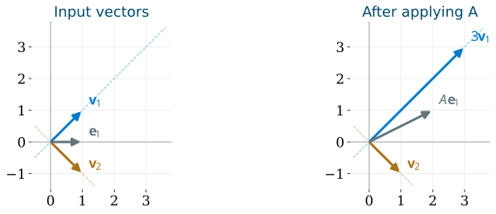

# Course Map {.deck-course-map}

::: {.columns}
::: {.column width="38%"}
<h3>Course decks</h3>

::: {style="font-size: 0.86em;"}
- [Why Linear Algebra?]()
- [Systems and Matrices]()
- [Inverses]()
- [Matrix Transformations]()
- [Determinants]()
- [Euclidean Spaces]()
- [Vector Spaces and Span]()
- [Bases and Coordinates]()
- [Matrix Spaces and Rank]()
- [Eigenvalues](){.current-deck aria-current="page"}
- [Inner Products]()
- [Special Topics]()
:::
:::

::: {.column width="4%"}
:::

::: {.column width="58%"}
<h3>In this deck</h3>

::: {.key-point}
Choose directions that turn a matrix action into separate scalar actions

&nbsp;

$\mat{A}\mat{P}=\mat{P}\mat{D},\qquad
\vct{x}=\mat{P}\vct{c}\longmapsto\mat{A}\vct{x}=\mat{P}\mat{D}\vct{c}$
:::

- [Preserved Directions](#preserved-directions)
- [Eigenvalues and Eigenspaces](#eigenvalues-and-eigenspaces)
- [Eigenvector Bases and Diagonalization](#eigenvector-bases-and-diagonalization)
- [Complex Eigenvalues](#complex-eigenvalues)
- [Powers and Dynamics](#powers-and-dynamics)
- [Symmetric Matrices](#symmetric-matrices)
- [Big Ideas](#big-ideas)
:::
:::

# Preserved Directions {#preserved-directions}

Which lines through the origin does a matrix send into themselves?

- [An eigenvector stays on its own line](#an-eigenvector-stays-on-its-own-line)
- [Two directions reveal the action](#two-directions-reveal-the-action)
- [An eigenvalue describes a scalar action](#an-eigenvalue-describes-a-scalar-action)
- [Recognize eigenvectors before computing](#recognize-eigenvectors-before-computing)

## An eigenvector stays on its own line {#an-eigenvector-stays-on-its-own-line}

For a square matrix $\mat{A}$, an [eigenvector]{.alert} is a nonzero vector $\vct{v}$ satisfying

$$
\mat{A}\vct{v}=\lambda\vct{v},\qquad \vct{v}\ne\vct{0}
$$

The scalar $\lambda$ is its [eigenvalue]{.alert}

- Every multiple of $\vct{v}$ is mapped into $\operatorname{span}\{\vct{v}\}$
- A nonzero multiple is another eigenvector for the same eigenvalue
- The zero vector satisfies the equation for every $\lambda$, so it is excluded

::: {.key-point}
The line is preserved as a subspace; its vectors may stretch, reverse, or collapse
:::

::: {.notes}
A is n-by-n over a specified field, initially R. For any scalar c,
A(cv)=cAv=lambda(cv). When lambda=0 the entire line maps to zero, so
“preserved” means invariant (mapped into itself), not necessarily mapped onto
itself. A nonzero eigenvector can have zero entries. Zero is an allowed
eigenvalue, but the zero vector is never an eigenvector. The real/complex
field distinction becomes essential in the complex-eigenvalue section.
:::

## Two directions reveal the action {#two-directions-reveal-the-action}

$$
\mat{A}=\begin{bmatrix}2&1\\1&2\end{bmatrix},\qquad
\vct{v}_1=\begin{bmatrix}1\\1\end{bmatrix},\quad
\vct{v}_2=\begin{bmatrix}1\\-1\end{bmatrix}
$$

{fig-alt="Before and after applying A with rows 2,1 and 1,2. The vector v1=(1,1) becomes (3,3) on the same diagonal line; v2=(1,-1) stays fixed. The vector e1=(1,0) becomes (2,1), leaving its original line." width="70%" .nostretch}

$$
\mat{A}\vct{v}_1=3\vct{v}_1,\qquad
\mat{A}\vct{v}_2=\vct{v}_2
$$

::: {.key-point}
The standard axes mix; the two diagonal directions act independently
:::

## An eigenvalue describes a scalar action {#an-eigenvalue-describes-a-scalar-action}

For a real eigenvalue and its eigenvector:

| Eigenvalue | Action on that vector |
|---|---|
| $\lambda>1$ | stretch in the same direction |
| $0<\lambda<1$ | shrink in the same direction |
| $\lambda=1$ | leave fixed |
| $\lambda<0$ | reverse direction and scale length by $|\lambda|$ |
| $\lambda=0$ | send to zero |

For a square matrix,

$$
0\text{ is an eigenvalue}\iff\operatorname{null}(\mat{A})\ne\{\vct{0}\}
\iff\mat{A}\text{ is singular}
$$

::: {.key-point}
The scale factor belongs to a direction; it need not describe every vector
:::

## Recognize eigenvectors before computing {#recognize-eigenvectors-before-computing}

::: {.exitem .lettered}
$\exstar$
Find eigenvalues and describe their eigendirections geometrically
Reflection $\mat{H}=\begin{bmatrix}1&0\\0&-1\end{bmatrix}$
Projection $\mat{J}=\begin{bmatrix}1&0\\0&0\end{bmatrix}$
Scaling $\mat{S}=2\mat{I}_2$: which nonzero vectors are eigenvectors?
For the preceding $\mat{A}=\begin{bmatrix}2&1\\1&2\end{bmatrix}$, is $[2,1]^\top$ an eigenvector?

:::

::: {.notes}
H: eigenvalue 1 on the horizontal axis, -1 on the vertical axis. J:
eigenvalue 1 on the horizontal axis, 0 on the vertical axis. S: every
nonzero vector has eigenvalue 2. For A, A[2,1]^T=[5,4]^T, which is not
a scalar multiple of [2,1]^T. These are all the real eigenvalues for the
first three matrices. Reconnect H and J to Matrix Transformations.
:::

# Eigenvalues and Eigenspaces {#eigenvalues-and-eigenspaces}

Turn the preserved-direction question into a homogeneous system

- [A nonzero null vector identifies an eigenvalue](#a-nonzero-null-vector-identifies-an-eigenvalue)
- [Example: find eigenvalues, then eigenvectors](#find-eigenvalues-then-eigenvectors)
- [An eigenspace includes all vectors for one eigenvalue](#an-eigenspace-includes-all-vectors-for-one-eigenvalue)
- [Compute and check an eigenspace](#compute-and-check-an-eigenspace)
- [Trace and determinant check the eigenvalues](#trace-and-determinant-check-the-eigenvalues)

## A nonzero null vector identifies an eigenvalue {#a-nonzero-null-vector-identifies-an-eigenvalue}

For $\mat{A}\in\reals^{n\times n}$:

$$
\mat{A}\vct{v}=\lambda\vct{v}
\iff(\mat{A}-\lambda\mat{I}_n)\vct{v}=\vct{0}
$$

A nonzero solution exists exactly when the shifted matrix is singular:

$$
\det(\mat{A}-\lambda\mat{I}_n)=0
$$

Define the [characteristic polynomial]{.alert}

$$
p_{\mat{A}}(\lambda)=\det(\lambda\mat{I}_n-\mat{A})
$$

::: {.key-point}
First solve the scalar polynomial equation; then solve a homogeneous system for each root
:::

::: {.notes}
We use the monic convention det(lambda I-A). The alternative det(A-lambda I)
differs by (-1)^n and has exactly the same roots with the same multiplicities.
The equivalence uses the invertibility/determinant results already taught.
To find eigenvectors after finding a root, reduce A-lambda I and solve its
homogeneous system. A root guarantees at least one free variable, not a
unique eigenvector. Never divide a vector equation by a vector.
:::

## Example: find eigenvalues, then eigenvectors {#find-eigenvalues-then-eigenvectors}

Return to $\mat{A}=\begin{bmatrix}2&1\\1&2\end{bmatrix}$

$$
p_{\mat{A}}(\lambda)
=\det\begin{bmatrix}\lambda-2&-1\\-1&\lambda-2\end{bmatrix}
=(\lambda-2)^2-1=(\lambda-3)(\lambda-1)
$$

For each eigenvalue, solve a different homogeneous system:

| $\lambda$ | $\mat{A}-\lambda\mat{I}$ | Solution condition | Eigenspace basis |
|---|---|---|---|
| $3$ | $\begin{bmatrix}-1&1\\1&-1\end{bmatrix}$ | $v_2=v_1$ | $\{[1,1]^\top\}$ |
| $1$ | $\begin{bmatrix}1&1\\1&1\end{bmatrix}$ | $v_2=-v_1$ | $\{[1,-1]^\top\}$ |

::: {.key-point}
The determinant finds the scale factors; null spaces find their directions
:::

## An eigenspace includes all vectors for one eigenvalue {#an-eigenspace-includes-all-vectors-for-one-eigenvalue}

For an eigenvalue $\lambda$, its [eigenspace]{.alert} is

$$
E_\lambda=\operatorname{null}(\mat{A}-\lambda\mat{I})
$$

- It is a subspace: zero and all linear combinations remain in it
- Its nonzero vectors are exactly the eigenvectors with eigenvalue $\lambda$
- Its basis comes from [free variables](#pivots-organize-elimination) in the shifted system

By [rank–nullity](#rank-nullity-counts-inputs),

$$
\dim(E_\lambda)=n-\operatorname{rank}(\mat{A}-\lambda\mat{I})\ge1
$$

::: {.key-point}
Eigenvectors exclude zero; the eigenspace includes zero
:::

## Compute and check an eigenspace {#compute-and-check-an-eigenspace}

$$
\mat{B}=\begin{bmatrix}4&1\\0&2\end{bmatrix}
$$

::: {.exitem .lettered}
$\exstar$
Use determinants, homogeneous systems, and direct multiplication
Find the characteristic polynomial and both eigenvalues
Find a basis for each eigenspace
Check $\mat{B}\vct{v}=\lambda\vct{v}$ for each chosen basis vector
Does $\vct{e}_2$ have to be an eigenvector because $\mat{B}$ is triangular?

:::

::: {.notes}
p_B=(lambda-4)(lambda-2). E_4=span{[1,0]^T}; E_2=span{[1,-2]^T}.
B[1,-2]^T=[2,-4]^T=2[1,-2]^T. B e2=[1,2]^T, not a multiple
of e2. Triangular diagonal entries give eigenvalues, not necessarily
standard-basis eigenvectors. The two chosen eigenvectors are independent.
:::

## Trace and determinant check the eigenvalues {#trace-and-determinant-check-the-eigenvalues}

Count all $n$ eigenvalues with algebraic multiplicity, allowing complex roots

$$
\operatorname{tr}(\mat{A})=\sum_{j=1}^n\lambda_j,
\qquad \det(\mat{A})=\prod_{j=1}^n\lambda_j
$$

For $\mat{A}=\begin{bmatrix}2&1\\1&2\end{bmatrix}$:
$\quad3+1=4$, $\quad3\cdot1=3$

For any triangular matrix, the characteristic determinant is a product:

$$
p_{\mat{U}}(\lambda)=\prod_{j=1}^n(\lambda-u_{jj})
$$

::: {.key-point}
Triangular eigenvalues are the diagonal entries; trace and determinant are checks, not a general eigensolver
:::

::: {.notes}
The coefficient of lambda^(n-1) in the monic characteristic polynomial is
-tr(A); its constant coefficient is (-1)^n det(A). Comparing with the
factored polynomial proves both identities, without diagonalizability.
The identities do not generally determine all eigenvalues when n>2.
For a triangular matrix, lambda I-U remains triangular, so its determinant
is the product of its diagonal entries. A real matrix may have nonreal roots;
that topic is developed below rather than excluded by the real entries.
:::

# Eigenvector Bases and Diagonalization {#eigenvector-bases-and-diagonalization}

When do preserved directions provide enough coordinates for every vector?

- [An eigenvector basis makes the matrix diagonal](#an-eigenvector-basis-makes-the-matrix-diagonal)
- [Example: diagonalize and read the coordinates](#diagonalize-and-read-the-coordinates)
- [Distinct eigenvalues supply independent eigenvectors](#distinct-eigenvalues-supply-independent-eigenvectors)
- [Repeated roots may leave too few directions](#repeated-roots-may-leave-too-few-directions)
- [Count eigenspace dimensions before building a basis](#count-eigenspace-dimensions-before-building-a-basis)
- [A diagonalization recipe](#a-diagonalization-recipe)
- [Practice deciding whether diagonalization is possible](#practice-deciding-whether-diagonalization-is-possible)
- [Similarity changes coordinates, not the operator](#similarity-changes-coordinates-not-the-operator)

## An eigenvector basis makes the matrix diagonal {#an-eigenvector-basis-makes-the-matrix-diagonal}

Put $n$ independent eigenvectors into $\mat{P}$, with matching eigenvalues in $\mat{D}$:

$$
\mat{P}=[\vct{v}_1\ \cdots\ \vct{v}_n],\qquad
\mat{D}=\operatorname{diag}(\lambda_1,\ldots,\lambda_n)
$$

Multiplication by columns gives

$$
\mat{A}\mat{P}=[\lambda_1\vct{v}_1\ \cdots\ \lambda_n\vct{v}_n]
=\mat{P}\mat{D}
$$

Independence makes $\mat{P}$ invertible:

$$
\boxed{\mat{P}^{-1}\mat{A}\mat{P}=\mat{D}},\qquad
\mat{A}=\mat{P}\mat{D}\mat{P}^{-1}
$$

::: {.key-point}
$\mat{A}$ is [diagonalizable]{.alert} over the chosen field exactly when it has an eigenvector basis there
:::

::: {.notes}
The converse is equally important. If P^{-1} A P=D is diagonal and P is
invertible, multiply by P to obtain AP=PD. Column j says A v_j=lambda_j v_j.
The columns of invertible P form a basis, so this is an eigenvector basis.
The order of eigenvalues must match the order of columns. Scaling a column
by a nonzero constant gives another valid P with the same D. A matrix with
an eigenvalue zero may still be diagonalizable; P, not D, must be invertible.
:::

## Example: diagonalize and read the coordinates {#diagonalize-and-read-the-coordinates}

For $\mat{A}=\begin{bmatrix}2&1\\1&2\end{bmatrix}$, choose

$$
\mat{P}=\begin{bmatrix}1&1\\1&-1\end{bmatrix},\qquad
\mat{P}^{-1}=\tfrac12\begin{bmatrix}1&1\\1&-1\end{bmatrix},\qquad
\mat{D}=\begin{bmatrix}3&0\\0&1\end{bmatrix}
$$

For $\vct{x}=[4,2]^\top$:

$$
\underbrace{\mat{P}^{-1}\vct{x}}_{\text{eigenbasis coordinates}}
=\begin{bmatrix}3\\1\end{bmatrix}
\quad\xrightarrow{\mat{D}}\quad
\begin{bmatrix}9\\1\end{bmatrix}
\quad\xrightarrow{\mat{P}}\quad
\mat{A}\vct{x}=\begin{bmatrix}10\\8\end{bmatrix}
$$

::: {.key-point}
Read coordinates, scale them separately, then reconstruct the output
:::

::: {.notes}
Check P D P^{-1}=A and P^{-1}P=I. The input x is 3v1+v2; the output
is 9v1+v2. Direct multiplication gives [10,8]^T. P maps eigenbasis
coordinates to standard coordinates; P^{-1} goes the reverse way.
This is the same coordinate route taught in Bases and Coordinates.
:::

## Distinct eigenvalues supply independent eigenvectors {#distinct-eigenvalues-supply-independent-eigenvectors}

Eigenvectors belonging to distinct eigenvalues are linearly independent

For two eigenvectors, suppose $c_1\vct{v}_1+c_2\vct{v}_2=\vct{0}$

Apply $\mat{A}$, then subtract $\lambda_2$ times the original relation:

$$
c_1\lambda_1\vct{v}_1+c_2\lambda_2\vct{v}_2=\vct{0}
\quad\implies\quad c_1(\lambda_1-\lambda_2)\vct{v}_1=\vct{0}
$$

Since $\lambda_1\ne\lambda_2$ and $\vct{v}_1\ne\vct{0}$, $c_1=0$, then $c_2=0$

::: {.key-point}
An $n\times n$ matrix with $n$ distinct eigenvalues in the chosen field is diagonalizable there
:::

::: {.notes}
For k distinct eigenvalues, induction proves the same statement. Apply
A-lambda_k I to a zero relation among v1,...,vk. The first k-1 terms
have coefficients c_j(lambda_j-lambda_k); the inductive hypothesis forces
them all to zero. Distinct eigenvalues give c_j=0 for j<k; the original
relation gives c_k=0. Existence of n distinct roots is sufficient, not
necessary: the identity matrix is a counterexample to necessity.
:::

## Repeated roots may leave too few directions {#repeated-roots-may-leave-too-few-directions}

Two matrices with the same characteristic polynomial $(\lambda-2)^2$:

::: {.columns}
::: {.column width="47%"}
$$
\mat{S}=\begin{bmatrix}2&0\\0&2\end{bmatrix}
$$

$\mat{S}-2\mat{I}=\mat{0}$

$E_2=\reals^2$: two independent eigenvectors

[Diagonalizable]{.alert}
:::
::: {.column width="6%"}
:::
::: {.column width="47%"}
$$
\mat{J}=\begin{bmatrix}2&1\\0&2\end{bmatrix}
$$

$\mat{J}-2\mat{I}=\begin{bmatrix}0&1\\0&0\end{bmatrix}$

$E_2=\operatorname{span}\{\vct{e}_1\}$: only one independent eigenvector

[Not diagonalizable]{.alert}
:::
:::

::: {.key-point}
Repeated roots permit diagonalization, but do not guarantee enough eigenvectors
:::

## Count eigenspace dimensions before building a basis {#count-eigenspace-dimensions-before-building-a-basis}

For each eigenvalue $\lambda$:

| Multiplicity | What it counts |
|---|---|
| [Algebraic]{.alert}, $a_\lambda$ | repetitions of the root in $p_{\mat{A}}$ |
| [Geometric]{.alert}, $g_\lambda$ | $\dim(E_\lambda)$: independent eigenvectors available |

$$
1\le g_\lambda\le a_\lambda
$$

Over a field in which $p_{\mat{A}}$ splits into linear factors:

$$
\mat{A}\text{ diagonalizable}
\iff\sum_{\text{distinct }\lambda}g_\lambda=n
\iff g_\lambda=a_\lambda\text{ for every }\lambda
$$

::: {.key-point}
Collect a basis of each eigenspace; diagonalization needs $n$ independent columns altogether
:::

::: {.notes}
For a real eigenbasis all roots must be real. Over C the characteristic
polynomial always splits. To justify g<=a, extend a basis of E_lambda to
one of the whole space. In that basis A has block form
[[lambda I_g, B],[0,C]], whose characteristic polynomial contains
(t-lambda)^g. Thus g<=a. Eigenspaces for distinct eigenvalues form a direct
sum: apply the distinct-eigenvalue independence argument to a relation
among nonzero vectors, one from each eigenspace. Combining bases of the
individual eigenspaces is therefore independent. Since sum a=n when the
polynomial splits, the three displayed conditions are equivalent. A
repeated root is a prompt to compute nullity, not evidence of failure.
:::

## A diagonalization recipe {#a-diagonalization-recipe}

For a square matrix over the chosen field:

1. Factor $p_{\mat{A}}(\lambda)$ and list its distinct roots and multiplicities
2. For each root, solve $(\mat{A}-\lambda\mat{I})\vct{v}=\vct{0}$ and find an eigenspace basis
3. Count all independent eigenvectors obtained; fewer than $n$ means no eigenvector basis
4. If there are $n$, put them into $\mat{P}$ and their matching eigenvalues into $\mat{D}$
5. Check $\mat{A}\mat{P}=\mat{P}\mat{D}$ and that $\mat{P}$ is invertible

::: {.key-point}
If the characteristic polynomial does not split in the field, diagonalization there is impossible

&nbsp;

Verification by $\mat{A}\mat{P}=\mat{P}\mat{D}$ avoids computing an inverse
:::

## Practice deciding whether diagonalization is possible {#practice-deciding-whether-diagonalization-is-possible}

$$
\mat{B}=\begin{bmatrix}4&1\\0&2\end{bmatrix},\qquad
\mat{C}=\begin{bmatrix}2&0&0\\0&2&0\\0&0&3\end{bmatrix}
$$

::: {.exitem .lettered}
$\exstar$
Build and verify eigenvector bases
Use the eigenspaces already found for $\mat{B}$ to construct $\mat{P},\mat{D}$; verify $\mat{B}\mat{P}=\mat{P}\mat{D}$
For $\mat{C}$, give both multiplicities for each eigenvalue and construct an eigenvector basis
Explain why $\mat{C}$ disproves “diagonalizable means all eigenvalues are distinct”

:::

::: {.notes}
For B use P=[[1,1],[0,-2]], D=diag(4,2), P^{-1}=[[1,1/2],[0,-1/2]].
Both sides BP=PD=[[4,2],[0,-4]]. For C, lambda=2 has algebraic and
geometric multiplicity 2, E_2=span{e1,e2}; lambda=3 has both
multiplicities 1, E_3=span{e3}. P=I_3, D=C is a diagonalization.
Any basis within E_2 works, together with a nonzero vector from E_3.
:::

---

### A repeated-root test {#a-repeated-root-test}

$$
\mat{F}=\begin{bmatrix}2&1&0\\0&2&0\\0&0&3\end{bmatrix}
$$

::: {.exitem .lettered}
$\exstar$
The diagonal entries give eigenvalues 2 and 3
Find the algebraic multiplicity and an eigenspace basis for each
How many independent eigenvectors are available altogether?
Can a different choice of vectors inside those same eigenspaces produce an eigenvector basis?

:::

::: {.notes}
For lambda=2, F-2I has rows [0,1,0], [0,0,0], [0,0,1], so
E_2=span{e1}, algebraic multiplicity 2, geometric multiplicity 1.
For lambda=3, F-3I has rows [-1,1,0], [0,-1,0], [0,0,0], so
E_3=span{e3}, with both multiplicities 1. Only two independent
eigenvectors are available in dimension three. No change of basis within
these eigenspaces can increase their dimensions, so F is not diagonalizable.
:::

## Similarity changes coordinates, not the operator {#similarity-changes-coordinates-not-the-operator}

Matrices $\mat{A}$ and $\mat{B}$ are [similar]{.alert} when

$$
\mat{B}=\mat{P}^{-1}\mat{A}\mat{P},\qquad\mat{P}\text{ invertible}
$$

Their characteristic polynomials agree:

$$
\det(\lambda\mat{I}-\mat{B})
=\det\bigl(\mat{P}^{-1}(\lambda\mat{I}-\mat{A})\mat{P}\bigr)
=\det(\lambda\mat{I}-\mat{A})
$$

- Same eigenvalues, multiplicities, trace, and determinant
- If $\mat{B}\vct{c}=\lambda\vct{c}$, then $\mat{A}(\mat{P}\vct{c})=\lambda\mat{P}\vct{c}$
- Eigenvector coordinate columns usually change

::: {.key-point}
Diagonalization is similarity to a diagonal matrix; ordinary row reduction is a different operation
:::

::: {.notes}
The identity lambda I=P^{-1}(lambda I)P gives the displayed factorization.
The nonzero determinant factors of P cancel. Similarity also preserves
rank and eigenspace dimensions, via the invertible coordinate change.
Row operations are left multiplication by an invertible matrix; similarity
requires matching inverse changes on the left and right. For example
rref(diag(2,3))=I changes its eigenvalues. Equal characteristic polynomials
alone do not imply similarity: S and J in the repeated-root example differ
in eigenspace dimension. Avoid treating eigenvalues as a full classification.
:::

# Complex Eigenvalues {#complex-eigenvalues}

A real matrix may need complex coordinates to reveal its eigenvectors

- [A quarter turn has no real eigendirection](#a-quarter-turn-has-no-real-eigendirection)
- [Complex coordinates reveal two eigenvectors](#complex-coordinates-reveal-two-eigenvectors)
- [Real matrices pair their nonreal eigenvalues](#real-matrices-pair-their-nonreal-eigenvalues)
- [Practice interpreting a rotation and scaling](#practice-interpreting-a-rotation-and-scaling)

## A quarter turn has no real eigendirection {#a-quarter-turn-has-no-real-eigendirection}

$$
\mat{R}=\begin{bmatrix}0&-1\\1&0\end{bmatrix},\qquad
\mat{R}\begin{bmatrix}x\\y\end{bmatrix}=\begin{bmatrix}-y\\x\end{bmatrix}
$$

Every nonzero real vector turns through $90^\circ$; none stays on its line

$$
p_{\mat{R}}(\lambda)=\lambda^2+1
$$

- Over $\reals$: no roots, no eigenvectors, no diagonalization
- Over $\mathbb{C}$: roots $i,-i$, where $i^2=-1$

::: {.key-point}
Always name the scalar field when deciding whether an eigenvector basis exists
:::

::: {.notes}
R maps real vectors to real vectors and has determinant 1; absence of real
eigenvectors does not imply singularity. A 180-degree rotation is different:
-I has every nonzero real vector as an eigenvector. On C^2 the same matrix
acts complex-linearly, with two distinct eigenvalues. This is an extension
of the scalar field, as in the oscillator example in Bases and Coordinates.
:::

## Complex coordinates reveal two eigenvectors {#complex-coordinates-reveal-two-eigenvectors}

For the quarter-turn matrix, direct multiplication gives

$$
\mat{R}\begin{bmatrix}1\\-i\end{bmatrix}
=\begin{bmatrix}i\\1\end{bmatrix}
=i\begin{bmatrix}1\\-i\end{bmatrix},\qquad
\mat{R}\begin{bmatrix}1\\i\end{bmatrix}
=\begin{bmatrix}-i\\1\end{bmatrix}
=-i\begin{bmatrix}1\\i\end{bmatrix}
$$

Thus, over $\mathbb{C}$,

$$
\mat{P}=\begin{bmatrix}1&1\\-i&i\end{bmatrix},\qquad
\mat{D}=\begin{bmatrix}i&0\\0&-i\end{bmatrix},\qquad
\mat{R}=\mat{P}\mat{D}\mat{P}^{-1}
$$

For real $x,y$:

$$
\begin{bmatrix}x\\y\end{bmatrix}
=\frac{x+iy}{2}\begin{bmatrix}1\\-i\end{bmatrix}
+\frac{x-iy}{2}\begin{bmatrix}1\\i\end{bmatrix}
$$

::: {.key-point}
Conjugate coefficients and eigenvectors reconstruct a real vector
:::

::: {.notes}
The determinant of P is 2i, so P is invertible. Its inverse is
(1/2)[[1,i],[1,-i]]. The coordinate formula follows by multiplication.
Applying R multiplies the first coefficient by i and the second by -i;
they remain conjugates, and their reconstruction is real. Do not draw the
complex eigenvectors as real planar arrows. The actual real motion is
still a quarter turn, not two real stretches.
:::

## Real matrices pair their nonreal eigenvalues {#real-matrices-pair-their-nonreal-eigenvalues}

If $\mat{A}$ has real entries and $\mat{A}\vct{v}=\lambda\vct{v}$, conjugate both sides:

$$
\mat{A}\overline{\vct{v}}=\overline{\lambda}\,\overline{\vct{v}}
$$

Nonreal eigenvalues and their eigenvectors occur in conjugate pairs

For $\lambda=a+ib$, $\vct{v}=\vct{p}+i\vct{q}$, equate real and imaginary parts:

$$
\mat{A}\vct{p}=a\vct{p}-b\vct{q},\qquad
\mat{A}\vct{q}=b\vct{p}+a\vct{q}
$$

When $b\ne0$, $\vct{p},\vct{q}$ span a real invariant plane

::: {.key-point}
A complex pair describes a real two-dimensional action, even without real eigenvectors in that plane
:::

::: {.notes}
For b nonzero, p and q are real-linearly independent. Otherwise v would
be a nonzero complex scalar times a real vector w, giving A w=lambda w,
impossible for a nonreal lambda and real nonzero w. In the ordered real
basis {p,q}, the plane action has matrix [[a,b],[-b,a]]. This is rotation
and uniform scaling in those coordinates, but p and q need not be
orthonormal, so it need not be Euclidean rotation/scaling in the original
coordinates. The next exercise uses a matrix already expressed in an
orthonormal standard basis, where the geometric interpretation is literal.
:::

## Practice interpreting a rotation and scaling {#practice-interpreting-a-rotation-and-scaling}

$$
\mat{B}=\begin{bmatrix}1&-1\\1&1\end{bmatrix}
$$

::: {.exitem .lettered}
$\exstar$
Compare real geometry with complex coordinates
Find the characteristic polynomial, eigenvalues, and an eigenvector for each
Is $\mat{B}$ diagonalizable over $\reals$? Over $\mathbb{C}$?
Compute $\mat{B}\vct{e}_1$ and $\mat{B}\vct{e}_2$; identify the rotation angle and length factor

:::

::: {.notes}
p_B=(lambda-1)^2+1, roots 1+i,1-i, with eigenvectors [1,-i]^T
and [1,i]^T respectively. Not diagonalizable over R; diagonalizable over
C because there are two distinct complex eigenvalues. B e1=[1,1]^T,
B e2=[-1,1]^T. Both axes rotate counterclockwise 45 degrees and scale
by sqrt(2); B=sqrt(2) R_(pi/4). B^T B=2I verifies the length factor
for every real vector, not just the axes.
:::

# Powers and Dynamics {#powers-and-dynamics}

Repeated matrix actions become repeated scalar actions in an eigenvector basis

- [Powers act separately on eigenbasis coordinates](#powers-act-separately-on-eigenbasis-coordinates)
- [Example: a two-group population exchange](#a-two-group-population-exchange)
- [Separate the equilibrium from the changing part](#separate-the-equilibrium-from-the-changing-part)
- [Practice predicting repeated actions](#practice-predicting-repeated-actions)

## Powers act separately on eigenbasis coordinates {#powers-act-separately-on-eigenbasis-coordinates}

If $\mat{A}=\mat{P}\mat{D}\mat{P}^{-1}$, cancellation gives, for integers $k\ge0$,

$$
\mat{A}^k=\mat{P}\mat{D}^k\mat{P}^{-1},\qquad
\mat{D}^k=\operatorname{diag}(\lambda_1^k,\ldots,\lambda_n^k)
$$

If $\vct{x}_0=\sum_{j=1}^n c_j\vct{v}_j$, then

$$
\vct{x}_k=\mat{A}^k\vct{x}_0
=\sum_{j=1}^n c_j\lambda_j^k\vct{v}_j
$$

- $|\lambda_j|<1$: that component tends to zero
- $\lambda_j=1$: that component stays fixed
- $\lambda_j=-1$: that component alternates sign
- $|\lambda_j|>1$: a nonzero component grows in magnitude

::: {.notes}
A^0=I and D^0=I by definition, including when an eigenvalue is zero; avoid
interpreting the k=0 case as a scalar 0^0 limit. For k>=1 the powers are
ordinary scalar powers. Negative powers require A invertible. Complex
components include phase changes; their magnitudes scale by |lambda|^k.
This formula assumes an eigenvector basis. A missing initial component
c_j=0 stays absent, so a large eigenvalue does not make every initial vector
grow. Jordan methods for defective matrices are outside this deck's scope.
:::

## Example: a two-group population exchange {#a-two-group-population-exchange}

Each step: 20% of group 1 moves to group 2; 30% of group 2 moves to group 1

$$
\vct{x}_{k+1}=\mat{A}\vct{x}_k,\qquad
\mat{A}=\begin{bmatrix}0.8&0.3\\0.2&0.7\end{bmatrix},\qquad
\vct{x}_0=\begin{bmatrix}100\\0\end{bmatrix}
$$

Columns describe where each group's population goes; each column sums to 1

$$
p_{\mat{A}}(\lambda)=\lambda^2-1.5\lambda+0.5
=(\lambda-1)(\lambda-0.5)
$$

$$
\lambda_1=1:\ \vct{v}_1=\begin{bmatrix}3\\2\end{bmatrix},\qquad
\lambda_2=\tfrac12:\ \vct{v}_2=\begin{bmatrix}1\\-1\end{bmatrix}
$$

::: {.key-point}
One direction persists; the other describes a redistribution that decays
:::

::: {.notes}
This is a deterministic aggregate model (or expected counts); fractional
counts are allowed. There are no births or deaths, and transitions are
constant over time. The column convention matters: x is a column and
x_(k+1)=A x_k. The row [1,1] satisfies [1,1]A=[1,1], so total population
is conserved. The eigenvector v2 describes a signed perturbation, not
itself a nonnegative population. A v1=v1, A v2=(1/2)v2.
:::

## Separate the equilibrium from the changing part {#separate-the-equilibrium-from-the-changing-part}

Decompose the initial population into eigenvectors:

$$
\begin{bmatrix}100\\0\end{bmatrix}
=20\begin{bmatrix}3\\2\end{bmatrix}
+40\begin{bmatrix}1\\-1\end{bmatrix}
$$

Then

$$
\vct{x}_k
=20\begin{bmatrix}3\\2\end{bmatrix}
+40\left(\tfrac12\right)^k\begin{bmatrix}1\\-1\end{bmatrix}
=\begin{bmatrix}60+40(1/2)^k\\40-40(1/2)^k\end{bmatrix}
$$

$$
\vct{x}_1=\begin{bmatrix}80\\20\end{bmatrix},\qquad
\vct{x}_2=\begin{bmatrix}70\\30\end{bmatrix},\qquad
\vct{x}_k\longrightarrow\begin{bmatrix}60\\40\end{bmatrix}
$$

::: {.key-point}
The eigenvalue 1 gives the equilibrium proportions; $1/2$ gives the decay factor per step
:::

## Practice predicting repeated actions {#practice-predicting-repeated-actions}

::: {.exitem .lettered}
$\exstar$
Use the eigenvectors before multiplying matrices repeatedly
For the population matrix, start with $[0,100]^\top$; find $\vct{x}_k$ and its limit
For $\mat{A}=\begin{bmatrix}2&1\\1&2\end{bmatrix}$ and $\vct{x}_0=[1,0]^\top$, find $\mat{A}^k\vct{x}_0$
For that same $\mat{A}$, why does $\vct{x}_0=[1,-1]^\top$ stay fixed even though 3 is an eigenvalue?

:::

::: {.notes}
Population: x0=20[3,2]^T-60[1,-1]^T, so xk=[60-60(1/2)^k,
40+60(1/2)^k]^T and the limit is [60,40]^T. For the symmetric
matrix, e1=(v1+v2)/2, so A^k e1=[(3^k+1)/2,(3^k-1)/2]^T.
For x0=v2 the v1 coefficient is zero, so no growing component is present.
At k=0 the formula returns e1, and k=1 gives [2,1]^T.
:::

# Symmetric Matrices {#symmetric-matrices}

Symmetry guarantees a real eigenbasis with especially simple geometry

- [Symmetry makes different eigenspaces perpendicular](#symmetry-makes-different-eigenspaces-perpendicular)
- [The spectral theorem supplies an orthonormal eigenbasis](#the-spectral-theorem-supplies-an-orthonormal-eigenbasis)
- [Example: normalize the eigenvectors](#normalize-the-eigenvectors)
- [Practice orthogonal diagonalization](#practice-orthogonal-diagonalization)

## Symmetry makes different eigenspaces perpendicular {#symmetry-makes-different-eigenspaces-perpendicular}

Let $\mat{A}=\mat{A}^{\mathsf T}$ be real, with
$\mat{A}\vct{u}=\lambda\vct{u}$ and $\mat{A}\vct{v}=\mu\vct{v}$

Symmetry lets the action move across the dot product:

$$
\lambda\vct{u}^{\mathsf T}\vct{v}
=(\mat{A}\vct{u})^{\mathsf T}\vct{v}
=\vct{u}^{\mathsf T}\mat{A}\vct{v}
=\mu\vct{u}^{\mathsf T}\vct{v}
$$

Thus

$$
(\lambda-\mu)\vct{u}^{\mathsf T}\vct{v}=0
$$

::: {.key-point}
Distinct eigenvalues of a real symmetric matrix have perpendicular eigenvectors

&nbsp;

Within a repeated eigenspace, perpendicular basis vectors must still be chosen
:::

::: {.notes}
The displayed calculation concerns real eigenvectors and eigenvalues. The
spectral theorem on the next slide supplies their existence for all real
symmetric matrices. For a general nonsymmetric matrix, distinct eigenvalues
still imply independence but do not imply perpendicular eigenvectors: B in
the earlier exercise has eigenvectors [1,0]^T and [1,-2]^T. In a repeated
eigenspace every linear combination remains an eigenvector; therefore
Gram-Schmidt within that eigenspace, introduced in Inner Products, can
choose an orthonormal basis without changing the eigenvalue.
:::

## The spectral theorem supplies an orthonormal eigenbasis {#the-spectral-theorem-supplies-an-orthonormal-eigenbasis}

[Spectral theorem]{.alert}: every real symmetric $n\times n$ matrix has a real orthonormal eigenbasis

Put its unit eigenvectors in $\mat{Q}$, in the same order as $\mat{D}$:

$$
\mat{Q}^{\mathsf T}\mat{Q}=\mat{I},\qquad
\mat{Q}^{-1}=\mat{Q}^{\mathsf T},\qquad
\boxed{\mat{A}=\mat{Q}\mat{D}\mat{Q}^{\mathsf T}}
$$

This is [orthogonal diagonalization]{.alert}

- All eigenvalues are real; repeated eigenvalues are allowed
- Coordinates are dot products: $[\vct{x}]_{\mathcal{Q}}=\mat{Q}^{\mathsf T}\vct{x}$
- Euclidean lengths are preserved: $\|\mat{Q}^{\mathsf T}\vct{x}\|=\|\vct{x}\|$

::: {.key-point}
A real matrix is orthogonally diagonalizable exactly when it is symmetric
:::

::: {.notes}
State the existence part as a theorem; the preceding orthogonality calculation
alone does not prove it. One proof selects a real unit eigenvector by
maximizing x^T A x on the unit sphere, shows its perpendicular complement
is invariant, and uses induction. That proof needs tools beyond the current
course prerequisites and is not required here. Conversely, Q D Q^T with
real diagonal D is symmetric by taking its transpose. Length preservation
follows by squaring the norm and using QQ^T=I. This strengthens the general
coordinate isomorphism, which preserves algebra but need not preserve
ordinary coordinate lengths. Repeated eigenspaces admit orthonormal bases.
:::

## Example: normalize the eigenvectors {#normalize-the-eigenvectors}

For $\mat{A}=\begin{bmatrix}2&1\\1&2\end{bmatrix}$:

$$
\vct{q}_1=\tfrac1{\sqrt2}\begin{bmatrix}1\\1\end{bmatrix},\qquad
\vct{q}_2=\tfrac1{\sqrt2}\begin{bmatrix}1\\-1\end{bmatrix},\qquad
\mat{Q}=\tfrac1{\sqrt2}\begin{bmatrix}1&1\\1&-1\end{bmatrix}
$$

$$
\mat{Q}^{\mathsf T}\mat{A}\mat{Q}=\begin{bmatrix}3&0\\0&1\end{bmatrix},\qquad
\mat{A}=3\vct{q}_1\vct{q}_1^{\mathsf T}+\vct{q}_2\vct{q}_2^{\mathsf T}
$$

Each $\vct{q}_j\vct{q}_j^{\mathsf T}\vct{x}$ projects onto one unit eigendirection

::: {.key-point}
Resolve the input into perpendicular components, then scale each by its eigenvalue
:::

[Later:  — quadratic forms and principal axes](#symmetry-gives-orthogonal-eigenvectors)

::: {.notes}
The projection statement follows from q q^T x=(q^T x)q and ||q||=1,
using the Euclidean projection formula already taught. Expanding the two
rank-one matrices gives (3/2)[[1,1],[1,1]]+(1/2)[[1,-1],[-1,1]]=A.
The sum of the two orthogonal projectors is I. PCA uses eigenvectors of
a symmetric covariance matrix; estimation, centering, and choice of how
many directions to retain belong to the later application. Do not imply
that arbitrary nonsymmetric matrices admit orthonormal eigenvectors.
:::

## Practice orthogonal diagonalization {#practice-orthogonal-diagonalization}

$$
\mat{C}=\begin{bmatrix}5&2\\2&5\end{bmatrix},\qquad
\mat{B}=\begin{bmatrix}4&1\\0&2\end{bmatrix}
$$

::: {.exitem .lettered}
$\exstar$
Distinguish an eigenbasis from an orthonormal eigenbasis
Find an orthogonal $\mat{Q}$ and diagonal $\mat{D}$ with $\mat{C}=\mat{Q}\mat{D}\mat{Q}^{\mathsf T}$
Write $\mat{C}$ as a sum of scaled orthogonal projectors
The matrix $\mat{B}$ is diagonalizable; can it be orthogonally diagonalized over $\reals$? Explain

:::

::: {.notes}
C has eigenvalues 7,3 with unit eigenvectors q1=[1,1]^T/sqrt(2),
q2=[1,-1]^T/sqrt(2). Q has those columns and D=diag(7,3).
C=7q1q1^T+3q2q2^T. B is not symmetric, so the converse of the real
spectral theorem rules out orthogonal diagonalization. Its eigenspaces
span the plane but are not perpendicular. Scaling its eigenvectors
cannot change the nonzero angle between those lines to a right angle.
:::

# Big Ideas {#big-ideas data-state="goldborder"}

- Eigenvectors are nonzero vectors satisfying $\mat{A}\vct{v}=\lambda\vct{v}$
- Characteristic roots give eigenvalues; shifted null spaces give eigenspaces
- An eigenvector basis makes the matrix diagonal
- Distinct eigenvalues guarantee independence; repeated roots require an eigenspace count
- The scalar field matters: real matrices can have nonreal eigenvalues
- Powers scale each eigenbasis component by $\lambda_j^k$
- Real symmetric matrices have real orthonormal eigenbases

# How Far We Have Come

::: {.columns}
::: {.column width="47%"}
- [](#read-the-solution-set) — reduce $[\,\mat{A}\mid\vct{b}\,]$ to find consistency and free parameters; PLU reuses elimination
- [Matrix actions]{.alert} — products compose and inverses undo; determinants measure signed scale and detect collapse
- [](#the-coordinate-map-preserves-linear-combinations) — bases give unique coordinates; dimension counts directions
:::
::: {.column width="6%"}
:::
::: {.column width="47%"}
- [](#rank-separates-existence-from-uniqueness) — column space gives attainable outputs; null space gives lost inputs; rank–nullity counts both
- [Eigenspaces](#an-eigenspace-includes-all-vectors-for-one-eigenvalue) — solve $(\mat{A}-\lambda\mat{I})\vct{v}=\vct{0}$ to find directions adapted to a square matrix
- [Diagonalization](#an-eigenvector-basis-makes-the-matrix-diagonal) — enough eigenvectors separate a matrix action; symmetry permits perpendicular unit directions
:::
:::

::: {.key-point}
In an eigenvector basis, $\vct{x}=\sum_j c_j\vct{v}_j$ becomes
$\mat{A}\vct{x}=\sum_j\lambda_jc_j\vct{v}_j$

&nbsp;

The coordinate method now explains both a single action and its repeated effects
:::

# What Comes Next

How do we measure lengths and angles for abstract vectors, and choose perpendicular coordinates?

::: {.key-point}
[Next: ]()

&nbsp;

Inner products lead to orthogonal projection, Gram–Schmidt, QR, and least squares
:::
