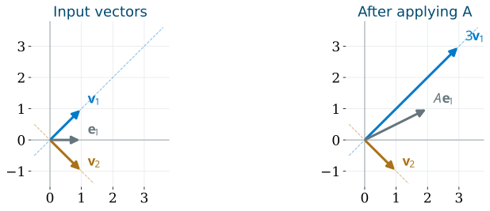
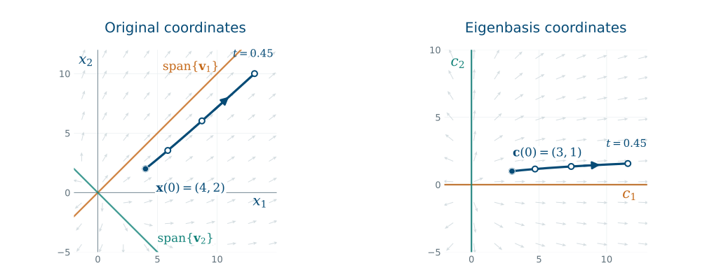

# Course Map {.deck-course-map}

::: {.columns}
::: {.column width="38%"}
<h3>Course decks</h3>

::: {style="font-size: 0.86em;"}
- [Why Linear Algebra?]()
- [Systems and Matrices]()
- [Inverses]()
- [Matrix Transformations]()
- [Determinants]()
- [Euclidean Spaces]()
- [Vector Spaces and Span]()
- [Bases and Coordinates]()
- [Matrix Spaces and Rank]()
- [Eigenvalues](){.current-deck aria-current="page"}
- [Inner Products]()
- [Special Topics]()
:::
:::

::: {.column width="4%"}
:::

::: {.column width="58%"}
<h3>In this deck</h3>

::: {.key-point}
Choose directions that turn a matrix action into separate scalar actions

&nbsp;

$\mat{A}\mat{V}=\mat{V}\mat{D},\qquad
\mat{A}\vct{x}=\mat{V}\mat{D}\vct{c}\xleftarrow{\mat{A}}\vct{x}=\mat{V}\vct{c}$
:::

- [Preserved Directions](#preserved-directions)
- [Eigenvalues and Eigenspaces](#eigenvalues-and-eigenspaces)
- [Eigenvector Bases and Diagonalization](#eigenvector-bases-and-diagonalization)
- [Complex Eigenvalues](#complex-eigenvalues)
- [Powers and Dynamics](#powers-and-dynamics)
- [Symmetric Matrices](#symmetric-matrices)
- [Big Ideas](#big-ideas)
:::
:::

# Preserved Directions {#preserved-directions}

Which lines through the origin does a matrix send into themselves?

- [An eigenvector stays on its own line](#an-eigenvector-stays-on-its-own-line)
- [Chosen directions reveal the action](#two-directions-reveal-the-action)
- [An eigenvalue describes a scalar action](#an-eigenvalue-describes-a-scalar-action)
- [Recognize eigenvectors before computing](#recognize-eigenvectors-before-computing)

## An eigenvector stays on its own line {#an-eigenvector-stays-on-its-own-line}

For a square matrix $\mat{A}$, an [eigenvector]{.alert} is a [nonzero]{.alert} vector $\vct{v}$ satisfying

$$
\mat{A}\vct{v}=\lambda\vct{v},\qquad \vct{v}\ne\vct{0}
$$

The scalar $\lambda$ is its [eigenvalue]{.alert}

- Every multiple of $\vct{v}$ is mapped into its span

\begin{equation*}
\mat{A}\operatorname{span}\{\vct{v}\}\subseteq\operatorname{span}\{\vct{v}\},
\qquad \text{equality when }\lambda\ne0
\end{equation*}

- A nonzero multiple is another eigenvector for the same eigenvalue
- The zero vector satisfies the equation for every $\lambda$, so it is excluded

::: {.key-point}
The line is preserved as a subspace; its vectors may stretch, reverse, or collapse
:::

::: {.notes}
A is n-by-n over a specified field, initially R. For any scalar c,
A(cv)=cAv=lambda(cv). When lambda=0 the entire line maps to zero, so
“preserved” means invariant (mapped into itself), not necessarily mapped onto
itself. A nonzero eigenvector can have zero entries. Zero is an allowed
eigenvalue, but the zero vector is never an eigenvector. The real/complex
field distinction becomes essential in the complex-eigenvalue section.
:::

## Chosen directions reveal the action {#two-directions-reveal-the-action}

$$
\mat{A}=\begin{bmatrix}2&1\\1&2\end{bmatrix},\qquad
\vct{v}_1=\begin{bmatrix}1\\1\end{bmatrix},\quad
\vct{v}_2=\begin{bmatrix}1\\-1\end{bmatrix}
$$

{fig-alt="Before and after applying A with rows 2,1 and 1,2. The vector v1=(1,1) becomes (3,3) on the same diagonal line; v2=(1,-1) stays fixed. The vector e1=(1,0) becomes (2,1), leaving its original line." width="70%" .nostretch}

$$
\mat{A}\vct{v}_1=3\vct{v}_1,\qquad
\mat{A}\vct{v}_2=\vct{v}_2
$$

::: {.key-point}
The standard axes mix; the two diagonal directions act independently
:::

## An eigenvalue describes a scalar action {#an-eigenvalue-describes-a-scalar-action}

For a real eigenvalue and its eigenvector:

| Eigenvalue | Action on that vector |
|---|---|
| $\lambda>1$ | stretch in the same direction |
| $0<\lambda<1$ | shrink in the same direction |
| $\lambda=1$ | leave fixed |
| $\lambda<0$ | reverse direction and scale length by $|\lambda|$ |
| $\lambda=0$ | send to zero |

For a square matrix,

$$
0\text{ is an eigenvalue}\iff\operatorname{null}(\mat{A})\ne\{\vct{0}\}
\iff\mat{A}\text{ is singular}
$$

::: {.key-point}
The scale factor belongs to a direction; it need not describe every vector
:::

## Recognize eigenvectors before computing {#recognize-eigenvectors-before-computing}

::: {.exitem .lettered}
$\exstar$
Find eigenvalues and describe their eigendirections geometrically
Reflection $\mat{H}=\begin{bmatrix}1&0\\0&-1\end{bmatrix}$
Projection $\mat{J}=\begin{bmatrix}1&0\\0&0\end{bmatrix}$
Scaling $\mat{S}=2\mat{I}_2$: which nonzero vectors are eigenvectors?
For the preceding $\mat{A}=\begin{bmatrix}2&1\\1&2\end{bmatrix}$, is $[2,1]^\top$ an eigenvector?

:::

::: {.notes}
H: eigenvalue 1 on the horizontal axis, -1 on the vertical axis. J:
eigenvalue 1 on the horizontal axis, 0 on the vertical axis. S: every
nonzero vector has eigenvalue 2. For A, A[2,1]^T=[5,4]^T, which is not
a scalar multiple of [2,1]^T. These are all the real eigenvalues for the
first three matrices. Reconnect H and J to Matrix Transformations.
:::

# Eigenvalues and Eigenspaces {#eigenvalues-and-eigenspaces}

Turn the preserved-direction question into a homogeneous system

- [A nonzero null vector identifies an eigenvalue](#a-nonzero-null-vector-identifies-an-eigenvalue)
- [Example: find eigenvalues, then eigenvectors](#find-eigenvalues-then-eigenvectors)
- [An eigenspace includes all vectors for one eigenvalue](#an-eigenspace-includes-all-vectors-for-one-eigenvalue)
- [Example: a spinning tennis racket](#a-spinning-tennis-racket)
- [Compute and check an eigenspace](#compute-and-check-an-eigenspace)
- [Trace and determinant check the eigenvalues](#trace-and-determinant-check-the-eigenvalues)
- [Use software for practical eigenvalue problems](#use-software-for-practical-eigenvalue-problems)

## A nonzero null vector identifies an eigenvalue {#a-nonzero-null-vector-identifies-an-eigenvalue}

For $\mat{A}\in\reals^{n\times n}$ and $\vct{v}\ne\vct{0}$:

$$
\mat{A}\vct{v}=\lambda\vct{v}
\iff(\mat{A}-\lambda\mat{I}_n)\vct{v}=\vct{0}
\iff\vct{0}\ne\vct{v}\in\nullspace(\mat{A}-\lambda\mat{I}_n)
$$

A nonzero solution exists exactly when the shifted matrix is singular:

$$
\det(\mat{A}-\lambda\mat{I}_n)=0
$$

Define the [characteristic polynomial]{.alert}

$$
p_{\mat{A}}(\lambda)=\det(\lambda\mat{I}_n-\mat{A})
$$

Some sources use $\det(\mat{A}-\lambda\mat{I}_n)$ — the same roots and multiplicities

::: {.key-point}
First solve the scalar polynomial equation; then solve a homogeneous system for each root
:::

::: {.notes}
We follow Anton's monic convention det(lambda I-A), with leading coefficient
1 and constant term (-1)^n det(A). The alternative det(A-lambda I) differs
by (-1)^n and has exactly the same roots with the same multiplicities.
The two polynomials agree in even dimensions and have opposite signs in odd
dimensions. A characteristic equation may be multiplied by a nonzero
constant without changing its solutions.
The equivalence uses the invertibility/determinant results already taught.
To find eigenvectors after finding a root, reduce A-lambda I and solve its
homogeneous system. A root guarantees at least one free variable, not a
unique eigenvector. Never divide a vector equation by a vector.
:::

## Example: find eigenvalues, then eigenvectors {#find-eigenvalues-then-eigenvectors}

Return to $\mat{A}=\begin{bmatrix}2&1\\1&2\end{bmatrix}$

$$
p_{\mat{A}}(\lambda)
=\det\begin{bmatrix}\lambda-2&-1\\-1&\lambda-2\end{bmatrix}
=(\lambda-2)^2-1=(\lambda-3)(\lambda-1)
$$

For each eigenvalue, solve a different homogeneous system:

| $\lambda$ | $\mat{A}-\lambda\mat{I}$ | Solution condition | Eigenspace basis |
|---|---|---|---|
| $3$ | $\begin{bmatrix}-1&1\\1&-1\end{bmatrix}$ | $v_2=v_1$ | $\{[1,1]^\top\}$ |
| $1$ | $\begin{bmatrix}1&1\\1&1\end{bmatrix}$ | $v_2=-v_1$ | $\{[1,-1]^\top\}$ |

::: {.key-point}
The determinant finds the scale factors; null spaces find their directions
:::

::: {.notes}
Teaching reminder for the November 12 recap: correct the earlier general
square-matrix condition-number claim. The 2-norm condition number uses the
largest/smallest singular values, including for square matrices. This
example is symmetric positive definite, so its singular values equal its
positive eigenvalues and kappa(A)=3/1=3 is valid. Do not extend that eigenvalue
ratio to an arbitrary square matrix. Use kappa without a norm subscript.
:::

## An eigenspace includes all vectors for one eigenvalue {#an-eigenspace-includes-all-vectors-for-one-eigenvalue}

For an eigenvalue $\lambda$, its [eigenspace]{.alert} is

$$
E_\lambda=\operatorname{null}(\mat{A}-\lambda\mat{I})
$$

- It is a subspace: zero and all linear combinations remain in it
- Its nonzero vectors are exactly the eigenvectors with eigenvalue $\lambda$
- Its basis comes from [free variables](#pivots-organize-elimination) in the shifted system

By [rank–nullity](#rank-nullity-counts-inputs),

$$
\dim(E_\lambda)=n-\operatorname{rank}(\mat{A}-\lambda\mat{I})\ge1
$$

::: {.key-point}
Eigenvectors exclude zero; the eigenspace includes zero
:::

## Example: a spinning tennis racket {#a-spinning-tennis-racket}

The [inertia tensor]{.alert} $\mat{J}=\mat{J}^\top\in\reals^{3\times3}$ describes rotational inertia about the center of mass

\begin{equation*}
\mat{J}\vct{v}_j=I_j\vct{v}_j,\qquad 0<I_1<I_2<I_3
\end{equation*}

- Principal-axis directions $\vct{v}_j$: [eigenvectors]{.alert}; principal moments $I_j$: [eigenvalues]{.alert}
- Each eigenspace is a line: $E_{I_j}=\operatorname{span}\{\vct{v}_j\}$

| Axis through the center of mass | Moment | Rotation without external torque |
|---|---|---|
| Along the handle | Smallest | Stable |
| Across the racket, in its plane | Intermediate | Unstable |
| Perpendicular to the racket face | Largest | Stable |

::: {.key-point}
Rotation about the intermediate axis is possible, but small disturbances grow and make the racket tumble
:::

::: {.notes}
Demonstration: mark one face of the racket, compare tosses about the three
principal axes, and watch the extra face flip for the intermediate-axis toss.
Treat the racket as a rigid, approximately symmetric flat body. All axes pass
through its center of mass, and external torque about that point is neglected.
The tensor maps angular velocity to angular momentum; principal-axis rotation
makes those vectors parallel. The tensor is not the matrix of a spatial
rotation. Its three distinct principal moments make these eigenspaces
one-dimensional. Exact steady rotation about the intermediate axis is a valid
motion; instability means small off-axis disturbances grow, not that the
motion is impossible. The stability assertion is a result of rigid-body
dynamics, not a consequence of the eigenvalue definition alone.

Sources: [UT Austin: principal axes of rotation](https://farside.ph.utexas.edu/teaching/336k/lectures/node67.html)
and [Harvard: tennis racquet flip](https://sciencedemonstrations.fas.harvard.edu/presentations/tennis-racquet-flip).
:::

---

### A small wobble may oscillate or grow {#tennis-racket-wobble-eigenvalues}

Perfect spin about any principal axis is possible — test it with a tiny wobble

Let $\vct{u}$ contain the two small angular-velocity components perpendicular to the spin axis

The linear approximation uses a [different matrix]{.alert}, $\mat{B}$

$$
\vct{u}'=\mat{B}\vct{u},\qquad
\mat{B}\vct{w}=\mu\vct{w}
\implies \vct{u}(t)=e^{\mu t}\vct{w}
$$

| Steady spin axis | Wobble eigenvalues | Effect of a small disturbance |
|---|---|---|
| Smallest or largest moment | $\pm\sqrt{-1}\,\nu$ | Oscillation; wobble stays small |
| Intermediate moment | $\pm\sigma$ | A growing component; onset of tumbling |

$\nu,\sigma>0$ — imaginary rates oscillate; a positive real rate grows initially

::: {.key-point}
Inertia eigenvalues are principal moments; wobble eigenvalues govern growth or oscillation
:::

::: {.notes}
Keep the distinction verbal and brief: the inertia eigenvectors are the
natural spin axes, and the three positive inertia eigenvalues are the
principal moments. Perfect torque-free spin about any one axis is possible.
The new question is whether a tiny off-axis wobble stays small. The angular
velocity components are measured in the body-fixed principal-axis frame.
B is the two-dimensional transverse linearization about that chosen steady spin,
not the inertia tensor J. An eigenvector mode in the linear model evolves
as exp(mu t)w; its real and imaginary parts give real oscillatory solutions
when mu is purely imaginary. The displayed mode has initial data w, and
general small disturbances combine the two modes.
For the smallest and largest moments the pair is purely imaginary, giving
neutral oscillation, not decay back to the exact spin. For the middle moment
there is one positive and one negative real rate; a generic perturbation
contains the growing mode. The full three-component angular-velocity
linearization also has a zero eigenvalue, corresponding to changing the
steady spin speed along the same axis. It is omitted because u contains
only the two perpendicular components.
Assume a rigid body, no external torque, three distinct principal moments
and nonzero spin. Conserved energy and angular-momentum magnitude support
the bounded-wobble interpretation at the extreme axes; imaginary eigenvalues
alone do not prove nonlinear stability for every system. Intermediate-axis
growth describes the initial small disturbance; the full motion remains
energy bounded and develops into tumbling rather than unbounded spin speed.
Optional physical intuition: at fixed angular-momentum magnitude, the energy
has extrema at the extreme-moment axes and a saddle at the middle axis.
Nearby conserved-energy contours surround the extrema but allow departures
near the saddle. No Euler-equation derivation is needed for this illustration.

Source: [TU Delft: Euler's equations and the tennis racket theorem](https://interactivetextbooks.tudelft.nl/nb1140/content/generalrotationalmotion.html#euler-s-equations).
:::

## Compute and check an eigenspace {#compute-and-check-an-eigenspace}

$$
\mat{B}=\begin{bmatrix}4&1\\0&2\end{bmatrix}
$$

::: {.exitem .lettered}
$\exstar$
Use determinants, homogeneous systems, and direct multiplication
Find the characteristic polynomial and both eigenvalues
Find a basis for each eigenspace
Check $\mat{B}\vct{v}=\lambda\vct{v}$ for each chosen basis vector
Does $\vct{e}_2$ have to be an eigenvector because $\mat{B}$ is triangular?

:::

::: {.notes}
p_B=(lambda-4)(lambda-2). E_4=span{[1,0]^T}; E_2=span{[1,-2]^T}.
B[1,-2]^T=[2,-4]^T=2[1,-2]^T. B e2=[1,2]^T, not a multiple
of e2. Triangular diagonal entries give eigenvalues, not necessarily
standard-basis eigenvectors. The two chosen eigenvectors are independent.
:::

## Trace and determinant check the eigenvalues {#trace-and-determinant-check-the-eigenvalues}

Count all $n$ eigenvalues with algebraic multiplicity, allowing complex roots

$$
\operatorname{tr}(\mat{A})=\sum_{j=1}^n\lambda_j,
\qquad \det(\mat{A})=\prod_{j=1}^n\lambda_j
$$

For $\mat{A}=\begin{bmatrix}2&1\\1&2\end{bmatrix}$:
$\quad3+1=4$, $\quad3\cdot1=3$

For any triangular matrix, the characteristic determinant is a product:

$$
p_{\mat{U}}(\lambda)=\prod_{j=1}^n(\lambda-u_{jj})
$$

::: {.key-point}
Triangular eigenvalues are the diagonal entries; trace and determinant are checks, not a general eigensolver
:::

::: {.notes}
The coefficient of lambda^(n-1) in the monic characteristic polynomial is
-tr(A); its constant coefficient is (-1)^n det(A). Comparing with the
factored polynomial proves both identities, without diagonalizability.
The identities do not generally determine all eigenvalues when n>2.
For a triangular matrix, lambda I-U remains triangular, so its determinant
is the product of its diagonal entries. A real matrix may have nonreal roots;
that topic is developed below rather than excluded by the real entries.
:::

## Use software for practical eigenvalue problems {#use-software-for-practical-eigenvalue-problems}

Hand calculations reveal the ideas; software handles practical matrix sizes

- Diagonal or triangular matrices: read eigenvalues from the diagonal
- General matrices: use an eigenvalue solver rather than expand a characteristic determinant
- Python: `numpy.linalg.eig(A)`; for real symmetric matrices, `numpy.linalg.eigh(A)`

For a computed eigenpair, check

\begin{equation*}
\mat{A}\widehat{\vct{v}}\approx\widehat{\lambda}\widehat{\vct{v}},
\qquad \widehat{\vct{v}}\ne\vct{0}
\end{equation*}

::: {.key-point}
Understand the eigenvalue equation and interpret the directions; let software do the larger computations
:::

::: {.notes}
The characteristic polynomial defines the eigenvalues, but numerical eigensolvers
normally work directly with the matrix rather than expand that polynomial and
find its roots. Use small or structured examples for exact hand calculations.
Once an exact eigenvalue is known, row reduction of A-lambda I finds its
eigenspace. Row reduction of A itself does not preserve its eigenvalues.
Numerical eigenvectors are approximate and may be rescaled or reordered;
check the corresponding eigenvalue/vector pair together. Interpret the residual
relative to the scales of A and v. A small residual alone does not guarantee
small forward errors for a sensitive nonsymmetric eigenvalue problem.
The companion demonstrates eigh, residual checks and orthonormality.
:::

# Eigenvector Bases and Diagonalization {#eigenvector-bases-and-diagonalization}

When do preserved directions provide enough coordinates for every vector?

- [An eigenvector basis makes the matrix diagonal](#an-eigenvector-basis-makes-the-matrix-diagonal)
- [Repeated roots may leave too few directions](#repeated-roots-may-leave-too-few-directions)
- [A diagonalization recipe](#a-diagonalization-recipe)
- [Optional: generalized eigenvectors](#optional-generalized-eigenvectors)
- [Similarity changes coordinates, not the operator](#similarity-changes-coordinates-not-the-operator)

## An eigenvector basis makes the matrix diagonal {#an-eigenvector-basis-makes-the-matrix-diagonal}

For the ordered eigenbasis $\mathcal{V}=\{\vct{v}_1,\ldots,\vct{v}_n\}$,
match each column to its eigenvalue

$$
\mat{V}=[\vct{v}_1\ \cdots\ \vct{v}_n],\qquad
\mat{D}=\operatorname{diag}(\lambda_1,\ldots,\lambda_n)
$$

Multiplication by columns gives

$$
\mat{A}\mat{V}=[\lambda_1\vct{v}_1\ \cdots\ \lambda_n\vct{v}_n]
=\mat{V}\mat{D}
$$

Independence makes $\mat{V}$ invertible:

$$
\boxed{\mat{V}^{-1}\mat{A}\mat{V}=\mat{D}},\qquad
\mat{A}=\mat{V}\mat{D}\mat{V}^{-1}
$$

::: {.key-point}
$\mat{A}$ is [diagonalizable]{.alert} over the chosen field exactly when it has an eigenvector basis there
:::

::: {.notes}
The converse is equally important. If V^{-1} A V=D is diagonal and V is
invertible, multiply by V to obtain AV=VD. Column j says A v_j=lambda_j v_j.
The columns of invertible V form a basis, so this is an eigenvector basis.
The order of eigenvalues must match the order of columns. Scaling a column
by a nonzero constant gives another valid V with the same D. A matrix with
an eigenvalue zero may still be diagonalizable; V, not D, must be invertible.
:::

---

### Example: diagonalize and read the coordinates {#diagonalize-and-read-the-coordinates}

For $\mat{A}=\begin{bmatrix}2&1\\1&2\end{bmatrix}$, choose

$$
\mat{V}=\begin{bmatrix}1&1\\1&-1\end{bmatrix},\qquad
\mat{V}^{-1}=\tfrac12\begin{bmatrix}1&1\\1&-1\end{bmatrix},\qquad
\mat{D}=\begin{bmatrix}3&0\\0&1\end{bmatrix}
$$

For $\vct{x}=[4,2]^\top$, write $\vct{c}=[\vct{x}]_{\mathcal{V}}=\mat{V}^{-1}\vct{x}$

$$
\mat{A}\vct{x}=\begin{bmatrix}10\\8\end{bmatrix}
\quad\xleftarrow{\mat{V}}\quad
\underbrace{\begin{bmatrix}9\\1\end{bmatrix}}_{[\mat{A}\vct{x}]_{\mathcal{V}}}
\quad\xleftarrow{\mat{D}}\quad
\underbrace{\begin{bmatrix}3\\1\end{bmatrix}}_{[\vct{x}]_{\mathcal{V}}}
$$

::: {.key-point}
Read coordinates, scale them separately, then reconstruct the output
:::

::: {.notes}
Check V D V^{-1}=A and V^{-1}V=I. The input x is 3v1+v2; the output
is 9v1+v2. Direct multiplication gives [10,8]^T. V maps eigenbasis
coordinates to standard coordinates; V^{-1} goes the reverse way.
This is the same coordinate route taught in Bases and Coordinates.
:::

---

### Diagonalization is a change of coordinates {#diagonalization-is-a-change-of-coordinates}

Use the inverse basis matrix as in
[](#a-basis-matrix-converts-coordinates-to-standard-form)

::: {.eigen-map role="group" aria-label="Read from right to left: the basis matrix V maps the eigenbasis coordinate column c in the right box to the vector x in the left box. Its inverse reads those coordinates."}

Eigenbasis coordinates
$[\vct{x}]_{\mathcal{V}}=\vct{c}=\begin{bmatrix}c_1\\\vdots\\c_n\end{bmatrix}$

$\xleftarrow{\quad\mat{V}\quad}$

Vector
$\displaystyle\vct{x}=\sum_{j=1}^n c_j\vct{v}_j$
$\vct{x}=\mat{V}\vct{c}$

:::

Apply $\mat{A}$ to the vector or $\mat{D}$ to its eigenbasis coordinates

$$
\mat{A}\vct{x}=\mat{A}(\mat{V}\vct{c})=\mat{V}(\mat{D}\vct{c}),
\qquad [\mat{A}\vct{x}]_{\mathcal{V}}=\mat{D}[\vct{x}]_{\mathcal{V}}
$$

$\mat{V}^{-1}$ reads the coordinates; $\mat{D}$ scales them separately

::: {.key-point}
The operator is unchanged; the new coordinates separate its scalar actions
:::

::: {.notes}
Recall the coordinate-to-vector boxes from Bases and Coordinates. The right
box contains the eigenbasis coordinate column; the left box contains the
vector described in standard coordinates. The scalar field is real or
complex, as specified for the chosen eigenbasis. AV=VD says that building
the vector then applying A agrees with applying D to its coordinates then
building the output vector.
The basis may be oblique or scaled; V need not preserve lengths or angles.
For the preceding example, c=[3,1]^T and Dc=[9,1]^T; V sends these to
x=[4,2]^T and Ax=[10,8]^T. Later replace the single action D by e^(tD):
the same coordinate change will separate an entire differential system.
:::

---

### Example: two descriptions of one action {#two-descriptions-of-one-action}

Use an eigenbasis whose vectors are not perpendicular:

$$
\mat{B}=\begin{bmatrix}4&1\\0&2\end{bmatrix},\qquad
\mat{V}=\begin{bmatrix}1&1\\0&-2\end{bmatrix},\qquad
\mat{D}=\begin{bmatrix}4&0\\0&2\end{bmatrix}
$$

$\mat{B}\mat{V}=\mat{V}\mat{D}$; start with $\vct{x}=[3,-2]^\top$

::: {.eigen-map .eigen-map-square role="group" aria-label="A commuting square with eigenbasis coordinate columns on the right and corresponding vectors on the left. Read horizontal arrows right to left: V maps c=(2,1) to x=(3,-2). Downward D on the right maps c to (8,2), while downward B on the left maps x to (10,-4). V also maps the lower coordinate column to the lower vector."}

Eigenbasis coordinates
$[\vct{x}]_{\mathcal{V}}=\vct{c}=\begin{bmatrix}2\\1\end{bmatrix}$

$\xleftarrow{\quad\mat{V}\quad}$

Vector
$\vct{x}=\mat{V}\vct{c}=\begin{bmatrix}3\\-2\end{bmatrix}$

$\mat{D}\big\downarrow$

$\mat{B}\big\downarrow$

Coordinates after the action
$[\mat{B}\vct{x}]_{\mathcal{V}}=\mat{D}\vct{c}=\begin{bmatrix}8\\2\end{bmatrix}$

$\xleftarrow{\quad\mat{V}\quad}$

Output vector
$\mat{B}\vct{x}=\mat{V}\mat{D}\vct{c}=\begin{bmatrix}10\\-4\end{bmatrix}$

:::

::: {.key-point}
Across then down equals down then across: $\mat{B}(\mat{V}\vct{c})=\mat{V}(\mat{D}\vct{c})$
:::

::: {.notes}
The eigenbasis is v1=[1,0]^T for lambda1=4 and v2=[1,-2]^T for lambda2=2.
These are the eigenvectors found in the earlier triangular-matrix exercise.
They are independent but not perpendicular. Direct multiplication gives
BV=VD=[[4,2],[0,-4]]. Solve Vc=x: -2c2=-2 gives c2=1, then
c1+c2=3 gives c1=2. Equivalently V^{-1}=[[1,1/2],[0,-1/2]].
The upper coordinate column builds x=2v1+v2=[3,-2]^T. D multiplies
the two coefficients by 4 and 2, producing 8v1+2v2=[10,-4]^T.
Directly Bx=[4*3-2,2*(-2)]^T=[10,-4]^T. The vertical arrows apply the
same operator in the two coordinate systems; horizontal V changes the
description. This is not an orthogonal coordinate change: V need not preserve
Euclidean lengths or angles. Keep x distinct from its eigenbasis column c.
:::

---

### Practice changing to eigenbasis coordinates {#practice-changing-to-eigenbasis-coordinates}

Use the same $\mat{B},\mat{V},\mat{D}$, now with $\vct{x}=[1,2]^\top$

::: {.eigen-map role="group" aria-label="Find the unknown eigenbasis coordinates c1 and c2 in the right box. Read the map V from right to left: it sends their column to x=(1,2) in the left box."}

Find these coordinates
$\vct{c}=[\vct{x}]_{\mathcal{V}}=\begin{bmatrix}c_1\\c_2\end{bmatrix}$

$\xleftarrow{\quad\mat{V}\quad}$

Given vector
$\vct{x}=\begin{bmatrix}1\\2\end{bmatrix}$

:::

::: {.exitem .lettered}
$\exstar$
Complete the coordinate route
Find $\vct{c}$ and write $\vct{x}=c_1\vct{v}_1+c_2\vct{v}_2$
Use $\mat{D}\vct{c}$ to find $[\mat{B}\vct{x}]_{\mathcal{V}}$, then reconstruct $\mat{B}\vct{x}$ and check by direct multiplication
Compute $\mat{D}\vct{x}$; does it equal $\mat{B}\vct{x}$? Which coordinate column should $\mat{D}$ act on?

:::

::: {.notes}
Vc=x gives -2c2=2 and c1+c2=1, so c=[2,-1]^T.
Thus x=2v1-v2. Dc=[8,-2]^T, and V(Dc)=8v1-2v2=[6,4]^T.
Directly Bx=[4*1+2,2*2]^T=[6,4]^T. But Dx=[4,4]^T differs.
Multiplying D by the standard-coordinate column x is a defined matrix
product, but it does not represent B's action on that vector. D represents
the operator on eigenbasis coordinates, so apply it to c=V^{-1}x and use V
to reconstruct the output. The same matrices and eigenvalue-column order
from the preceding example are used throughout this exercise.
:::

---

### Distinct eigenvalues supply independent eigenvectors {#distinct-eigenvalues-supply-independent-eigenvectors}

Eigenvectors belonging to distinct eigenvalues are linearly independent

For two eigenvectors, suppose $c_1\vct{v}_1+c_2\vct{v}_2=\vct{0}$

Apply $\mat{A}$, then substitute $c_2\vct{v}_2=-c_1\vct{v}_1$ from the original relation

\begin{align*}
\vct{0}&=c_1\lambda_1\vct{v}_1+\lambda_2(c_2\vct{v}_2)\\
&=c_1\lambda_1\vct{v}_1-\lambda_2 c_1\vct{v}_1\\
&=c_1(\lambda_1-\lambda_2)\vct{v}_1
\end{align*}

Since $\lambda_1\ne\lambda_2$ and $\vct{v}_1\ne\vct{0}$, $c_1=0$, then $c_2=0$

For $k$ eigenvectors, eliminate the last term as above and apply induction to the first $k-1$

::: {.key-point}
An $n\times n$ matrix with $n$ distinct eigenvalues in the chosen field is diagonalizable there
:::

::: {.notes}
The one-vector case holds because an eigenvector is nonzero. For k distinct
eigenvalues, start with a zero relation among v1,...,vk, apply A, and use the
original relation to substitute for c_k v_k in the term lambda_k(c_k v_k).
The remaining k-1 terms have coefficients c_j(lambda_j-lambda_k). By
induction the first k-1 vectors are independent, so those coefficients vanish.
Distinct eigenvalues give c_j=0 for j<k. The original relation then gives
c_k=0 since v_k is nonzero. The identity matrix shows that diagonalizability
can also hold with repeated eigenvalues.
:::

## Repeated roots may leave too few directions {#repeated-roots-may-leave-too-few-directions}

Two matrices with the same characteristic polynomial $(\lambda-2)^2$:

::: {.columns}
::: {.column width="47%"}
$$
\mat{S}=\begin{bmatrix}2&0\\0&2\end{bmatrix}
$$

$\mat{S}-2\mat{I}=\mat{0}$

$E_2=\reals^2$: two independent eigenvectors

[Diagonalizable]{.alert}
:::
::: {.column width="6%"}
:::
::: {.column width="47%"}
$$
\mat{J}=\begin{bmatrix}2&1\\0&2\end{bmatrix}
$$

$\mat{J}-2\mat{I}=\begin{bmatrix}0&1\\0&0\end{bmatrix}$

$E_2=\operatorname{span}\{\vct{e}_1\}$: only one independent eigenvector

[Not diagonalizable]{.alert}
:::
:::

::: {.key-point}
Repeated roots permit diagonalization, but do not guarantee enough eigenvectors
:::

---

### Count eigenspace dimensions before building a basis {#count-eigenspace-dimensions-before-building-a-basis}

For each eigenvalue $\lambda$:

| Multiplicity | What it counts |
|---|---|
| [Algebraic]{.alert}, $a_\lambda$ | repetitions of the root in $p_{\mat{A}}$ |
| [Geometric]{.alert}, $g_\lambda$ | $\dim(E_\lambda)$: independent eigenvectors available |

$$
1\le g_\lambda\le a_\lambda
$$

Over a field in which $p_{\mat{A}}$ splits into linear factors:

$$
\mat{A}\text{ diagonalizable}
\iff\sum_{\text{distinct }\lambda}g_\lambda=n
\iff g_\lambda=a_\lambda\text{ for every }\lambda
$$

::: {.key-point}
Collect a basis of each eigenspace; diagonalization needs $n$ independent columns altogether
:::

::: {.notes}
For a real eigenbasis all roots must be real. Over C the characteristic
polynomial always splits. To justify g<=a, extend a basis of E_lambda to
one of the whole space. In that basis A has block form
[[lambda I_g, B],[0,C]], whose characteristic polynomial contains
(t-lambda)^g. Thus g<=a. Eigenspaces for distinct eigenvalues form a direct
sum: apply the distinct-eigenvalue independence argument to a relation
among nonzero vectors, one from each eigenspace. Combining bases of the
individual eigenspaces is therefore independent. Since sum a=n when the
polynomial splits, the three displayed conditions are equivalent. A
repeated root is a prompt to compute nullity, not evidence of failure.
:::

## A diagonalization recipe {#a-diagonalization-recipe}

For a square matrix over the chosen field:

1. Factor $p_{\mat{A}}(\lambda)$ and list its distinct roots and multiplicities
2. For each root, solve $(\mat{A}-\lambda\mat{I})\vct{v}=\vct{0}$ and find an eigenspace basis
3. Count all independent eigenvectors obtained; fewer than $n$ means no eigenvector basis
4. If there are $n$, put them into $\mat{V}$ and their matching eigenvalues into $\mat{D}$
5. Check $\mat{A}\mat{V}=\mat{V}\mat{D}$ and that $\mat{V}$ is invertible

::: {.key-point}
If the characteristic polynomial does not split in the field, diagonalization there is impossible

&nbsp;

Verification by $\mat{A}\mat{V}=\mat{V}\mat{D}$ avoids computing an inverse
:::

---

### Practice deciding whether diagonalization is possible {#practice-deciding-whether-diagonalization-is-possible}

$$
\mat{B}=\begin{bmatrix}4&1\\0&2\end{bmatrix},\qquad
\mat{C}=\begin{bmatrix}2&0&0\\0&2&0\\0&0&3\end{bmatrix}
$$

::: {.exitem .lettered}
$\exstar$
Build and verify eigenvector bases
Use the eigenspaces already found for $\mat{B}$ to construct $\mat{V},\mat{D}$; verify $\mat{B}\mat{V}=\mat{V}\mat{D}$
For $\mat{C}$, give both multiplicities for each eigenvalue and construct an eigenvector basis
Explain why $\mat{C}$ disproves “diagonalizable means all eigenvalues are distinct”

:::

::: {.notes}
For B use V=[[1,1],[0,-2]], D=diag(4,2), V^{-1}=[[1,1/2],[0,-1/2]].
Both sides BV=VD=[[4,2],[0,-4]]. For C, lambda=2 has algebraic and
geometric multiplicity 2, E_2=span{e1,e2}; lambda=3 has both
multiplicities 1, E_3=span{e3}. V=I_3, D=C is a diagonalization.
Any basis within E_2 works, together with a nonzero vector from E_3.
:::

---

### A repeated-root test {#a-repeated-root-test}

$$
\mat{F}=\begin{bmatrix}2&1&0\\0&2&0\\0&0&3\end{bmatrix}
$$

::: {.exitem .lettered}
$\exstar$
The diagonal entries give eigenvalues 2 and 3
Find the algebraic multiplicity and an eigenspace basis for each
How many independent eigenvectors are available altogether?
Can a different choice of vectors inside those same eigenspaces produce an eigenvector basis?

:::

::: {.notes}
For lambda=2, F-2I has rows [0,1,0], [0,0,0], [0,0,1], so
E_2=span{e1}, algebraic multiplicity 2, geometric multiplicity 1.
For lambda=3, F-3I has rows [-1,1,0], [0,-1,0], [0,0,0], so
E_3=span{e3}, with both multiplicities 1. Only two independent
eigenvectors are available in dimension three. No change of basis within
these eigenspaces can increase their dimensions, so F is not diagonalizable.
:::

## Optional: generalized eigenvectors {#optional-generalized-eigenvectors}

Optional enrichment; may be skipped

Let $\lambda$ be a characteristic root of [algebraic multiplicity]{.alert} $k$

Its [generalized eigenspace]{.alert} is

$$
G_\lambda=\nullspace\bigl((\mat{A}-\lambda\mat{I}_n)^k\bigr),\qquad
E_\lambda=\nullspace(\mat{A}-\lambda\mat{I}_n)\subseteq G_\lambda
$$

A [generalized eigenvector]{.alert} is any nonzero vector in $G_\lambda$

Ordinary eigenvectors are included; a new direction lies in $G_\lambda\setminus E_\lambda$

A length-two [chain]{.alert} satisfies

$$
(\mat{A}-\lambda\mat{I})\vct{v}=\vct{0},\qquad
(\mat{A}-\lambda\mat{I})\vct{w}=\vct{v}\ne\vct{0}
$$

::: {.key-point}
$\mat{A}\vct{v}=\lambda\vct{v}$, but $\mat{A}\vct{w}=\lambda\vct{w}+\vct{v}$

The second direction feeds into the first instead of scaling independently
:::

::: {.notes}
This is optional enrichment, not a commitment to a Jordan algorithm.
Here k is the algebraic multiplicity of this eigenvalue: it is a sufficient
power for the whole generalized eigenspace, not necessarily the smallest
power that kills a particular vector. The original definition using some
positive integer power is equivalent to membership in this G_lambda.
Ordinary eigenvectors satisfy every positive-power condition; taking a
power greater than one alone does not exclude them. New generalized
directions are the vectors in G_lambda outside E_lambda. In the displayed
length-two chain, w is not an ordinary eigenvector because (A-lambda I)w
is nonzero, but (A-lambda I)^2 w=0. The vectors v,w are independent:
apply A-lambda I to av+bw=0 to obtain bv=0, hence b=0 and then a=0.
Use G for this generalized basis, V for a basis of ordinary eigenvectors,
and Q for an orthonormal eigenvector matrix. The basis-existence statement
below is a theorem; no general Jordan algorithm is required for the example.
:::

---

### A chain supplies the missing second direction {#a-chain-supplies-the-missing-second-direction}

Return to the matrix with only one independent eigenvector:

$$
\mat{J}=\begin{bmatrix}2&1\\0&2\end{bmatrix},\qquad
\vct{v}=\begin{bmatrix}1\\0\end{bmatrix},\quad
\vct{w}=\begin{bmatrix}0\\1\end{bmatrix}
$$

$$
(\mat{J}-2\mat{I})\vct{v}=\vct{0},\qquad
(\mat{J}-2\mat{I})\vct{w}=\vct{v},\qquad
(\mat{J}-2\mat{I})^2\vct{w}=\vct{0}
$$

The two vectors form a basis $\mat{G}=[\vct{v}\ \vct{w}]$, with

$$
\mat{J}\mat{G}
=\mat{G}\underbrace{\begin{bmatrix}2&1\\0&2\end{bmatrix}}_{\text{Jordan block}}
$$

::: {.key-point}
The missing eigenvector is replaced by a generalized eigenvector

The off-diagonal $1$ records the coupling; the matrix is still not diagonalizable
:::

::: {.notes}
Here G=I because J is already a Jordan block. The basis still illustrates
the distinction: its second column is generalized, not an ordinary
eigenvector. A vector av+bw is sent to (2a+b)v+2bw. Thus the diagonal
entries scale coefficients while the off-diagonal entry mixes them.
The nonzero off-diagonal entry cannot be removed by choosing a different
ordinary eigenvector basis, because the eigenspace has dimension one.
:::

---

### Generalized eigenspaces supply a full basis {#generalized-eigenspaces-supply-a-full-basis}

For $\mat{A}\in\reals^{n\times n}$, suppose all characteristic roots are real, with distinct roots
$\lambda_1,\ldots,\lambda_s$ and algebraic multiplicities $k_1,\ldots,k_s$

$$
G_{\lambda_j}=\nullspace\bigl((\mat{A}-\lambda_j\mat{I}_n)^{k_j}\bigr),
\qquad\dim G_{\lambda_j}=k_j,\qquad\sum_{j=1}^s k_j=n
$$

Choose a basis of each $G_{\lambda_j}$ and combine the lists

The result is $n$ independent generalized eigenvectors $\vct{g}_1,\ldots,\vct{g}_n$:

$$
\boxed{\operatorname{span}\{\vct{g}_1,\ldots,\vct{g}_n\}=\reals^n}
$$

::: {.key-point}
A generalized eigenvector basis gives coordinates even when an ordinary eigenvector basis is missing

With nonreal roots, work over $\mathbb{C}$ instead: the span is $\mathbb{C}^n$
:::

::: {.notes}
State the generalized-eigenspace decomposition as a theorem. When the
characteristic polynomial splits over the scalar field, each generalized
eigenspace has dimension equal to the corresponding algebraic multiplicity,
and the generalized eigenspaces for distinct eigenvalues form a direct sum
of the whole space. Hence their individual bases combine into a basis.
Over C splitting always holds; over R the displayed real conclusion needs
all roots real. An arbitrary independent subset does not necessarily span:
we need n independent vectors in dimension n. Generalized eigenvectors
include ordinary eigenvectors, so a complete list can contain both kinds.
If the root has multiplicity one, its generalized eigenspace equals its
ordinary eigenspace. A scalar matrix can have a repeated root with no new
directions in higher kernels: its ordinary eigenspace already fills the
corresponding generalized eigenspace. Thus a repeated root does not require
a genuinely higher-order vector.
For the preceding J, k=2, G_2=null((J-2I)^2)=R^2 and {v,w} is such a basis.
For the earlier diag(J,3) example F, G_2=span{e1,e2} and G_3=span{e3}.
Do not claim an arbitrary generalized basis gives canonical Jordan blocks;
chain-adapted choices give that additional form. Coupling may remain, so this
theorem does not assert diagonalizability or the ordinary eigenmode formula.

Sources: [University of Lethbridge: generalized eigenvectors](https://opentext.uleth.ca/Math3410/sec-gen-eigen.html)
and [Treil: advanced spectral theory](https://www.math.brown.edu/streil/papers/LADW/HTML_2026_08-31/Ch9.html).
:::

## Similarity changes coordinates, not the operator {#similarity-changes-coordinates-not-the-operator}

Matrices $\mat{A}$ and $\mat{B}$ are [similar]{.alert} when

$$
\mat{B}=\mat{P}^{-1}\mat{A}\mat{P},\qquad\mat{P}\text{ invertible}
$$

Their characteristic polynomials agree:

$$
\det(\lambda\mat{I}-\mat{B})
=\det\bigl(\mat{P}^{-1}(\lambda\mat{I}-\mat{A})\mat{P}\bigr)
=\det(\lambda\mat{I}-\mat{A})
$$

- Same eigenvalues, multiplicities, trace, and determinant
- If $\mat{B}\vct{c}=\lambda\vct{c}$, then $\mat{A}(\mat{P}\vct{c})=\lambda\mat{P}\vct{c}$
- Eigenvector coordinate columns usually change

::: {.key-point}
Diagonalization is similarity to a diagonal matrix; ordinary row reduction is a different operation
:::

::: {.notes}
The identity lambda I=P^{-1}(lambda I)P gives the displayed factorization.
The nonzero determinant factors of P cancel. Similarity also preserves
rank and eigenspace dimensions, via the invertible coordinate change.
Row operations are left multiplication by an invertible matrix; similarity
requires matching inverse changes on the left and right. For example
rref(diag(2,3))=I changes its eigenvalues. Equal characteristic polynomials
alone do not imply similarity: S and J in the repeated-root example differ
in eigenspace dimension. Avoid treating eigenvalues as a full classification.
:::

# Complex Eigenvalues {#complex-eigenvalues}

A real matrix may need complex coordinates to reveal its eigenvectors

- [A quarter turn has no real eigendirection](#a-quarter-turn-has-no-real-eigendirection)
- [Complex coordinates reveal two eigenvectors](#complex-coordinates-reveal-two-eigenvectors)
- [Real matrices pair their nonreal eigenvalues](#real-matrices-pair-their-nonreal-eigenvalues)
- [Practice interpreting a rotation and scaling](#practice-interpreting-a-rotation-and-scaling)

## A quarter turn has no real eigendirection {#a-quarter-turn-has-no-real-eigendirection}

$$
\mat{R}=\begin{bmatrix}0&-1\\1&0\end{bmatrix},\qquad
\mat{R}\begin{bmatrix}x\\y\end{bmatrix}=\begin{bmatrix}-y\\x\end{bmatrix}
$$

Every nonzero real vector turns through $90^\circ$; none stays on its line

$$
p_{\mat{R}}(\lambda)=\lambda^2+1
$$

- Over $\reals$: no roots, no eigenvectors, no diagonalization
- Over $\mathbb{C}$: roots $i,-i$, where $i^2=-1$

::: {.key-point}
Always name the scalar field when deciding whether an eigenvector basis exists
:::

::: {.notes}
R maps real vectors to real vectors and has determinant 1; absence of real
eigenvectors does not imply singularity. A 180-degree rotation is different:
-I has every nonzero real vector as an eigenvector. On C^2 the same matrix
acts complex-linearly, with two distinct eigenvalues. This is an extension
of the scalar field, as in the oscillator example in Bases and Coordinates.
:::

## Complex coordinates reveal two eigenvectors {#complex-coordinates-reveal-two-eigenvectors}

For the quarter-turn matrix, direct multiplication gives

$$
\mat{R}\begin{bmatrix}1\\-i\end{bmatrix}
=\begin{bmatrix}i\\1\end{bmatrix}
=i\begin{bmatrix}1\\-i\end{bmatrix},\qquad
\mat{R}\begin{bmatrix}1\\i\end{bmatrix}
=\begin{bmatrix}-i\\1\end{bmatrix}
=-i\begin{bmatrix}1\\i\end{bmatrix}
$$

Thus, over $\mathbb{C}$,

$$
\mat{V}=\begin{bmatrix}1&1\\-i&i\end{bmatrix},\qquad
\mat{D}=\begin{bmatrix}i&0\\0&-i\end{bmatrix},\qquad
\mat{R}=\mat{V}\mat{D}\mat{V}^{-1}
$$

For real $x,y$:

$$
\begin{bmatrix}x\\y\end{bmatrix}
=\frac{x+iy}{2}\begin{bmatrix}1\\-i\end{bmatrix}
+\frac{x-iy}{2}\begin{bmatrix}1\\i\end{bmatrix}
$$

::: {.key-point}
Conjugate coefficients and eigenvectors reconstruct a real vector
:::

::: {.notes}
The determinant of V is 2i, so V is invertible. Its inverse is
(1/2)[[1,i],[1,-i]]. The coordinate formula follows by multiplication.
Applying R multiplies the first coefficient by i and the second by -i;
they remain conjugates, and their reconstruction is real. Do not draw the
complex eigenvectors as real planar arrows. The actual real motion is
still a quarter turn, not two real stretches.
:::

## Real matrices pair their nonreal eigenvalues {#real-matrices-pair-their-nonreal-eigenvalues}

If $\mat{A}$ has real entries and $\mat{A}\vct{v}=\lambda\vct{v}$, conjugate both sides:

$$
\mat{A}\overline{\vct{v}}=\overline{\lambda}\,\overline{\vct{v}}
$$

Nonreal eigenvalues and their eigenvectors occur in conjugate pairs

For $\lambda=a+ib$, $\vct{v}=\vct{p}+i\vct{q}$, equate real and imaginary parts:

$$
\mat{A}\vct{p}=a\vct{p}-b\vct{q},\qquad
\mat{A}\vct{q}=b\vct{p}+a\vct{q}
$$

When $b\ne0$, $\vct{p},\vct{q}$ span a real invariant plane

::: {.key-point}
A complex pair describes a real two-dimensional action, even without real eigenvectors in that plane
:::

::: {.notes}
For b nonzero, p and q are real-linearly independent. Otherwise v would
be a nonzero complex scalar times a real vector w, giving A w=lambda w,
impossible for a nonreal lambda and real nonzero w. In the ordered real
basis {p,q}, the plane action has matrix [[a,b],[-b,a]]. This is rotation
and uniform scaling in those coordinates, but p and q need not be
orthonormal, so it need not be Euclidean rotation/scaling in the original
coordinates. The next exercise uses a matrix already expressed in an
orthonormal standard basis, where the geometric interpretation is literal.
:::

## Practice interpreting a rotation and scaling {#practice-interpreting-a-rotation-and-scaling}

$$
\mat{B}=\begin{bmatrix}1&-1\\1&1\end{bmatrix}
$$

::: {.exitem .lettered}
$\exstar$
Compare real geometry with complex coordinates
Find the characteristic polynomial, eigenvalues, and an eigenvector for each
Is $\mat{B}$ diagonalizable over $\reals$? Over $\mathbb{C}$?
Compute $\mat{B}\vct{e}_1$ and $\mat{B}\vct{e}_2$; identify the rotation angle and length factor

:::

::: {.notes}
p_B=(lambda-1)^2+1, roots 1+i,1-i, with eigenvectors [1,-i]^T
and [1,i]^T respectively. Not diagonalizable over R; diagonalizable over
C because there are two distinct complex eigenvalues. B e1=[1,1]^T,
B e2=[-1,1]^T. Both axes rotate counterclockwise 45 degrees and scale
by sqrt(2); B=sqrt(2) R_(pi/4). B^T B=2I verifies the length factor
for every real vector, not just the axes.
:::

# Powers and Dynamics {#powers-and-dynamics}

Powers and matrix functions become scalar actions in an eigenvector basis

- [Leontief review: demand determines production](#leontief-production-adds-successive-rounds-of-inputs)
- [Powers act separately on eigenbasis coordinates](#powers-act-separately-on-eigenbasis-coordinates)
- [Functions act separately on eigenbasis coordinates](#functions-act-separately-on-eigenbasis-coordinates)
- [The matrix exponential solves a linear differential system](#the-matrix-exponential-solves-a-linear-differential-system)
- [Initial data choose a whole solution](#initial-data-choose-a-whole-solution)
- [Compare discrete steps and continuous time](#compare-discrete-steps-and-continuous-time)

## Leontief review: demand determines production {#leontief-production-adds-successive-rounds-of-inputs}

[Two-sector model from ](#production-creates-internal-demand): same input matrix, a new demand forecast

$$
\mat{C}=\begin{bmatrix}0.20&0.10\\0.30&0.25\end{bmatrix},\qquad
\vct{d}=\underbrace{\begin{bmatrix}74\\15\end{bmatrix}}_{\text{external demand by sector}}
$$

$c_{ij}$ — sector $i$ input needed per unit of sector $j$ output

Entry $i$ refers to sector $i$ in each vector

\begin{align*}
\underbrace{\vct{x}}_{\text{total production by sector}}
&=\underbrace{\mat{C}\vct{x}}_{\text{internal demand}}
+\underbrace{\vct{d}}_{\text{external demand}}\\
(\mat{I}-\mat{C})\vct{x}
&=\begin{bmatrix}0.80&-0.10\\-0.30&0.75\end{bmatrix}\vct{x}
=\begin{bmatrix}74\\15\end{bmatrix}
\end{align*}

::: {.key-point}
Find production first by elimination, then explain it using an eigenvector basis
:::

::: {.notes}
The input-requirements matrix is unchanged from Deck 02. That deck used
external demand [72,30]^T and production [100,80]^T. This new forecast is
chosen so both eigenbasis demand coordinates and production coordinates are
whole numbers. All quantities use consistent sector-output units. Cx gives
intermediate inputs; (I-C)x gives the external demand a production plan can
meet. This is a static balance model. Successive input rounds below are
layers of requirements, not observations at successive times.
:::

---

### Row echelon form recovers gross production {#leontief-row-echelon-solve}

Scale the first equation by $10$ and the second by $20$

$$
\left[\begin{array}{rr|r}8&-1&740\\-6&15&300\end{array}\right]
\xrightarrow{\substack{R_2\leftarrow4R_2\\R_2\leftarrow R_2+3R_1}}
\left[\begin{array}{rr|r}8&-1&740\\0&57&3420\end{array}\right]
$$

Back substitution gives

\begin{align*}
57x_2=3420&\implies x_2=60\\
8x_1-x_2=740&\implies x_1=100
\end{align*}

Two [pivots](#pivots-organize-elimination) — one unique production plan

$$
\vct{x}=\begin{bmatrix}100\\60\end{bmatrix},\qquad
\underbrace{\begin{bmatrix}26\\45\end{bmatrix}}_{\mat{C}\vct{x}}
+\underbrace{\begin{bmatrix}74\\15\end{bmatrix}}_{\vct{d}}
=\underbrace{\begin{bmatrix}100\\60\end{bmatrix}}_{\vct{x}}
$$

::: {.notes}
The two arrow labels are successive elementary row operations: multiply
row 2 by 4, then add 3 times row 1. The scaled system has the same solution
as the original. Echelon form and back substitution suffice; no RREF or
explicit inverse is needed. Both coefficient columns have pivots, so the
square system has a unique solution for every demand. The final check
also verifies the economic balance and nonnegative production.
:::

---

### Find the eigenvalues and eigenvectors of the input matrix {#leontief-eigenpairs}

Scaling preserves the eigendirections; use a trial vector $\vct{v}=[a,b]^\top$

$$
\mat{M}=20\mat{C}=\begin{bmatrix}4&2\\6&5\end{bmatrix}
$$

$$
p_{\mat{M}}(\mu)=\det(\mu\mat{I}-\mat{M})
=(\mu-4)(\mu-5)-12=(\mu-8)(\mu-1)
$$

::: {.columns}
::: {.column width="47%"}
$\mu_1=8$: $-4a+2b=0$

$$
\vct{v}_1=\begin{bmatrix}1\\2\end{bmatrix},\qquad
\mat{C}\vct{v}_1=\frac25\vct{v}_1
$$
:::
::: {.column width="6%"}
:::
::: {.column width="47%"}
$\mu_2=1$: $3a+2b=0$

$$
\vct{v}_2=\begin{bmatrix}2\\-3\end{bmatrix},\qquad
\mat{C}\vct{v}_2=\frac1{20}\vct{v}_2
$$
:::
:::

::: {.key-point}
The eigenvalues of $\mat{C}$ are $2/5=0.4$ and $1/20=0.05$
:::

::: {.notes}
Use scalar entries a,b in the trial vector; bold v_j names one of the two
complete eigenvectors. An eigenvalue mu of M=20C corresponds to lambda=mu/20
of C. The monic characteristic polynomial follows Anton. Each displayed
linear equation comes from (M-mu I)v=0; the second row is dependent.
Directly check Cv1=[0.4,0.8]^T and Cv2=[0.1,-0.15]^T. Distinct eigenvalues
make these two eigenvectors independent, hence a basis of R^2.
:::

---

### Subtracting from the identity preserves the eigenvectors {#leontief-shared-eigenvectors}

For each eigenpair of $\mat{C}$,

$$
\mat{C}\vct{v}_j=\lambda_j\vct{v}_j
\implies
(\mat{I}-\mat{C})\vct{v}_j=(1-\lambda_j)\vct{v}_j
$$

Multipliers along each eigendirection

| Direction | Internal requirements $\mat{C}$: $\lambda_j$ | Net output $\mat{I}-\mat{C}$: $1-\lambda_j$ | Total output $\mat{I}$: $1$ |
|---|---:|---:|---:|
| $\vct{v}_1=[1,2]^\top$ | $2/5$ | $3/5$ | $1$ |
| $\vct{v}_2=[2,-3]^\top$ | $1/20$ | $19/20$ | $1$ |

Both net-output multipliers are nonzero — $\mat{I}-\mat{C}$ is invertible

::: {.key-point}
The same eigendirections describe total output, internal requirements and net output
:::

::: {.notes}
The displayed implication works for every eigenvector without assuming
diagonalizability. Here the two vectors form a basis, so the two nonzero
multipliers prove invertibility. Conversely, if (I-C)v=eta v, then
Cv=(1-eta)v; the eigenspaces are exactly the same, with shifted eigenvalues.
The second line of each table header identifies the matrix and its scalar
multiplier on v_j. Total output is the identity action, with multiplier 1;
internal requirements use lambda_j and net output uses 1-lambda_j.
Invertibility needs lambda not equal to 1. The stronger magnitude-below-1
condition will justify the geometric series and iteration later.
:::

---

### Interpret a production mix and a sector adjustment {#leontief-interpret-eigendirections}

For total output in an eigendirection,

$$
\mat{C}\vct{x}=\lambda\vct{x},\qquad
\vct{d}=\vct{x}-\mat{C}\vct{x}=(1-\lambda)\vct{x}
$$

::: {.columns}
::: {.column width="47%"}
$\vct{v}_1=[1,2]^\top$ — a feasible production mix in the ratio $1:2$

- Internal inputs keep the same mix: $\mat{C}\vct{v}_1=0.4\vct{v}_1$
- Net output for external demand: $0.6\vct{v}_1$
- Demand in this direction needs $5/3$ times as much gross production
:::
::: {.column width="6%"}
:::
::: {.column width="47%"}
$\vct{v}_2=[2,-3]^\top$ — increase sector 1, decrease sector 2

- Internal-input change: $0.05\vct{v}_2$
- External-demand change: $0.95\vct{v}_2$
- A negative entry means a decrease from an existing production level
:::
:::

::: {.key-point}
Internal demand, external demand and total output are parallel in an eigendirection
:::

::: {.notes}
A nonnegative multiple of v1 is a feasible gross-production profile; its
internal requirements and net output have the same sector ratio. v2 has
opposite signs, so it is not a feasible production plan by itself. By
linearity it describes a small signed change around a baseline with enough
production in both sectors: delta x=a v2 implies delta d=0.95a v2.
This interprets a right eigenvector of C, not a left price eigenvector.
Neither individual eigendirection represents the complete new forecast;
both components contribute to d and x.
The external output is the net output x-Cx that satisfies external demand d.
Thus x, Cx and d are scalar multiples of one another along an eigendirection;
for the signed second mode, interpret the relation as parallel changes in
these three quantities. Both eigenvalues here lie strictly between 0 and 1,
so neither internal demand nor net output vanishes along a nonzero mode.
:::

---

### A basis turns the demand vector into coordinates {#leontief-basis-and-coordinates}

Use the ordered eigenbasis $\mathcal{V}=\{\vct{v}_1,\vct{v}_2\}$

$$
\mat{V}=[\vct{v}_1\ \vct{v}_2]
=\begin{bmatrix}1&2\\2&-3\end{bmatrix},\qquad
\mat{V}^{-1}=\frac17\begin{bmatrix}3&2\\2&-1\end{bmatrix}
$$

Read the coordinates, then reconstruct the same demand

\begin{align*}
[\vct{d}]_{\mathcal{V}}
&=\mat{V}^{-1}\begin{bmatrix}74\\15\end{bmatrix}
=\begin{bmatrix}36\\19\end{bmatrix}\\
\vct{d}&=36\vct{v}_1+19\vct{v}_2
=[\vct{v}_1\ \vct{v}_2]\begin{bmatrix}36\\19\end{bmatrix}
=\begin{bmatrix}74\\15\end{bmatrix}
\end{align*}

::: {.key-point}
The entries $36,19$ describe demand in the eigenbasis; $74,15$ describe sector demand
:::

::: {.notes}
The basis is a set listed in a specified order; coordinate entry j multiplies
v_j, and V uses that same column order. det(V)=-7, so the representation is
unique. V maps eigenbasis coordinate columns to standard sector vectors;
V^-1 reads eigenbasis coordinates. These eigenvectors are not perpendicular:
v1^T v2=-4, which reinforces that a basis need not be orthogonal. The numbers
36 and 19 are coordinates, not the individual sectors' external demands.
:::

---

### Solve the same system in eigenbasis coordinates {#leontief-solve-in-eigenbasis}

Let $\vct{c}=[\vct{x}]_{\mathcal{V}}$ and $\mat{D}=\operatorname{diag}(2/5,1/20)$

$$
\mat{C}=\mat{V}\mat{D}\mat{V}^{-1},\qquad
(\mat{I}-\mat{C})\mat{V}\vct{c}=\vct{d}
$$

Change coordinates to separate the two equations

$$
\underbrace{\begin{bmatrix}3/5&0\\0&19/20\end{bmatrix}}_{\mat{I}-\mat{D}}
\begin{bmatrix}c_1\\c_2\end{bmatrix}
=\underbrace{\begin{bmatrix}36\\19\end{bmatrix}}_{[\vct{d}]_{\mathcal{V}}}
\implies \vct{c}=\begin{bmatrix}60\\20\end{bmatrix}
$$

$$
\vct{x}=\mat{V}\vct{c}
=60\vct{v}_1+20\vct{v}_2
=\begin{bmatrix}100\\60\end{bmatrix}
$$

::: {.key-point}
Read demand coordinates, divide by $1-\lambda_j$, then reconstruct production
:::

::: {.notes}
Multiplying the standard-coordinate system by V^-1 gives (I-D)c=V^-1d.
Thus c1=36/(3/5)=60 and c2=19/(19/20)=20. This reproduces the elimination
answer. The complete map is x=V(I-D)^-1 V^-1 d. Eigenvectors describe whole
production directions; c is the coordinate column of the unknown vector.
Diagonalizing is a conceptual/reusable description, not a claim that it is
the fastest way to solve every numerical system.
:::

---

### Decompose production into a mix and an adjustment {#leontief-production-decomposition}

The production coordinates $[\vct{x}]_{\mathcal{V}}=[60,20]^\top$ give

\begin{align*}
\vct{x}&=60\vct{v}_1+20\vct{v}_2\\
&=\underbrace{\begin{bmatrix}60\\120\end{bmatrix}}_{\text{baseline production}}
+\underbrace{\begin{bmatrix}40\\-60\end{bmatrix}}_{\text{signed adjustment}}
=\begin{bmatrix}100\\60\end{bmatrix}
\end{align*}

Increase sector 1 by $40$; decrease sector 2 by $60$ — both final outputs remain nonnegative

| Quantity | Baseline | Adjustment | Result |
|---|---:|---:|---:|
| Internal demand $\mat{C}\vct{x}$ | $[24,48]^\top$ | $[2,-3]^\top$ | $[26,45]^\top$ |
| External demand $\vct{d}$ | $[36,72]^\top$ | $[38,-57]^\top$ | $[74,15]^\top$ |

::: {.key-point}
One eigenvector describes a production mix; the other describes a sector adjustment
:::

::: {.notes}
Place this worked economic interpretation after the eigenbasis solve so the
coordinates 60 and 20 have already been derived. The baseline 60v1 is a
feasible production plan with its own nonnegative external demand [36,72]^T.
The adjustment 20v2 raises sector 1 by 40 and lowers sector 2 by 60, yielding
the new feasible plan [100,60]^T. A negative adjustment entry represents a
decrease from the baseline, not a negative final production level.
By linearity, C(20v2)=0.05(20v2)=[2,-3]^T and
(I-C)(20v2)=0.95(20v2)=[38,-57]^T. Adding these to the baseline's
internal requirements [24,48]^T and external demand [36,72]^T gives the
original checked totals. The table therefore applies the same decomposition
to total production, internal demand and external demand; the table's
entries are sector vectors, not eigenvalues. These are static comparisons
between production plans, not a time-dependent adjustment model.
:::

---

### Powers add successive rounds of input requirements {#leontief-input-rounds}

External demand $\vct{d}$ needs inputs $\mat{C}\vct{d}$, which need $\mat{C}^2\vct{d}$, and so on

Since $\vct{d}=36\vct{v}_1+19\vct{v}_2$,

$$
\mat{C}^k\vct{d}
=36\left(\frac25\right)^k\vct{v}_1
+19\left(\frac1{20}\right)^k\vct{v}_2,\qquad k\ge0
$$

Both eigenvalues have magnitude below $1$ — the input-round vectors tend to zero

\begin{align*}
\vct{x}
&=\vct{d}+\mat{C}\vct{d}+\mat{C}^2\vct{d}+\cdots\\
&=\frac{36}{1-2/5}\vct{v}_1+\frac{19}{1-1/20}\vct{v}_2\\
&=60\vct{v}_1+20\vct{v}_2=\begin{bmatrix}100\\60\end{bmatrix}
\end{align*}

::: {.notes}
Each round is another layer of intermediate inputs in the static model.
Apply C repeatedly to each eigenvector to obtain the scalar powers; at k=0
both scalar powers equal 1. The mixed demand does not shrink by one common
factor each round. The earlier special demand [3,6]^T was 3v1 and therefore
had only the 0.4 mode; retain that as an optional spoken simplification.
Here Cd=[16.3,25.95]^T: sector 2's first input requirement exceeds its
external demand 15. Convergence to zero does not mean every sector decreases
at every round. The identity x-Cx=[74,15]^T checks the sum. The general
powers formula follows immediately after this worked review.
:::

---

### A matrix geometric series gives an iterative solve {#leontief-matrix-series-and-iteration}

For this model, every eigenvalue of $\mat{C}$ has magnitude below $1$

$$
(\mat{I}-\mat{C})^{-1}=\mat{I}+\mat{C}+\mat{C}^2+\cdots
$$

Start with $\vct{x}^{(0)}=\vct{0}$ and add one layer of inputs per step

\begin{align*}
\vct{x}^{(k+1)}&=\mat{C}\vct{x}^{(k)}+\vct{d}\\
\vct{x}^{(1)}&=\vct{d},\qquad
\vct{x}^{(2)}=\vct{d}+\mat{C}\vct{d}\\
\vct{x}^{(k)}&=\sum_{j=0}^{k-1}\mat{C}^j\vct{d}
\longrightarrow(\mat{I}-\mat{C})^{-1}\vct{d}
\end{align*}

::: {.key-point}
Repeated matrix–vector products approach the same production plan without forming an inverse
:::

::: {.notes}
This preserves the earlier iterative-solve addition. It is fixed-point
iteration for x=Cx+d, equivalently a stationary iterative method for (I-C)x=d.
For any initial guess, e^(k+1)=C e^(k), where e^(k)=x-x^(k), so e^(k)=C^k e^(0).
The finite identity (I-C)(I+C+...+C^m)=I-C^(m+1) proves the inverse formula
when C^k tends to zero. For any square matrix, eigenvalues of magnitude below
1 suffice; diagonalizability is not required. Invertibility alone does not
guarantee convergence of this particular iteration. For a sparse C with s
nonzero entries, a step costs O(s+n) and stores C, d and the current iterate.
This may help large sparse systems but is not always better than a direct
solve. Eigenvalues near the unit circle give slow asymptotic convergence;
a nonnormal matrix can also show transient error growth.
:::

---

### The production response is a matrix function {#leontief-response-matrix-function}

The scalar response $f(z)=1/(1-z)$ acts on each eigendirection

$$
f(\mat{C})=(\mat{I}-\mat{C})^{-1}
=\mat{V}\begin{bmatrix}5/3&0\\0&20/19\end{bmatrix}\mat{V}^{-1},\qquad
\vct{x}=f(\mat{C})\vct{d}
$$

| Action in the same eigenbasis | Scalar multiplier on $\vct{v}_j$ |
|---|---:|
| Internal inputs $\mat{C}$ | $\lambda_j$ |
| Net output $\mat{I}-\mat{C}$ | $1-\lambda_j$ |
| Input round $\mat{C}^k$ | $\lambda_j^k$ |
| Production response $(\mat{I}-\mat{C})^{-1}$ | $1/(1-\lambda_j)$ |

::: {.key-point}
One eigenvector basis connects linear systems, coordinates, powers and matrix functions
:::

::: {.notes}
The response is the matrix function f(C), not entrywise application of
1/(1-z) to the four entries of C. The basis vectors are unchanged while
the scalar multipliers change. The rational response only needs 1 not to
be an eigenvalue; representing it by the displayed geometric series also
needs all eigenvalues to have magnitude below 1. The general powers and
matrix-function formulas now summarize what this practical example earned.
:::

## Powers act separately on eigenbasis coordinates {#powers-act-separately-on-eigenbasis-coordinates}

If $\mat{A}=\mat{V}\mat{D}\mat{V}^{-1}$, cancellation gives, for integers $k\ge0$,

$$
\mat{A}^k=\mat{V}\mat{D}^k\mat{V}^{-1},\qquad
\mat{D}^k=\operatorname{diag}(\lambda_1^k,\ldots,\lambda_n^k)
$$

If $\vct{x}_0=\sum_{j=1}^n c_j\vct{v}_j$, then

$$
\vct{x}_k=\mat{A}^k\vct{x}_0
=\sum_{j=1}^n c_j\lambda_j^k\vct{v}_j
$$

- $|\lambda_j|<1$: that component tends to zero
- $\lambda_j=1$: that component stays fixed
- $\lambda_j=-1$: that component alternates sign
- $|\lambda_j|>1$: a nonzero component grows in magnitude

::: {.notes}
A^0=I and D^0=I by definition, including when an eigenvalue is zero; avoid
interpreting the k=0 case as a scalar 0^0 limit. For k>=1 the powers are
ordinary scalar powers. Negative powers require A invertible. Complex
components include phase changes; their magnitudes scale by |lambda|^k.
This formula assumes an eigenvector basis. A missing initial component
c_j=0 stays absent, so a large eigenvalue does not make every initial vector
grow. The optional generalized-eigenvector topic introduces a coupled Jordan
block; powers of defective matrices and a general Jordan algorithm are not
developed here.
:::

## Functions act separately on eigenbasis coordinates {#functions-act-separately-on-eigenbasis-coordinates}

If $\mat{A}=\mat{V}\mat{D}\mat{V}^{-1}$ and $f$ is defined at every eigenvalue, define

\begin{equation*}
f(\mat{A})=\mat{V}\,\operatorname{diag}\bigl(f(\lambda_1),\ldots,f(\lambda_n)\bigr)\,\mat{V}^{-1}
\end{equation*}

Each eigenvector is scaled by the corresponding scalar value:

\begin{equation*}
f(\mat{A})\vct{v}_j=f(\lambda_j)\vct{v}_j
\end{equation*}

| Scalar function | Matrix function |
|---|---|
| $f(z)=z^k$, integer $k\ge0$ | $\mat{A}^k$ |
| $f(z)=1/z$, no zero eigenvalue | $\mat{A}^{-1}$ |
| $f(z)=1/(1-z)$, no eigenvalue $1$ | $(\mat{I}-\mat{A})^{-1}$ |
| $f(z)=e^{tz}$ | $e^{t\mat{A}}$ |

::: {.key-point}
Apply $f$ to the eigenvalues, then change back — not to the individual matrix entries
:::

::: {.notes}
This definition assumes a complete eigenvector basis over the chosen scalar
field, and f must be defined at all eigenvalues. It is independent of the
eigenvector ordering, scaling and choice of basis within a repeated eigenspace.
For a polynomial p, cancellation in powers gives the usual p(A). A convergent
power series similarly agrees with this formula. Do not claim this prescription
defines arbitrary matrix functions for defective matrices; the exponential on
the next slide is defined for all square matrices by its convergent series.
For k=0, use the constant function f(z)=1, including at zero.
The companion checks p(A)=A^2-2A for the running example.
:::

---

### Taylor series give more matrix functions {#taylor-series-give-more-matrix-functions}

For $\mat{A}=\mat{V}\mat{D}\mat{V}^{-1}$, let the [Taylor series]{.alert}
$f(z)=\sum_{k=0}^{\infty}a_kz^k$ converge at every eigenvalue

\begin{equation*}
f(\mat{A})=\sum_{k=0}^{\infty}a_k\mat{A}^k
=\mat{V}\operatorname{diag}\bigl(f(\lambda_1),\ldots,f(\lambda_n)\bigr)\mat{V}^{-1}
\end{equation*}

For example,

\begin{align*}
\sin(\mat{A})&=\mat{A}-\frac{\mat{A}^3}{3!}+\frac{\mat{A}^5}{5!}-\cdots\\
\cos(\mat{A})&=\mat{I}-\frac{\mat{A}^2}{2!}+\frac{\mat{A}^4}{4!}-\cdots
\end{align*}

::: {.key-point}
The same series coefficients; matrix powers replace scalar powers
:::

::: {.notes}
For a diagonalizable matrix, convergence at every eigenvalue gives convergence
of the matrix series. For a Taylor series centered at a, replace scalar powers
(z-a)^k by (A-aI)^k. The sine and cosine series converge for every square
matrix, even without diagonalizability. These are matrix series, not
entrywise sine and cosine. The exponential is the next example.
:::

## The matrix exponential solves a linear differential system {#the-matrix-exponential-solves-a-linear-differential-system}

For any square matrix, define the [matrix exponential]{.alert}

\begin{equation*}
e^{t\mat{A}}=\sum_{k=0}^{\infty}\frac{t^k\mat{A}^k}{k!}
=\mat{I}+t\mat{A}+\frac{t^2}{2}\mat{A}^2+\cdots
\end{equation*}

For a constant matrix, the [linear differential system](#homogeneous-linear-des-give-vector-spaces)
has the unique solution

\begin{equation*}
\vct{x}'=\mat{A}\vct{x},\quad\vct{x}(0)=\vct{x}_0
\qquad\implies\qquad
\vct{x}(t)=e^{t\mat{A}}\vct{x}_0
\end{equation*}

If $\mat{A}$ has an [eigenvector basis]{.alert},

\begin{equation*}
e^{t\mat{A}}=\mat{V}e^{t\mat{D}}\mat{V}^{-1},\qquad
e^{t\mat{D}}=\operatorname{diag}(e^{t\lambda_1},\ldots,e^{t\lambda_n})
\end{equation*}

::: {.key-point}
The matrix exponential works for every square matrix; the diagonal formula needs an eigenbasis
:::

::: {.notes}
A is constant and t is real. The series converges for every finite square A
and every finite t. Termwise differentiation gives E'(t)=A E(t) and E(0)=I,
so E(t)x0 solves the initial-value problem, even if A is not diagonalizable.
Uniqueness follows, for example, by differentiating e^(-tA)x(t): the product
is constant and equals x0. The derivative identity uses that A commutes
with its exponential. Only the eigenbasis formulas require diagonalizability.
Real parts of eigenvalues determine
exponential growth/decay for complex modes; no general stability theory is
required here. The identity at t=0 is I, not a matrix of entrywise exponentials.
Unlike A itself, e^(tA) is always invertible, with inverse e^(-tA).
A zero eigenvalue gives a constant ODE mode, not a collapsed solution:
e^(t*0)=1. In discrete steps lambda=1 is fixed; in continuous time lambda=0
is an equilibrium direction. Avoid interchanging multipliers and rates.
:::

---

### Eigenbasis coordinates decouple a differential system {#eigenbasis-coordinates-decouple-a-differential-system}

Let $\mat{A}=\mat{V}\mat{D}\mat{V}^{-1}$ and write
$\vct{x}(t)=\mat{V}\vct{c}(t)$

The basis matrix is constant, so

\begin{equation*}
\vct{x}'=\mat{A}\vct{x}
\iff\mat{V}\vct{c}'=\mat{A}\mat{V}\vct{c}=\mat{V}\mat{D}\vct{c}
\iff\boxed{\vct{c}'=\mat{D}\vct{c}}
\end{equation*}

Each coordinate solves its own scalar equation:

\begin{equation*}
c_j'(t)=\lambda_jc_j(t)
\quad\implies\quad
c_j(t)=e^{\lambda_jt}c_j(0)
\end{equation*}

\begin{equation*}
\boxed{\vct{x}(t)=\mat{V}e^{t\mat{D}}\mat{V}^{-1}\vct{x}_0}
\end{equation*}

\begin{equation*}
\vct{x}(t)
\xleftarrow{\ \mat{V}\ }
\vct{c}(t)
\xleftarrow{\ e^{t\mat{D}}\ }
\underbrace{\vct{c}_0}_{\text{initial coordinates}}
\xleftarrow{\ \mat{V}^{-1}\ }
\underbrace{\vct{x}_0}_{\text{initial state}}
\end{equation*}

::: {.key-point}
Read right to left: change to the eigenbasis, evolve each coordinate, then reconstruct
:::

::: {.notes}
Both the state and its velocity use the same constant basis. A time-dependent
basis would contribute a V'(t)c(t) term and is not under discussion here.
Define c0=c(0)=V^{-1}x0. The evolving c_j(t) is not a constant; its initial
value c_j(0) is the fixed coefficient of the solution mode. For a complex
eigenbasis of a real matrix, conjugate modes reconstruct real solutions.
Read both the boxed product and the arrow line from right to left:
V^{-1}x0 gives the initial
eigenbasis coordinates, e^(tD) evolves them, and V reconstructs the current
state. The factor x0 is essential for a solution vector. Without x0,
V e^(tD) V^{-1}=e^(tA) is the evolution matrix, not the state vector.
:::

---

### Example: two exponential modes {#example-two-exponential-modes}

Return to $\mat{A}=\begin{bmatrix}2&1\\1&2\end{bmatrix}$ and $\vct{x}(0)=\begin{bmatrix}1\\0\end{bmatrix}$

The eigenvectors $\vct{v}_1=[1,1]^\top$, $\vct{v}_2=[1,-1]^\top$ have eigenvalues $3,1$

\begin{equation*}
e^{t\mat{A}}=\frac12
\begin{bmatrix}
e^{3t}+e^t&e^{3t}-e^t\\
e^{3t}-e^t&e^{3t}+e^t
\end{bmatrix}
\end{equation*}

Since $\vct{x}(0)=(\vct{v}_1+\vct{v}_2)/2$,

\begin{equation*}
\vct{x}(t)=\frac12 e^{3t}\begin{bmatrix}1\\1\end{bmatrix}
+\frac12 e^t\begin{bmatrix}1\\-1\end{bmatrix}
=\frac12\begin{bmatrix}e^{3t}+e^t\\e^{3t}-e^t\end{bmatrix}
\end{equation*}

::: {.key-point}
Split the initial vector into eigenvectors; evolve each scalar coordinate
:::

::: {.notes}
Use V=[[1,1],[1,-1]], D=diag(3,1), V^{-1}=V/2.
At t=0 the exponential matrix is I and x(0)=[1,0]^T. Differentiating gives
x'(t)=[(3e^(3t)+e^t)/2,(3e^(3t)-e^t)/2]^T=A x(t).
The companion verifies the full matrix identity, derivative, and initial data.
Both modes grow for increasing t; the rate-3 mode dominates this initial
condition. Do not infer every solution contains that mode.
:::

---

### One trajectory in two coordinate systems {#one-trajectory-in-two-coordinate-systems}

Use the earlier initial vector $\vct{x}_0=[4,2]^\top$, so
$\vct{c}_0=\mat{V}^{-1}\vct{x}_0=[3,1]^\top$

{fig-alt="The same differential-system trajectory in original coordinates on the left and eigenbasis coordinates on the right. Read the coordinate change right to left: the initial point (3,1) in the c plane maps through V to (4,2) in the x plane. Matching dots mark the same four times; coordinate axes in the c plane correspond to diagonal eigendirections in the x plane." width="82%" .nostretch .diagram-image}

\begin{equation*}
\vct{x}(t)=\begin{bmatrix}3e^{3t}+e^t\\3e^{3t}-e^t\end{bmatrix}
\quad\xleftarrow{\quad\mat{V}\quad}\quad
\vct{c}(t)=\begin{bmatrix}3e^{3t}\\e^t\end{bmatrix}
\end{equation*}

::: {.key-point}
Same motion, different coordinates
:::

::: {.notes}
This uses the diagonalization example's x0=[4,2]^T, not the preceding
example's x0=e1. Both use the same A,V,D. Equal-time markers correspond
under V; time itself is unchanged. The plot shows states in a plane, not
individual component values plotted against time. The direction field is
velocity, so diagonal D means c1'=3c1 and c2'=c2, not straight mixed-mode
trajectories. Pure modes stay on invariant lines; a combination need not.
V is sqrt(2) times an orthogonal matrix in this particular example; a general
eigenbasis can be oblique. The plotting script verifies x=Vc and x'=Ax.
:::

## Initial data choose a whole solution {#initial-data-choose-a-whole-solution}

Use $\mathbb{K}=\reals$ or $\mathbb{K}=\mathbb{C}$; $\mathbb{K}^n$ means columns of $n$ real or complex numbers

For a constant $\mat{A}\in\mathbb{K}^{n\times n}$, let

\begin{equation*}
S_{\mat{A}}=\{\vct{x}:\reals\to\mathbb{K}^n:\vct{x}'=\mat{A}\vct{x}\}
\end{equation*}

The [solution map]{.alert} $T_{\mat{A}}:\mathbb{K}^n\to S_{\mat{A}}$ builds the whole function

::: {.eigen-map role="group" aria-label="Read right to left: the solution map T sub A maps the initial state column in the right box to the whole solution function in the left box, whose value at time t is exp(tA) times that initial state."}

Initial state in $\mathbb{K}^n$
$\vct{x}_0=\begin{bmatrix}x_1(0)\\\vdots\\x_n(0)\end{bmatrix}$

$\xleftarrow{\quad T_{\mat{A}}\quad}$

Whole solution in $S_{\mat{A}}$
$\vct{x}(\cdot):t\longmapsto e^{t\mat{A}}\vct{x}_0$

:::

Evaluation at one time: $\operatorname{ev}_t\circ T_{\mat{A}}=e^{t\mat{A}}$

::: {.key-point}
$T_{\mat{A}}$ is a linear isomorphism, with inverse $\vct{x}\mapsto\vct{x}(0)$

$\dim S_{\mat{A}}=n$, even when $\mat{A}$ is not diagonalizable
:::

::: {.notes}
S_A consists of continuously differentiable functions on all real t; the
constant-coefficient equation makes them smooth. Addition and scalar
multiplication are pointwise. Closure follows by differentiating linear
combinations. T_A is linear because e^(tA) is linear at every t. Existence
and uniqueness give a bijection: every initial vector gives exactly one
solution, and evaluating that solution at zero returns the vector.
T_A is a map into a function space, not the numerical matrix e^(tA) for one
chosen t. This generalizes the earlier initial-data-to-spring-solution map
in Bases and Coordinates. The zero vector of S_A is the zero function.
Blackboard-bold K denotes specifically R or C in this differential-equation
context; its nth power is the space of n-component columns. Choose one
scalar field consistently for both boxes.
:::

---

### An eigenbasis becomes a basis of solution functions {#an-eigenbasis-becomes-a-basis-of-solution-functions}

If $\mathcal{V}=\{\vct{v}_1,\ldots,\vct{v}_n\}$ is an eigenvector basis,
define the [solution modes]{.alert}

\begin{equation*}
\vct{\phi}_j=T_{\mat{A}}(\vct{v}_j),\qquad
\vct{\phi}_j(t)=e^{\lambda_jt}\vct{v}_j
\end{equation*}

The isomorphism carries a basis to a basis:
$\mathcal{F}=\{\vct{\phi}_1,\ldots,\vct{\phi}_n\}$ of $S_{\mat{A}}$

::: {.eigen-map role="group" aria-label="Read right to left: the solution map T sub A takes the initial vector in the right box to the whole function in the left box. Both boxes contain the same coordinate column c zero, in the eigenvector and solution-mode bases respectively."}

Initial vector
$\displaystyle\vct{x}_0=\sum_{j=1}^n c_j(0)\vct{v}_j$
$[\vct{x}_0]_{\mathcal{V}}=\begin{bmatrix}c_1(0)\\\vdots\\c_n(0)\end{bmatrix}$

$\xleftarrow{\quad T_{\mat{A}}\quad}$

Whole solution function
$\displaystyle\vct{x}(\cdot)=\sum_{j=1}^n c_j(0)\vct{\phi}_j$
$[\vct{x}(\cdot)]_{\mathcal{F}}=\begin{bmatrix}c_1(0)\\\vdots\\c_n(0)\end{bmatrix}$

:::

::: {.key-point}
The same coordinate column in both boxes: $[\vct{x}(\cdot)]_{\mathcal{F}}=[\vct{x}_0]_{\mathcal{V}}=\vct{c}_0$
:::

::: {.notes}
Independence can be seen without a new theorem: evaluate a zero combination
of phi_j at zero to obtain the same zero combination of v_j, forcing all
coefficients to vanish. Spanning follows by expanding any initial vector
in V and applying T_A. This remains valid for repeated eigenvalues if there
is a complete eigenbasis. The basis vectors of S_A are whole vector-valued
functions, not their values at one t. The coordinates of that whole function
are constant c_j(0); the coordinates of its current state are c_j(t).
For x0=[4,2]^T, the whole solution is 3 phi1+phi2, whereas its state at time
t has eigenbasis coordinates [3e^(3t),e^t]^T. This distinction is central.
:::

---

### Differentiation has the same eigenvalues on the solution space {#differentiation-has-the-same-eigenvalues-on-the-solution-space}

On $S_{\mat{A}}$, differentiation is a linear operator
$\mathcal{L}:\vct{x}\mapsto\vct{x}'$

Each solution mode is an [eigenfunction]{.alert} of differentiation:

\begin{equation*}
\mathcal{L}\vct{\phi}_j
=\vct{\phi}_j'
=\lambda_j\vct{\phi}_j
\end{equation*}

The solution map connects the two actions:

\begin{equation*}
\boxed{\mathcal{L}\circ T_{\mat{A}}=T_{\mat{A}}\circ\mat{A}}
\qquad
[\mathcal{L}]_{\mathcal{F}\leftarrow\mathcal{F}}=\mat{D}
\end{equation*}

::: {.key-point}
In state space: eigenvectors of a matrix

In solution space: eigenvectors are exponential solution functions
:::

::: {.notes}
This is a conceptual extension connecting abstract linear operators and
eigenvectors; it may be skipped on a first pass. Because A is constant,
if x'=Ax, then (x')'=A x', so differentiation maps S_A into itself.
For any u, (T_A u)'(t)=A e^(tA)u=e^(tA)Au=(T_A(Au))(t).
Thus L=T_A A T_A^{-1}, a similarity of operators on different spaces.
The matrix D represents A in the eigenbasis V and differentiation in the
function basis F. Applying A to initial data is distinct from advancing
time; time advancement is e^(tA). No spectrum of an infinite-dimensional
function space is needed: S_A has dimension n.
:::

---

### The earlier spring uses the same coordinate change {#the-earlier-spring-uses-the-same-coordinate-change}

Recall [$y''+y=0$ in ](#initial-data-map-linearly-to-a-solution-function)
with $y(0)=a$, $y'(0)=b$

\begin{equation*}
\vct{x}=\begin{bmatrix}y\\y'\end{bmatrix}
\quad\implies\quad
\vct{x}'=\underbrace{\begin{bmatrix}0&1\\-1&0\end{bmatrix}}_{\mat{H}}\vct{x},
\qquad\vct{x}_0=\begin{bmatrix}a\\b\end{bmatrix}
\end{equation*}

Over $\mathbb{C}$, choose an eigenbasis:

\begin{equation*}
\mat{V}=\begin{bmatrix}1&1\\i&-i\end{bmatrix},\qquad
\mat{D}=\begin{bmatrix}i&0\\0&-i\end{bmatrix},\qquad
\vct{c}_0=\mat{V}^{-1}\vct{x}_0
=\frac12\begin{bmatrix}a-ib\\a+ib\end{bmatrix}
\end{equation*}

The first component of $\vct{x}(t)=\mat{V}e^{t\mat{D}}\vct{c}_0$ is

\begin{equation*}
y(t)=\frac{a-ib}{2}e^{it}+\frac{a+ib}{2}e^{-it}
=a\cos(t)+b\sin(t)
\end{equation*}

::: {.key-point}
The earlier change to exponential-function coordinates comes from an eigenbasis of the first-order system
:::

::: {.notes}
H has eigenvalue i with vector [1,i]^T and eigenvalue -i with vector
[1,-i]^T. H is the negative of the earlier quarter-turn matrix R; its real
flow is clockwise in the (y,y') plane. Use the given signs, not those of R.
The inverse V^{-1}=(1/2)[[1,-i],[1,i]] is exactly the earlier transition
Q_(E<-B) from cos,sin coordinates to exp(it),exp(-it) coordinates.
For real a,b, the coefficients and vector modes are conjugate pairs; their
sum is real. The scalar spring solution and vector state solution determine
each other by y -> (y,y'), so both solution spaces have dimension two.
There is no real eigenbasis; complex coordinates are necessary for scalar
decoupling, whereas a real rotation formula still describes the motion.
For the earlier critically damped spring, the state matrix [[0,1],[-1,-2]]
has a repeated eigenvalue -1 but only one eigendirection. Its solution map
is still an isomorphism; the t exp(-t) term is a reminder that not every
solution basis consists of ordinary eigenmodes. Do not imply otherwise.
:::

---

### Real coordinates show the same oscillation {#real-coordinates-show-the-same-oscillation}

Take real initial data $a,b\in\reals$

For $\mat{H}=\begin{bmatrix}0&1\\-1&0\end{bmatrix}$, $\mat{H}^2=-\mat{I}$,
so the exponential series gives

\begin{equation*}
e^{t\mat{H}}=\cos(t)\mat{I}+\sin(t)\mat{H}
=\begin{bmatrix}\cos(t)&\sin(t)\\-\sin(t)&\cos(t)\end{bmatrix}
\end{equation*}

\begin{equation*}
\begin{bmatrix}y(t)\\y'(t)\end{bmatrix}
=\begin{bmatrix}a\cos(t)+b\sin(t)\\-a\sin(t)+b\cos(t)\end{bmatrix},
\qquad y(t)^2+y'(t)^2=a^2+b^2
\end{equation*}

- Real state space: clockwise circles for nonzero initial data
- Complex eigenbasis: independent factors $e^{it}$ and $e^{-it}$
- Solution space: fixed coefficients of $\cos(t),\sin(t)$ or $e^{it},e^{-it}$

::: {.key-point}
One motion connects matrix geometry, coordinates, and a basis of functions
:::

::: {.notes}
Collect even and odd powers in the exponential, using H^2=-I. The matrix
is orthogonal, so it preserves the squared Euclidean length a^2+b^2.
The zero initial state gives the stationary zero solution. Complex
eigenvectors are not arrows in this real state plane. Euler's formula
recombines the two complex modes into the real circular motion.
An exercise extension: start from a=2,b=-1 and recover the previously
computed coefficients 1+i/2 and 1-i/2; check y(0)=2 and y'(0)=-1.
:::

## Compare discrete steps and continuous time {#compare-discrete-steps-and-continuous-time}

### Example: a two-group population exchange {#a-two-group-population-exchange}

Each step: 20% of group 1 moves to group 2; 30% of group 2 moves to group 1

$$
\vct{x}_{k+1}=\mat{A}\vct{x}_k,\qquad
\mat{A}=\begin{bmatrix}0.8&0.3\\0.2&0.7\end{bmatrix},\qquad
\vct{x}_0=\begin{bmatrix}100\\0\end{bmatrix}
$$

Columns describe where each group's population goes; each column sums to 1

$$
p_{\mat{A}}(\lambda)=\lambda^2-1.5\lambda+0.5
=(\lambda-1)(\lambda-0.5)
$$

$$
\lambda_1=1:\ \vct{v}_1=\begin{bmatrix}3\\2\end{bmatrix},\qquad
\lambda_2=\tfrac12:\ \vct{v}_2=\begin{bmatrix}1\\-1\end{bmatrix}
$$

::: {.key-point}
One direction persists; the other describes a redistribution that decays
:::

::: {.notes}
This is a deterministic aggregate model (or expected counts); fractional
counts are allowed. There are no births or deaths, and transitions are
constant over time. The column convention matters: x is a column and
x_(k+1)=A x_k. The row [1,1] satisfies [1,1]A=[1,1], so total population
is conserved. The eigenvector v2 describes a signed perturbation, not
itself a nonnegative population. A v1=v1, A v2=(1/2)v2.
:::

---

### Separate the equilibrium from the changing part {#separate-the-equilibrium-from-the-changing-part}

Decompose the initial population into eigenvectors:

$$
\begin{bmatrix}100\\0\end{bmatrix}
=20\begin{bmatrix}3\\2\end{bmatrix}
+40\begin{bmatrix}1\\-1\end{bmatrix}
$$

Then

$$
\vct{x}_k
=20\begin{bmatrix}3\\2\end{bmatrix}
+40\left(\tfrac12\right)^k\begin{bmatrix}1\\-1\end{bmatrix}
=\begin{bmatrix}60+40(1/2)^k\\40-40(1/2)^k\end{bmatrix}
$$

$$
\vct{x}_1=\begin{bmatrix}80\\20\end{bmatrix},\qquad
\vct{x}_2=\begin{bmatrix}70\\30\end{bmatrix},\qquad
\vct{x}_k\longrightarrow\begin{bmatrix}60\\40\end{bmatrix}
$$

::: {.key-point}
The eigenvalue 1 gives the equilibrium proportions; $1/2$ gives the decay factor per step
:::

---

### Practice predicting discrete and continuous actions {#practice-predicting-repeated-actions}

::: {.exitem .lettered}
$\exstar$
Use the eigenvectors to separate the scalar actions
For the population matrix, start with $[0,100]^\top$; find $\vct{x}_k$ and its limit
For $\mat{A}=\begin{bmatrix}2&1\\1&2\end{bmatrix}$ and $\vct{x}_0=[1,0]^\top$, find $\mat{A}^k\vct{x}_0$
For that same $\mat{A}$, why does $\vct{x}_0=[1,-1]^\top$ stay fixed even though 3 is an eigenvalue?
For that same $\mat{A}$, solve $\vct{x}'=\mat{A}\vct{x}$ from $\vct{x}(0)=[1,-1]^\top$; compare with the discrete steps

:::

::: {.notes}
Population: x0=20[3,2]^T-60[1,-1]^T, so xk=[60-60(1/2)^k,
40+60(1/2)^k]^T and the limit is [60,40]^T. For the symmetric
matrix, e1=(v1+v2)/2, so A^k e1=[(3^k+1)/2,(3^k-1)/2]^T.
For x0=v2 the v1 coefficient is zero, so no growing component is present.
At k=0 the formula returns e1, and k=1 gives [2,1]^T.
For the differential system with x(0)=v2, x(t)=e^t v2 since lambda2=1;
the discrete system instead has A^k v2=1^k v2=v2. The same eigenvalue is
a per-step multiplier in one model and an exponential rate in the other.
:::

# Symmetric Matrices {#symmetric-matrices}

Symmetry guarantees a real eigenbasis with especially simple geometry

- [Symmetry makes different eigenspaces perpendicular](#symmetry-makes-different-eigenspaces-perpendicular)
- [The spectral theorem supplies an orthonormal eigenbasis](#the-spectral-theorem-supplies-an-orthonormal-eigenbasis)
- [Example: normalize the eigenvectors](#normalize-the-eigenvectors)
- [Practice orthogonal diagonalization](#practice-orthogonal-diagonalization)

## Symmetry makes different eigenspaces perpendicular {#symmetry-makes-different-eigenspaces-perpendicular}

Let $\mat{A}=\mat{A}^\top$ be real, with
$\mat{A}\vct{u}=\lambda\vct{u}$ and $\mat{A}\vct{v}=\mu\vct{v}$

Symmetry lets the action move across the dot product:

$$
\lambda\vct{u}^\top\vct{v}
=(\mat{A}\vct{u})^\top\vct{v}
=\vct{u}^\top\mat{A}\vct{v}
=\mu\vct{u}^\top\vct{v}
$$

Thus

$$
(\lambda-\mu)\vct{u}^\top\vct{v}=0
$$

::: {.key-point}
Distinct eigenvalues of a real symmetric matrix have perpendicular eigenvectors

&nbsp;

Within a repeated eigenspace, perpendicular basis vectors must still be chosen
:::

::: {.notes}
The displayed calculation concerns real eigenvectors and eigenvalues. The
spectral theorem on the next slide supplies their existence for all real
symmetric matrices. For a general nonsymmetric matrix, distinct eigenvalues
still imply independence but do not imply perpendicular eigenvectors: B in
the earlier exercise has eigenvectors [1,0]^T and [1,-2]^T. In a repeated
eigenspace every linear combination remains an eigenvector; therefore
Gram-Schmidt within that eigenspace, introduced in Inner Products, can
choose an orthonormal basis without changing the eigenvalue.
:::

## The spectral theorem supplies an orthonormal eigenbasis {#the-spectral-theorem-supplies-an-orthonormal-eigenbasis}

[Spectral theorem]{.alert}: every real symmetric matrix is [orthogonally diagonalizable]{.alert}

It has a real orthonormal eigenbasis

Put its unit eigenvectors in $\mat{Q}$, in the same order as $\mat{D}$:

$$
\mat{Q}^\top\mat{Q}=\mat{I},\qquad
\mat{Q}^{-1}=\mat{Q}^\top,\qquad
\boxed{\mat{A}=\mat{Q}\mat{D}\mat{Q}^\top}
$$

- All eigenvalues are real; repeated eigenvalues are allowed
- Coordinates are dot products: $[\vct{x}]_{\mathcal{Q}}=\mat{Q}^\top\vct{x}$
- Euclidean lengths are preserved: $\|\mat{Q}^\top\vct{x}\|=\|\vct{x}\|$

::: {.key-point}
A real matrix is orthogonally diagonalizable exactly when it is symmetric
:::

::: {.notes}
State the existence part as a theorem; the preceding orthogonality calculation
alone does not prove it. One proof selects a real unit eigenvector by
maximizing x^T A x on the unit sphere, shows its perpendicular complement
is invariant, and uses induction. That proof needs tools beyond the current
course prerequisites and is not required here. Conversely, Q D Q^T with
real diagonal D is symmetric by taking its transpose. Length preservation
follows by squaring the norm and using QQ^T=I. This strengthens the general
coordinate isomorphism, which preserves algebra but need not preserve
ordinary coordinate lengths. Repeated eigenspaces admit orthonormal bases.
:::

## Example: normalize the eigenvectors {#normalize-the-eigenvectors}

For $\mat{A}=\begin{bmatrix}2&1\\1&2\end{bmatrix}$:

$$
\vct{q}_1=\tfrac1{\sqrt2}\begin{bmatrix}1\\1\end{bmatrix},\qquad
\vct{q}_2=\tfrac1{\sqrt2}\begin{bmatrix}1\\-1\end{bmatrix},\qquad
\mat{Q}=\tfrac1{\sqrt2}\begin{bmatrix}1&1\\1&-1\end{bmatrix}
$$

$$
\mat{Q}^\top\mat{A}\mat{Q}=\begin{bmatrix}3&0\\0&1\end{bmatrix},\qquad
\mat{A}=3\vct{q}_1\vct{q}_1^\top+\vct{q}_2\vct{q}_2^\top
$$

Each $\vct{q}_j\vct{q}_j^\top\vct{x}$ projects onto one unit eigendirection

::: {.key-point}
Resolve the input into perpendicular components, then scale each by its eigenvalue
:::

[Later:  — quadratic forms and principal axes](#symmetry-gives-orthogonal-eigenvectors)

::: {.notes}
The projection statement follows from q q^T x=(q^T x)q and ||q||=1,
using the Euclidean projection formula already taught. Expanding the two
rank-one matrices gives (3/2)[[1,1],[1,1]]+(1/2)[[1,-1],[-1,1]]=A.
The sum of the two orthogonal projectors is I. PCA uses eigenvectors of
a symmetric covariance matrix; estimation, centering, and choice of how
many directions to retain belong to the later application. Do not imply
that arbitrary nonsymmetric matrices admit orthonormal eigenvectors.
:::

## Practice orthogonal diagonalization {#practice-orthogonal-diagonalization}

$$
\mat{C}=\begin{bmatrix}5&2\\2&5\end{bmatrix},\qquad
\mat{B}=\begin{bmatrix}4&1\\0&2\end{bmatrix}
$$

::: {.exitem .lettered}
$\exstar$
Distinguish an eigenbasis from an orthonormal eigenbasis
Find an orthogonal $\mat{Q}$ and diagonal $\mat{D}$ with $\mat{C}=\mat{Q}\mat{D}\mat{Q}^\top$
Write $\mat{C}$ as a sum of scaled orthogonal projectors
The matrix $\mat{B}$ is diagonalizable; can it be orthogonally diagonalized over $\reals$? Explain

:::

::: {.notes}
C has eigenvalues 7,3 with unit eigenvectors q1=[1,1]^T/sqrt(2),
q2=[1,-1]^T/sqrt(2). Q has those columns and D=diag(7,3).
C=7q1q1^T+3q2q2^T. B is not symmetric, so the converse of the real
spectral theorem rules out orthogonal diagonalization. Its eigenspaces
span the plane but are not perpendicular. Scaling its eigenvectors
cannot change the nonzero angle between those lines to a right angle.
:::

# Big Ideas {#big-ideas data-state="goldborder"}

- Eigenvectors are nonzero vectors satisfying $\mat{A}\vct{v}=\lambda\vct{v}$
- Characteristic roots give eigenvalues; shifted null spaces give eigenspaces
- An eigenvector basis makes the matrix diagonal
- Distinct eigenvalues guarantee independence; repeated roots require an eigenspace count
- The scalar field matters: real matrices can have nonreal eigenvalues
- Matrix functions apply $f(\lambda_j)$ to each eigenbasis component
- Powers use $\lambda_j^k$; the differential system $\vct{x}'=\mat{A}\vct{x}$ uses $e^{t\lambda_j}$
- Initial data and whole solutions have the same coordinates in corresponding eigenvector and solution-mode bases
- Real symmetric matrices have real orthonormal eigenbases

# How Far We Have Come

::: {.columns}
::: {.column width="47%"}
- [](#read-the-solution-set) — reduce $[\,\mat{A}\mid\vct{b}\,]$ to find consistency and free parameters; PLU reuses elimination
- [Matrix actions]{.alert} — products compose and inverses undo; determinants measure signed scale and detect collapse
- [](#the-coordinate-map-preserves-linear-combinations) — bases give unique coordinates; dimension counts directions
:::
::: {.column width="6%"}
:::
::: {.column width="47%"}
- [](#rank-separates-existence-from-uniqueness) — column space gives attainable outputs; null space gives lost inputs; rank–nullity counts both
- [Eigenspaces](#an-eigenspace-includes-all-vectors-for-one-eigenvalue) — solve $(\mat{A}-\lambda\mat{I})\vct{v}=\vct{0}$ to find directions adapted to a square matrix
- [Diagonalization](#an-eigenvector-basis-makes-the-matrix-diagonal) — enough eigenvectors separate a matrix action; symmetry permits perpendicular unit directions
:::
:::

::: {.key-point}
In an eigenvector basis, $\vct{x}=\sum_j c_j\vct{v}_j$ becomes
$\mat{A}\vct{x}=\sum_j\lambda_jc_j\vct{v}_j$

&nbsp;

The coordinate method explains single actions, repeated steps, and continuous evolution
:::

# What Comes Next

How do we measure lengths and angles for abstract vectors, and choose perpendicular coordinates?

::: {.key-point}
[Next: ]()

&nbsp;

Inner products lead to orthogonal projection, Gram–Schmidt, QR, and least squares
:::

The [Eigenvalues companion notebook](https://github.com/fjhickernell/MATH332Fall2026/blob/main/notebooks/demonstrations/09-eigenvalues-and-eigenvectors.ipynb)
explores eigenspaces, matrix functions, and discrete and continuous evolution · [Open in Colab](https://colab.research.google.com/github/fjhickernell/MATH332Fall2026/blob/main/notebooks/demonstrations/09-eigenvalues-and-eigenvectors.ipynb)
