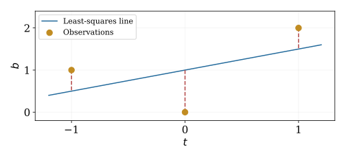
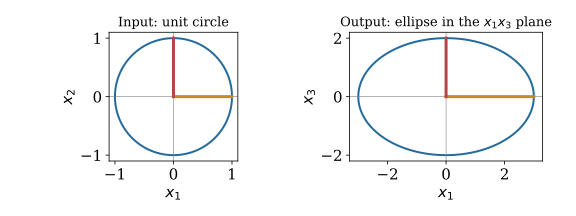

# Course Map {.deck-course-map}

::: {.columns}
::: {.column width="38%"}
<h3>Course decks</h3>

::: {style="font-size: 0.86em;"}
- [Why Linear Algebra?]()
- [Systems and Matrices]()
- [Inverses]()
- [Matrix Transformations]()
- [Determinants]()
- [Euclidean Spaces]()
- [Vector Spaces and Span]()
- [Bases and Coordinates]()
- [Matrix Spaces and Rank]()
- [Eigenvalues]()
- [Inner Products](){.current-deck aria-current="page"}
- [Special Topics]()
:::
:::

::: {.column width="4%"}
:::

::: {.column width="58%"}
<h3>In this deck</h3>

::: {.key-point}
Orthonormal coordinates expose fits and stretches

$\mat{A}=\mat{Q}\mat{R}\qquad\mat{A}=\mat{U}_r\mat{\Sigma}_r\mat{V}_r^\top$
:::

- [Inner Products and Geometry](#inner-products-and-geometry)
- [Orthogonality and Projection](#orthogonality-and-projection)
- [Gram–Schmidt and QR](#gram-schmidt-and-qr)
- [Least Squares and Regression](#least-squares-and-regression)
- [Singular Value Decomposition](#singular-value-decomposition)
- [Regression Through QR and SVD](#regression-through-qr-and-svd)
- [Function Approximation and Fourier Coordinates](#function-approximation-and-fourier-coordinates)
- [Big Ideas](#big-ideas)

:::
:::

# Inner Products and Geometry {#inner-products-and-geometry}

- [What measures the size of a vector?](#what-measures-the-size-of-a-vector)
- [The real inner-product axioms](#the-real-inner-product-axioms)
- [Weights change the geometry](#weights-change-the-geometry)
- [Continuous functions also have geometry](#continuous-functions-also-have-geometry)
- [Norms, distances, and angles follow](#norms-distances-and-angles-follow)
- [Practice testing an inner product](#practice-testing-an-inner-product)

## What measures the size of a vector? {#what-measures-the-size-of-a-vector}

Coordinates describe a vector; an inner product adds geometry

- Dot products in $\reals^n$
- Weighted measurements when coordinates have different scales
- Integrals comparing functions

::: {.key-point}
Choose the inner product to match what size and similarity mean in the problem
:::

## The real inner-product axioms {#the-real-inner-product-axioms}

An inner product on a real vector space $V$ assigns $\langle\vct{u},\vct{v}\rangle\in\reals$

For all vectors and real scalars:
\begin{align*}
\langle\vct{u},\vct{v}\rangle&=\langle\vct{v},\vct{u}\rangle\\
\langle a\vct{u}+b\vct{v},\vct{w}\rangle
&=a\langle\vct{u},\vct{w}\rangle+b\langle\vct{v},\vct{w}\rangle\\
\langle\vct{v},\vct{v}\rangle&\ge0,\qquad
\langle\vct{v},\vct{v}\rangle=0\iff\vct{v}=\vct{0}
\end{align*}

Symmetry makes linearity hold in both arguments

## Weights change the geometry {#weights-change-the-geometry}

\begin{gather*}
\langle\vct{u},\vct{v}\rangle_{\mat{W}}=\vct{u}^\top\mat{W}\vct{v},\qquad
\mat{W}=\mat{W}^\top\text{ positive definite}\\
\mat{W}=\begin{bmatrix}1&0\\0&4\end{bmatrix},\qquad
\left\|\begin{bmatrix}x_1\\x_2\end{bmatrix}\right\|_{\mat{W}}^2=x_1^2+4x_2^2
\end{gather*}

The weighted unit circle is an ellipse in standard coordinates

For $\vct{u}=[1,1]^\top$ and $\vct{v}=[4,-1]^\top$:
$\langle\vct{u},\vct{v}\rangle_{\mat{W}}=0$ but $\vct{u}^\top\vct{v}=3$

## Continuous functions also have geometry {#continuous-functions-also-have-geometry}

On $C([0,1])$, define
\begin{equation*}
\langle f,g\rangle=\int_0^1 f(t)g(t)\,\dif t
\end{equation*}

- Symmetry and linearity come from the integral
- A nonzero continuous function has a positive integral of its square
- Similarity compares entire functions, not only their sampled values

For $f(t)=1$, $g(t)=t$: $\langle f,g\rangle=1/2$

::: {.notes}
Continuity guarantees positive definiteness for actual functions. For general square-integrable functions, use equivalence classes modulo equality almost everywhere to obtain an inner-product space. Completeness and Hilbert spaces are later-course context.
:::

## Norms, distances, and angles follow {#norms-distances-and-angles-follow}

\begin{gather*}
\|\vct{v}\|=\sqrt{\langle\vct{v},\vct{v}\rangle},\qquad
d(\vct{u},\vct{v})=\|\vct{u}-\vct{v}\|\\
\cos\theta=\frac{\langle\vct{u},\vct{v}\rangle}{\|\vct{u}\|\|\vct{v}\|},
\quad\vct{u},\vct{v}\ne\vct{0}
\end{gather*}

Cauchy–Schwarz: $|\langle\vct{u},\vct{v}\rangle|\le\|\vct{u}\|\|\vct{v}\|$

Triangle inequality: $\|\vct{u}+\vct{v}\|\le\|\vct{u}\|+\|\vct{v}\|$

::: {.notes}
Cauchy–Schwarz follows by minimizing ||u-tv||^2 over real t when v is nonzero. Equality occurs exactly for linearly dependent vectors. Expand the squared norm and apply the inequality to obtain the triangle inequality.
:::

## Practice testing an inner product {#practice-testing-an-inner-product}

::: {.exitem}
$\exstar$
On $\reals^2$, which formulas are inner products? $u_1v_1+2u_2v_2$, $\quad u_1v_1-u_2v_2$, $\quad u_1v_1$ Name the failed axiom for each rejected formula
:::

::: {.notes}
The first is an inner product. The second is negative on (0,1). The third gives zero squared length to the nonzero vector (0,1), so positive definiteness fails.
:::

# Orthogonality and Projection {#orthogonality-and-projection}

- [Perpendicular vectors split squared length](#perpendicular-vectors-split-squared-length)
- [Projection onto one direction](#projection-onto-one-direction)
- [Projection onto an orthonormal basis](#projection-onto-an-orthonormal-basis)
- [An orthogonal projector has two signatures](#an-orthogonal-projector-has-two-signatures)
- [Practice projecting onto a plane](#practice-projecting-onto-a-plane)

## Perpendicular vectors split squared length {#perpendicular-vectors-split-squared-length}

$\vct{u}\perp\vct{v}$ means $\langle\vct{u},\vct{v}\rangle=0$
\begin{equation*}
\|\vct{u}+\vct{v}\|^2=\|\vct{u}\|^2+\|\vct{v}\|^2
\end{equation*}

Nonzero pairwise orthogonal vectors are linearly independent

An orthonormal list is pairwise orthogonal with each vector of norm one

::: {.notes}
For independence, take the inner product of a zero linear combination with each list vector. Its coefficient times the positive squared norm must vanish. The zero vector is perpendicular to every vector but cannot belong to an orthonormal list.
:::

## Projection onto one direction {#projection-onto-one-direction}

For $\vct{u}\ne\vct{0}$:
\begin{gather*}
\vct{p}=\frac{\langle\vct{u},\vct{v}\rangle}{\langle\vct{u},\vct{u}\rangle}\vct{u},\qquad
\vct{r}=\vct{v}-\vct{p}\\
\vct{p}\in\operatorname{span}\{\vct{u}\},\qquad \vct{r}\perp\vct{u}
\end{gather*}

For every $\vct{w}$ on that line:
\begin{equation*}
\|\vct{v}-\vct{w}\|^2=\|\vct{r}\|^2+\|\vct{p}-\vct{w}\|^2
\end{equation*}

$\vct{p}$ is the unique closest vector on the line

## Projection onto an orthonormal basis {#projection-onto-an-orthonormal-basis}

Let $\{\vct{q}_1,\ldots,\vct{q}_k\}$ be an orthonormal basis of a subspace $S$
\begin{gather*}
\operatorname{proj}_S\vct{v}=\sum_{j=1}^k\langle\vct{q}_j,\vct{v}\rangle\vct{q}_j\\
\vct{v}=\vct{p}+\vct{r},\qquad \vct{p}\in S,\quad \vct{r}\in S^\perp
\end{gather*}

Here $S^\perp=\{\vct{r}:\langle\vct{r},\vct{s}\rangle=0\text{ for every }\vct{s}\in S\}$

Orthonormal coordinates require inner products instead of solving a new system

## An orthogonal projector has two signatures {#an-orthogonal-projector-has-two-signatures}

In standard Euclidean coordinates, let $\mat{Q}$ have orthonormal columns spanning $S$
\begin{gather*}
\mat{P}=\mat{Q}\mat{Q}^\top,\qquad
\mat{P}^\top=\mat{P},\quad\mat{P}^2=\mat{P}\\
\mat{P}\vct{v}\in S,\qquad (\mat{I}-\mat{P})\vct{v}\in S^\perp
\end{gather*}

Idempotence alone characterizes a projection; symmetry additionally makes it orthogonal

[Revisit concrete projections]()

::: {.notes}
The symmetry criterion assumes the standard dot product. In a W inner product, the corresponding criterion is P^T W = W P together with idempotence. Finite-dimensional subspaces admit the orthogonal decomposition used here.
:::

## Practice projecting onto a plane {#practice-projecting-onto-a-plane}

::: {.exitem}
$\exstar$
Let $S=\operatorname{span}\{[1,1,0]^\top,[0,0,1]^\top\}$ Choose an orthonormal basis and project $[3,1,2]^\top$ onto $S$ Find the distance to $S$
:::

::: {.notes}
Use q_1=[1,1,0]^T/sqrt(2), q_2=[0,0,1]^T. Projection [2,2,2]^T; residual [1,-1,0]^T; distance sqrt(2).
:::

# Gram–Schmidt and QR {#gram-schmidt-and-qr}

- [Build perpendicular directions without changing the span](#build-perpendicular-directions-without-changing-the-span)
- [A worked Gram–Schmidt calculation](#a-worked-gram-schmidt-calculation)
- [The coefficients form a triangular matrix](#the-coefficients-form-a-triangular-matrix)
- [Read QR from the worked example](#read-qr-from-the-worked-example)
- [Exact construction and numerical computation differ](#exact-construction-and-numerical-computation-differ)
- [Practice extracting QR coordinates](#practice-extracting-qr-coordinates)

## Build perpendicular directions without changing the span {#build-perpendicular-directions-without-changing-the-span}

Start with independent $\vct{A}_1,\ldots,\vct{A}_n$
\begin{align*}
\vct{w}_1&=\vct{A}_1,\qquad\vct{q}_1=\vct{w}_1/\|\vct{w}_1\|\\
\vct{w}_j&=\vct{A}_j-\sum_{i=1}^{j-1}\langle\vct{q}_i,\vct{A}_j\rangle\vct{q}_i\\
\vct{q}_j&=\vct{w}_j/\|\vct{w}_j\|
\end{align*}

At each step, remove directions already represented, then normalize

$\operatorname{span}\{\vct{q}_1,\ldots,\vct{q}_j\}=\operatorname{span}\{\vct{A}_1,\ldots,\vct{A}_j\}$

## A worked Gram–Schmidt calculation {#a-worked-gram-schmidt-calculation}

In $\reals^3$, take $\vct{A}_1=[1,1,0]^\top$ and $\vct{A}_2=[1,0,1]^\top$
\begin{align*}
\vct{q}_1&=\frac1{\sqrt2}[1,1,0]^\top\\
\langle\vct{q}_1,\vct{A}_2\rangle&=1/\sqrt2\\
\vct{w}_2&=[1/2,-1/2,1]^\top\\
\vct{q}_2&=\frac1{\sqrt6}[1,-1,2]^\top
\end{align*}

Check $\vct{q}_1^\top\vct{q}_2=0$ and both squared norms equal one

## The coefficients form a triangular matrix {#the-coefficients-form-a-triangular-matrix}

For a real $m\times n$ matrix with independent columns, $m\ge n$:
\begin{gather*}
\mat{A}=\mat{Q}\mat{R},\qquad \mat{Q}^\top\mat{Q}=\mat{I}_n\\
\mat{Q}=[\vct{q}_1\ \cdots\ \vct{q}_n],\qquad
(\mat{R})_{ij}=\begin{cases}\vct{q}_i^\top\vct{A}_j,&i\le j\\0,&i>j\end{cases}
\end{gather*}

$\mat{Q}$: $m\times n$ orthonormal directions

$\mat{R}$: $n\times n$ upper triangular coordinates, positive diagonal with this construction

Here $\mat{R}$ is the QR factor, different from $\mat{R}$ in $\mat{A}=\mat{C}\mat{R}$

::: {.notes}
This is reduced QR. Here R denotes the triangular QR factor, not the row-space factor in A=C R. Reused matrix letters are defined by the current factorization. When Q is rectangular, Q^T Q=I but Q Q^T is a projector rather than the identity.
:::

## Read QR from the worked example {#read-qr-from-the-worked-example}

\begin{gather*}
\mat{A}=\begin{bmatrix}1&1\\1&0\\0&1\end{bmatrix},\qquad
\mat{Q}=\begin{bmatrix}
1/\sqrt2&1/\sqrt6\\1/\sqrt2&-1/\sqrt6\\0&2/\sqrt6
\end{bmatrix}\\
\mat{R}=\begin{bmatrix}\sqrt2&1/\sqrt2\\0&\sqrt{3/2}\end{bmatrix}
\end{gather*}

Column 1 uses only $\vct{q}_1$; column 2 uses $\vct{q}_1$ and $\vct{q}_2$

Verify $\mat{Q}\mat{R}=\mat{A}$

## Exact construction and numerical computation differ {#exact-construction-and-numerical-computation-differ}

- Dependent input: a zero remainder cannot be normalized
- Nearly dependent input: subtraction can lose orthogonality in floating point
- Modified Gram–Schmidt updates the remainder after each projection
- Householder QR uses orthogonal reflections for practical computation

[Recall Householder reflections]()

::: {.key-point}
Gram–Schmidt explains QR; numerical algorithms must also control round-off error
:::

::: {.notes}
Dependence detection in floating point requires a scale-aware tolerance; no universal fixed threshold is prescribed. Householder QR is backward stable; classical Gram–Schmidt may lose orthogonality substantially for ill-conditioned inputs. Reorthogonalization is another option.
:::

## Practice extracting QR coordinates {#practice-extracting-qr-coordinates}

::: {.exitem}
$\exstar$
Apply Gram–Schmidt to $[1,0,1]^\top$ and $[1,1,0]^\top$ Write the reduced QR factorization Why is $\mat{Q}\mat{Q}^\top$ not $\mat{I}_3$?
:::

::: {.notes}
q_1=[1,0,1]^T/sqrt(2), q_2=[1,2,-1]^T/sqrt(6), R=[[sqrt(2),1/sqrt(2)],[0,sqrt(3/2)]]. Q Q^T has rank two and projects onto the plane spanned by the two columns.
:::

# Least Squares and Regression {#least-squares-and-regression}

- [Inconsistent systems still have a best fit](#inconsistent-systems-still-have-a-best-fit)
- [QR turns least squares into a triangular solve](#qr-turns-least-squares-into-a-triangular-solve)
- [Fit a line to three observations](#fit-a-line-to-three-observations)
- [Inspect the fit and residual](#inspect-the-fit-and-residual)
- [A line fit leaves vertical residuals](#regression-residual-figure)
- [General features keep the model linear in coefficients](#general-features-keep-the-model-linear-in-coefficients)
- [The projection formula reconnects earlier geometry](#the-projection-formula-reconnects-earlier-geometry)
- [Weights and rank deficiency change the calculation](#weights-and-rank-deficiency-change-the-calculation)
- [Practice checking a regression fit](#practice-checking-a-regression-fit)

## Inconsistent systems still have a best fit {#inconsistent-systems-still-have-a-best-fit}

For $\mat{A}\vct{x}\approx\vct{b}$, minimize $\|\mat{A}\vct{x}-\vct{b}\|^2$

The best fitted vector lies in $\operatorname{col}(\mat{A})$ and leaves an orthogonal residual
\begin{gather*}
\mat{A}^\top(\vct{b}-\mat{A}\widehat{\vct{x}})=\vct{0}\\
\mat{A}^\top\mat{A}\widehat{\vct{x}}=\mat{A}^\top\vct{b}
\end{gather*}

These are the [normal equations]{.alert}

The fitted vector is unique; coefficients are unique exactly when columns are independent

## QR turns least squares into a triangular solve {#qr-turns-least-squares-into-a-triangular-solve}

With reduced QR and full column rank:
\begin{gather*}
\|\mat{A}\vct{x}-\vct{b}\|^2
=\|\mat{R}\vct{x}-\mat{Q}^\top\vct{b}\|^2
+\|(\mat{I}-\mat{Q}\mat{Q}^\top)\vct{b}\|^2\\
\mat{R}\widehat{\vct{x}}=\mat{Q}^\top\vct{b}\\
\widehat{\vct{b}}=\mat{Q}\mat{Q}^\top\vct{b}
\end{gather*}

Compute coordinates with $\mat{Q}^\top$, then back substitute

The perpendicular part cannot be fitted by any coefficient vector

## Fit a line to three observations {#fit-a-line-to-three-observations}

Data: $(t,b)=(-1,1),(0,0),(1,2)$

Model $b\approx x_1+x_2t$
\begin{gather*}
\mat{A}=\begin{bmatrix}1&-1\\1&0\\1&1\end{bmatrix},\quad
\vct{b}=\begin{bmatrix}1\\0\\2\end{bmatrix},\quad
\mat{A}^\top\mat{A}=\begin{bmatrix}3&0\\0&2\end{bmatrix},\quad
\mat{A}^\top\vct{b}=\begin{bmatrix}3\\1\end{bmatrix}\\
\widehat{\vct{x}}=\begin{bmatrix}1\\1/2\end{bmatrix},\qquad
\widehat b(t)=1+t/2
\end{gather*}

The feature columns happen to be orthogonal

## Inspect the fit and residual {#inspect-the-fit-and-residual}

For the line fit:
\begin{gather*}
\widehat{\vct{b}}=\begin{bmatrix}1/2\\1\\3/2\end{bmatrix},\quad
\vct{r}=\vct{b}-\widehat{\vct{b}}=\begin{bmatrix}1/2\\-1\\1/2\end{bmatrix}\\
\mat{A}^\top\vct{r}=\begin{bmatrix}0\\0\end{bmatrix},\quad \|\vct{r}\|^2=3/2
\end{gather*}

The residual sums to zero because the model includes a column of ones

Residuals are also perpendicular to the sampled $t$ values

::: {.notes}
Least squares minimizes vertical response errors at fixed predictor values, not perpendicular geometric distances to the plotted line. The zero-sum claim assumes ordinary unweighted least squares with an intercept.
:::

## A line fit leaves vertical residuals {#regression-residual-figure}

::: {style="text-align: center;"}
{fig-alt="Three observations at t equals minus one, zero, and one, with response values one, zero, and two. The fitted line is one plus t over two. Dashed vertical segments show the residuals." width="76%" .nostretch}
:::

Least squares minimizes the sum of squared vertical errors

## General features keep the model linear in coefficients {#general-features-keep-the-model-linear-in-coefficients}

Choose features $\phi_1(t),\ldots,\phi_n(t)$
\begin{gather*}
\widehat b(t)=\sum_{j=1}^n x_j\phi_j(t),\qquad a_{ij}=\phi_j(t_i)
\end{gather*}

- Polynomial regression: $1,t,t^2,\ldots$
- Periodic features: sines and cosines
- Several predictors: one column for each chosen feature

::: {.key-point}
Linear regression means linear in the unknown coefficients
:::

::: {.notes}
A feature may be nonlinear in t. Least squares alone does not establish causation or predictive performance. More features can improve training fit while worsening generalization; use held-out data when the goal is prediction.
:::

## The projection formula reconnects earlier geometry {#the-projection-formula-reconnects-earlier-geometry}

For independent columns:
\begin{gather*}
\mat{P}=\mat{A}(\mat{A}^\top\mat{A})^{-1}\mat{A}^\top
=\mat{Q}\mat{Q}^\top\\
\mat{P}^2=\mat{P},\quad\mat{P}^\top=\mat{P},\qquad
\widehat{\vct{b}}=\mat{P}\vct{b},\quad\vct{r}=(\mat{I}-\mat{P})\vct{b}
\end{gather*}

$\mat{P}$ preserves the column space; $\mat{I}-\mat{P}$ preserves its orthogonal complement

The inverse formula describes the geometry; QR computes the fit without explicitly forming that inverse

## Weights and rank deficiency change the calculation {#weights-and-rank-deficiency-change-the-calculation}

Positive observation weights $w_i$ and $\mat{W}=\operatorname{diag}(w_1,\ldots,w_m)$ give
\begin{gather*}
\min_{\vct{x}}\sum_iw_i((\mat{A}\vct{x})_i-b_i)^2
=\min_{\vct{x}}\|\mat{W}^{1/2}(\mat{A}\vct{x}-\vct{b})\|^2\\
\mat{A}^\top\mat{W}(\mat{A}\widehat{\vct{x}}-\vct{b})=\vct{0}
\end{gather*}

Apply QR to the weighted design matrix when it has full column rank

Dependent or nearly dependent features motivate [SVD and regularization](#regression-through-qr-and-svd)

## Practice checking a regression fit {#practice-checking-a-regression-fit}

::: {.exitem}
$\exstar$
Fit $b\approx x_1+x_2t$ to $(-1,0),(0,1),(1,1)$ Find coefficients, fitted values, and residuals Check both normal equations
:::

::: {.notes}
Coefficients [2/3,1/2]^T. Fitted values [1/6,2/3,7/6]^T; residuals [-1/6,1/3,-1/6]^T. Sum of residuals and dot product with [-1,0,1]^T are zero. Squared residual norm is 1/6.
:::

# Singular Value Decomposition {#singular-value-decomposition}

Orthogonal input and output coordinates extend the eigenvector idea to rectangular matrices

- [What can a rectangular matrix do?](#what-can-a-rectangular-matrix-do)
- [The SVD separates directions from scale](#the-svd-separates-directions-from-scale)
- [Each singular direction has its own stretch](#each-singular-direction-has-its-own-stretch)
- [A worked SVD without square roots of large matrices](#a-worked-svd-without-square-roots-of-large-matrices)
- [See the singular stretches](#svd-geometry)
- [Why an SVD exists](#why-an-svd-exists)
- [The four spaces reappear in orthonormal coordinates](#the-four-spaces-reappear-in-orthonormal-coordinates)
- [A matrix is a sum of rank-one maps](#a-matrix-is-a-sum-of-rank-one-maps)
- [The best low-rank approximation has a measurable error](#the-best-low-rank-approximation-has-a-measurable-error)
- [Practice reading singular values](#practice-reading-singular-values)

## What can a rectangular matrix do? {#what-can-a-rectangular-matrix-do}

$\mat{A}:\reals^n\to\reals^m$ may stretch, turn, and collapse directions

Eigenvectors require a square matrix; singular vectors work for every shape

::: {.key-point}
Choose orthonormal input and output directions adapted to the map
:::

## The SVD separates directions from scale {#the-svd-separates-directions-from-scale}

For a real $m\times n$ matrix of rank $r>0$:
\begin{gather*}
\mat{A}=\mat{U}_r\mat{\Sigma}_r\mat{V}_r^\top,\qquad
\mat{\Sigma}_r=\operatorname{diag}(\sigma_1,\ldots,\sigma_r)\\
\sigma_1\ge\cdots\ge\sigma_r>0,\qquad
\mat{U}_r^\top\mat{U}_r=\mat{V}_r^\top\mat{V}_r=\mat{I}_r
\end{gather*}

| Factor | Shape | Role |
|---|---|---|
| $\mat{V}_r^\top$ | $r\times n$ | input coordinates |
| $\mat{\Sigma}_r$ | $r\times r$ | stretch each coordinate |
| $\mat{U}_r$ | $m\times r$ | assemble the output |

::: {.notes}
This is the compact SVD. The zero matrix has no positive singular values and an empty compact factorization; its pseudoinverse is zero. Orthogonal completions give the full SVD with U m-by-m, V n-by-n, and rectangular Sigma.
:::

## Each singular direction has its own stretch {#each-singular-direction-has-its-own-stretch}

Write $\vct{U}_j$ and $\vct{V}_j$ for columns of the compact factors
\begin{gather*}
\mat{A}\vct{V}_j=\sigma_j\vct{U}_j,\qquad
\mat{A}^\top\vct{U}_j=\sigma_j\vct{V}_j\\
\mat{A}\vct{x}=\sum_{j=1}^r\sigma_j\vct{U}_j
\bigl(\vct{V}_j^\top\vct{x}\bigr)
\end{gather*}

Input perpendicular to every $\vct{V}_j$ is sent to zero

::: {.key-point}
Singular values measure stretches, not signed eigenvalues
:::

## A worked SVD without square roots of large matrices {#a-worked-svd-without-square-roots-of-large-matrices}

\begin{gather*}
\mat{A}=\begin{bmatrix}3&0\\0&0\\0&2\end{bmatrix},\quad
\mat{U}_r=\begin{bmatrix}1&0\\0&0\\0&1\end{bmatrix},\quad
\mat{\Sigma}_r=\begin{bmatrix}3&0\\0&2\end{bmatrix},\quad
\mat{V}_r=\mat{I}_2\\
\mat{A}\begin{bmatrix}\cos t\\\sin t\end{bmatrix}
=\begin{bmatrix}3\cos t\\0\\2\sin t\end{bmatrix}
\end{gather*}

The unit circle becomes an ellipse in the $x_1x_3$ plane

::: {.key-point}
The ellipse axes are the left singular vectors; their lengths are the singular values
:::

## See the singular stretches {#svd-geometry}

::: {style="text-align: center;"}
{fig-alt="The unit input circle maps to an ellipse with semiaxes three and two in the output x1 x3 plane" width="90%" .nostretch}
:::

## Why an SVD exists {#why-an-svd-exists}

$\mat{A}^\top\mat{A}$ is symmetric and positive semidefinite
\begin{gather*}
\vct{x}^\top\mat{A}^\top\mat{A}\vct{x}
=\|\mat{A}\vct{x}\|^2\ge0\\
\mat{A}^\top\mat{A}\vct{V}_j=\sigma_j^2\vct{V}_j,\qquad
\vct{U}_j=\frac{\mat{A}\vct{V}_j}{\sigma_j}\quad(\sigma_j>0)
\end{gather*}

Orthonormal eigenvectors on the input side produce orthonormal output vectors

::: {.notes}
For positive singular values, U_i^T U_j = V_i^T A^T A V_j/(sigma_i sigma_j) = delta_ij. Use the real symmetric spectral theorem from Eigenvalues and Eigenvectors; the optional quadratic-forms section is not a prerequisite. This is an existence argument, not a recommended numerical algorithm: forming A^T A squares the full-column-rank condition number.
:::

## The four spaces reappear in orthonormal coordinates {#the-four-spaces-reappear-in-orthonormal-coordinates}

| Space | SVD description |
|---|---|
| $\operatorname{col}(\mat{A})$ | span of $\vct{U}_1,\ldots,\vct{U}_r$ |
| $\operatorname{row}(\mat{A})$ | span of $\vct{V}_1,\ldots,\vct{V}_r$ |
| $\operatorname{null}(\mat{A})$ | perpendicular to all $\vct{V}_j$ |
| $\operatorname{null}(\mat{A}^\top)$ | perpendicular to all $\vct{U}_j$ |

Complete the columns of $\mat{U}_r$ and $\mat{V}_r$ to orthonormal bases to obtain bases of the two null spaces

[Recall matrix spaces](#orthogonal-pairs)

## A matrix is a sum of rank-one maps {#a-matrix-is-a-sum-of-rank-one-maps}

\begin{equation*}
\mat{A}=\sum_{j=1}^r\sigma_j\vct{U}_j\vct{V}_j^\top
\end{equation*}

Each term reads one input coordinate and sends it along one output direction

Keep only the first $k$ terms:
\begin{equation*}
\mat{A}_k=\sum_{j=1}^k\sigma_j\vct{U}_j\vct{V}_j^\top,\qquad 0\le k<r
\end{equation*}

A controlled approximation using fewer directions

## The best low-rank approximation has a measurable error {#the-best-low-rank-approximation-has-a-measurable-error}

Define $\|\mat{B}\|_F^2=\sum_{i,j}|b_{ij}|^2$ and
$\|\mat{B}\|_2=\max_{\|\vct{x}\|=1}\|\mat{B}\vct{x}\|$
\begin{gather*}
\|\mat{A}-\mat{A}_k\|_2=\sigma_{k+1}\\
\|\mat{A}-\mat{A}_k\|_F^2=\sum_{j=k+1}^r\sigma_j^2
\end{gather*}

$\mat{A}_k$ minimizes either error over matrices of rank at most $k$

::: {.key-point}
Choose the rank by the accuracy needed, not only by the appearance of the image
:::

::: {.notes}
Eckart–Young–Mirsky theorem; statement without proof. Approximation need not be unique when singular values tie. For an m-by-n grayscale image, storing compact factors uses k(m+n+1) scalar entries instead of mn, before file-format overhead or quantization.
:::

## Practice reading singular values {#practice-reading-singular-values}

::: {.exitem}
$\exstar$
A matrix has singular values $8,3,1$ Find the rank-one spectral error and rank-two Frobenius error How many rank-one terms reproduce the matrix exactly?
:::

::: {.notes}
Answers: 3; 1; three terms. Distinguish the two error norms.
:::

# Regression Through QR and SVD {#regression-through-qr-and-svd}

- [Regression asks for the closest attainable data](#regression-asks-for-the-closest-attainable-data)
- [QR solves full-column-rank least squares](#qr-solves-full-column-rank-least-squares)
- [The pseudoinverse reverses the nonzero stretches](#the-pseudoinverse-reverses-the-nonzero-stretches)
- [Rank deficiency changes coefficients, not the fitted vector](#rank-deficiency-changes-coefficients-not-the-fitted-vector)
- [A regression example with a redundant feature](#a-regression-example-with-a-redundant-feature)
- [Small singular values amplify data perturbations](#small-singular-values-amplify-data-perturbations)
- [Truncation and ridge control small stretches](#truncation-and-ridge-control-small-stretches)
- [Which factorization serves the regression question?](#which-factorization-serves-the-regression-question)
- [Practice separating fit from coefficients](#practice-separating-fit-from-coefficients)

## Regression asks for the closest attainable data {#regression-asks-for-the-closest-attainable-data}

Fit observations $b_i$ using features $a_{ij}$ and coefficients $x_j$
\begin{gather*}
\widehat{\vct{b}}=\mat{A}\widehat{\vct{x}},\qquad
\widehat{\vct{x}}\in\arg\min_{\vct{x}}\|\mat{A}\vct{x}-\vct{b}\|^2\\
\mat{A}^\top(\vct{b}-\widehat{\vct{b}})=\vct{0}
\end{gather*}

$\widehat{\vct{b}}$ is the orthogonal projection onto $\operatorname{col}(\mat{A})$

A column of ones supplies an intercept

[Recall least squares](#least-squares-and-regression)

## QR solves full-column-rank least squares {#qr-solves-full-column-rank-least-squares}

For $m\ge n$ and independent columns:
\begin{gather*}
\mat{A}=\mat{Q}\mat{R},\quad
\mat{Q}^\top\mat{Q}=\mat{I}_n,\quad
\mat{R}\text{ upper triangular and invertible}\\
\|\mat{A}\vct{x}-\vct{b}\|^2
=\|\mat{R}\vct{x}-\mat{Q}^\top\vct{b}\|^2
+\|(\mat{I}_m-\mat{Q}\mat{Q}^\top)\vct{b}\|^2\\
\mat{R}\widehat{\vct{x}}=\mat{Q}^\top\vct{b}
\end{gather*}

Compute orthogonal coordinates, then use back substitution

::: {.notes}
Reduced QR: Q is m-by-n, R is n-by-n. This R is the triangular QR factor, different from R in A=C R; reused matrix letters are defined by the current factorization. Gram–Schmidt explains the factorization; Householder QR is the standard practical method. This is an optional refresher of the earlier QR section; skip these two recap slides when proceeding directly to the pseudoinverse.
:::

## The pseudoinverse reverses the nonzero stretches {#the-pseudoinverse-reverses-the-nonzero-stretches}

\begin{gather*}
\mat{A}^{\dagger}=\mat{V}_r\mat{\Sigma}_r^{-1}\mat{U}_r^\top\\
\widehat{\vct{x}}=\mat{A}^{\dagger}\vct{b}
=\sum_{j=1}^r\frac{\vct{U}_j^\top\vct{b}}{\sigma_j}\vct{V}_j\\
\widehat{\vct{b}}=\mat{A}\widehat{\vct{x}}
=\mat{U}_r\mat{U}_r^\top\vct{b}
\end{gather*}

Works for rectangular and rank-deficient matrices

::: {.key-point}
The pseudoinverse selects the least-squares solution with smallest Euclidean norm
:::

## Rank deficiency changes coefficients, not the fitted vector {#rank-deficiency-changes-coefficients-not-the-fitted-vector}

Every least-squares minimizer has the form
\begin{equation*}
\vct{x}=\mat{A}^{\dagger}\vct{b}+\vct{z},\qquad
\vct{z}\in\operatorname{null}(\mat{A})
\end{equation*}

- All give the same fitted vector $\widehat{\vct{b}}$
- The pseudoinverse solution lies in $\operatorname{row}(\mat{A})$
- Adding a perpendicular null-space component increases the coefficient norm

::: {.notes}
Use the orthogonal splitting R^n = row(A) plus null(A). The minimizer is unique exactly when A has full column rank. This also covers underdetermined consistent systems.
:::

## A regression example with a redundant feature {#a-regression-example-with-a-redundant-feature}

\begin{gather*}
\mat{A}=\begin{bmatrix}1&1\\1&1\end{bmatrix},\quad
\vct{b}=\begin{bmatrix}2\\4\end{bmatrix},\quad
\vct{U}_1=\vct{V}_1=\frac1{\sqrt2}\begin{bmatrix}1\\1\end{bmatrix},\quad\sigma_1=2\\
\widehat{\vct{x}}=\begin{bmatrix}3/2\\3/2\end{bmatrix},\quad
\widehat{\vct{b}}=\begin{bmatrix}3\\3\end{bmatrix},\quad
\vct{b}-\widehat{\vct{b}}=\begin{bmatrix}-1\\1\end{bmatrix}
\end{gather*}

Both features are identical: only $x_1+x_2=3$ is identifiable

The smallest-norm solution divides the total equally

## Small singular values amplify data perturbations {#small-singular-values-amplify-data-perturbations}

A perturbation $\delta\vct{b}$ changes the pseudoinverse coefficients by
\begin{equation*}
\delta\widehat{\vct{x}}
=\sum_{j=1}^r\frac{\vct{U}_j^\top\delta\vct{b}}{\sigma_j}\vct{V}_j
\end{equation*}

Small positive $\sigma_j$: large coefficient changes in direction $\vct{V}_j$

For full column rank, the 2-norm condition number is $\kappa(\mat{A})=\sigma_1/\sigma_n$

::: {.key-point}
An accurate fit can coexist with poorly determined coefficients
:::

::: {.notes}
For a general square matrix, use singular values, not eigenvalues, in the 2-norm condition number. For a real symmetric positive-definite matrix, singular values equal its positive eigenvalues, so the largest/smallest eigenvalue ratio is valid. Keep rank and conditioning distinct. Exact zero singular values create nonidentifiability; small positive ones create sensitivity. Feature scaling affects these values and the meaning of a coefficient-norm penalty.
:::

## Truncation and ridge control small stretches {#truncation-and-ridge-control-small-stretches}

Truncated SVD retains only singular values above a chosen threshold $\tau$:
\begin{equation*}
\widehat{\vct{x}}_\tau
=\sum_{\sigma_j>\tau}\frac{\vct{U}_j^\top\vct{b}}{\sigma_j}\vct{V}_j
\end{equation*}

Ridge minimizes $\|\mat{A}\vct{x}-\vct{b}\|^2+\lambda\|\vct{x}\|^2$, $\lambda>0$:
\begin{equation*}
\widehat{\vct{x}}_\lambda
=\sum_{j=1}^r\frac{\sigma_j}{\sigma_j^2+\lambda}
(\vct{U}_j^\top\vct{b})\vct{V}_j
\end{equation*}

Truncation discards directions; ridge shrinks their contributions

::: {.notes}
This ridge formula penalizes every coefficient, including an intercept if present. In typical regression, center features and response or explicitly exempt the intercept; then the formula must be applied to the corresponding centered or weighted-penalty problem. Parameter choice requires a noise model or validation data; this deck introduces the algebra only.
:::

## Which factorization serves the regression question? {#which-factorization-serves-the-regression-question}

| Question | Useful tool |
|---|---|
| Full-column-rank least-squares coefficients | QR and a triangular solve |
| Rank deficiency and minimum-norm coefficients | SVD and pseudoinverse |
| Sensitivity and numerical rank | Singular values and feature scaling |
| Noise-sensitive directions | Truncation or ridge |

Forming $\mat{A}^\top\mat{A}$ squares $\kappa(\mat{A})$ when $\mat{A}$ has full column rank

Prefer an orthogonal factorization to explicitly inverting the normal-equation matrix

## Practice separating fit from coefficients {#practice-separating-fit-from-coefficients}

::: {.exitem}
$\exstar$
For the redundant-feature example, describe every least-squares solution Verify that the residual is perpendicular to both columns Explain why $[3/2,3/2]^\top$ has the smallest norm
:::

::: {.notes}
Solutions: $[3/2+t,3/2-t]^\top$, t real. Each column dotted with [-1,1]^T is zero. Squared coefficient norm is 9/2+2t^2, minimized at t=0.
:::

# Function Approximation and Fourier Coordinates {#function-approximation-and-fourier-coordinates}

::: {.notes}
Teach the finite-dimensional SVD core before this function/Fourier extension
when time is short. No result in the SVD or regression sections depends on
this section or on the optional Special Topics deck.
:::

- [Approximate a function in a finite-dimensional subspace](#approximate-a-function-in-a-finite-dimensional-subspace)
- [Orthogonalize the first two polynomial directions](#orthogonalize-the-first-two-polynomial-directions)
- [A best linear approximation to a quadratic function](#a-best-linear-approximation-to-a-quadratic-function)
- [Sines and cosines form orthogonal directions](#sines-and-cosines-form-orthogonal-directions)
- [Complex inner products use conjugation](#complex-inner-products-use-conjugation)
- [Complex exponentials package the Fourier pairs](#complex-exponentials-package-the-fourier-pairs)
- [Finite projections and infinite expansions have different meanings](#finite-projections-and-infinite-expansions-have-different-meanings)
- [Practice extracting Fourier coordinates](#practice-extracting-fourier-coordinates)

## Approximate a function in a finite-dimensional subspace {#approximate-a-function-in-a-finite-dimensional-subspace}

Choose an orthonormal list $q_1,\ldots,q_n$ using the integral inner product
\begin{gather*}
p_n=\sum_{j=1}^n\langle q_j,f\rangle q_j\\
\|f-p_n\|^2=\|f\|^2-\sum_{j=1}^n|\langle q_j,f\rangle|^2
\end{gather*}

$p_n$ is the unique best approximation in their span

This is the same projection geometry used in regression

## Orthogonalize the first two polynomial directions {#orthogonalize-the-first-two-polynomial-directions}

On $[0,1]$, begin with $1$ and $t$
\begin{gather*}
q_1(t)=1,\qquad w_2(t)=t-\int_0^1t\,\dif t=t-1/2\\
\int_0^1(t-1/2)^2\,\dif t=1/12,\qquad
q_2(t)=\sqrt{12}(t-1/2)
\end{gather*}

Gram–Schmidt works on functions as well as coordinate vectors

::: {.notes}
This is the beginning of shifted, normalized Legendre polynomials. Higher-degree formulas are optional; retain the same interval and weight when using orthogonality.
:::

## A best linear approximation to a quadratic function {#a-best-linear-approximation-to-a-quadratic-function}

For $f(t)=t^2$ on $[0,1]$:
\begin{gather*}
\langle q_1,f\rangle=1/3,\qquad
\langle q_2,f\rangle=\sqrt{12}/12\\
p(t)=\frac13+\frac{\sqrt{12}}{12}\sqrt{12}(t-1/2)=t-1/6\\
\|f-p\|^2=\frac15-\frac19-\frac1{12}=\frac1{180}
\end{gather*}

Continuous least squares minimizes an integral of squared error

It need not interpolate either endpoint

## Sines and cosines form orthogonal directions {#sines-and-cosines-form-orthogonal-directions}

On $[0,1]$, use $1$ and, for $k\ge1$:
\begin{equation*}
\sqrt2\cos(2\pi kt),\qquad \sqrt2\sin(2\pi kt)
\end{equation*}

These functions are orthonormal under $\int_0^1 f(t)g(t)\,\dif t$

Finite sums approximate a function by its periodic components

The constant coefficient is the mean $\int_0^1f(t)\,\dif t$

::: {.notes}
Use 1-periodic extension. Orthogonality follows from trigonometric product identities. Finite truncations are projections; do not assert pointwise convergence of every Fourier series. The infinite completeness statement is in the L2 sense.
:::

## Complex inner products use conjugation {#complex-inner-products-use-conjugation}

On $\mathbb{C}^n$, adopt $\langle\vct{u},\vct{v}\rangle=\vct{u}^*\vct{v}$

Conjugate linear in the first argument, linear in the second
\begin{gather*}
\langle\vct{u},\vct{v}\rangle=\overline{\langle\vct{v},\vct{u}\rangle},\qquad
\|\vct{v}\|^2=\sum_j|v_j|^2\\
\langle f,g\rangle=\int_0^1\overline{f(t)}g(t)\,\dif t
\end{gather*}

Ordinary real-angle formulas do not directly define a complex angle

::: {.notes}
Declare the argument convention explicitly; some books adopt the opposite one. With this convention coefficients in an orthonormal expansion are <q_j,v>, as in the real case. Orthogonality means the complex inner product is zero.
:::

## Complex exponentials package the Fourier pairs {#complex-exponentials-package-the-fourier-pairs}

For integers $k$, let $q_k(t)=e^{2\pi\sqrt{-1}\,kt}$
\begin{gather*}
\langle q_k,q_\ell\rangle
=\int_0^1e^{2\pi\sqrt{-1}(\ell-k)t}\,\dif t
=\begin{cases}1,&k=\ell\\0,&k\ne\ell\end{cases}\\
c_k=\langle q_k,f\rangle
=\int_0^1e^{-2\pi\sqrt{-1}\,kt}f(t)\,\dif t
\end{gather*}

For real $f$, $c_{-k}=\overline{c_k}$

[Fourier matrices and FFT](#fourier-coordinates-and-the-fft) turn sampled versions into fast coordinate calculations

## Finite projections and infinite expansions have different meanings {#finite-projections-and-infinite-expansions-have-different-meanings}

An algebraic basis represents each vector with a [finite]{.alert} linear combination

A complete orthonormal Fourier system represents square-integrable functions by limits in the $L^2$ norm
\begin{equation*}
\left\|f-\sum_{k=-N}^{N}c_kq_k\right\|_{L^2}\longrightarrow0
\end{equation*}

Convergence in mean square does not automatically imply convergence at every point

::: {.notes}
Use L2 equivalence classes. A continuous function viewed as L2 has the same finite integral projections. At jump discontinuities, familiar piecewise smooth Fourier series converge to midpoint values; leave detailed pointwise theorems to a later course. The Fourier system is not an algebraic Hamel basis.
:::

## Practice extracting Fourier coordinates {#practice-extracting-fourier-coordinates}

::: {.exitem}
$\exstar$
For $f(t)=2+3\cos(2\pi t)-\sin(4\pi t)$, find its mean Find its coefficients in the normalized real Fourier system Which complex frequencies can have nonzero coefficients?
:::

::: {.notes}
Mean 2. Normalized real coefficients: 2 for constant, 3/sqrt(2) for sqrt(2)cos(2pi t), -1/sqrt(2) for sqrt(2)sin(4pi t); others zero. Complex frequencies 0, ±1, ±2. Complex coefficients c_1=c_-1=3/2, c_2=i/2, c_-2=-i/2.
:::

# Big Ideas {#big-ideas data-state="goldborder"}

- [Inner products]{.alert} define length, distance, and perpendicularity
- [Orthogonal projection]{.alert} gives the unique closest vector in a finite-dimensional subspace
- [Gram–Schmidt]{.alert} produces orthonormal directions with the same span
- [QR]{.alert} records those directions and triangular coordinates
- [Least squares]{.alert} fits the column-space component of the data
- [SVD]{.alert} separates orthonormal directions from stretches for every matrix
- [Pseudoinverses]{.alert} select minimum-norm fits; small singular values reveal sensitivity
- [Fourier approximation]{.alert} projects onto oscillatory directions

# How Far We Have Come

[From exact solutions to orthogonal decompositions and best fits]{.alert}

::: {.columns}
::: {.column width="47%"}
- [](#the-augmented-matrix-stores-the-system) — $[\,\mat{A}\mid\vct{b}\,]$ tests exact solvability; column/null spaces describe attainable data and coefficient freedom
- [](#a-basis-gives-every-vector-unique-coordinates) — a basis gives unique coefficients; orthonormal coordinates are inner products
- [](#continuous-functions-also-have-geometry) — dot products extend to weighted and integral geometry; $\|\vct{v}\|^2=\langle\vct{v},\vct{v}\rangle$
:::

::: {.column width="6%"}
:::

::: {.column width="47%"}
- [Projection](#projection-onto-an-orthonormal-basis) — split a vector into its closest subspace component and a perpendicular residual
- [QR](#qr-turns-least-squares-into-a-triangular-solve) — Gram–Schmidt preserves span; $\mat{A}=\mat{Q}\mat{R}$ records orthonormal directions and triangular coordinates
- [SVD](#the-svd-separates-directions-from-scale) — orthonormal input/output directions reveal rank and controlled low-rank approximations
- [Minimum-norm fit](#the-pseudoinverse-reverses-the-nonzero-stretches) — pseudoinverses reverse nonzero stretches; small singular values amplify data errors
:::
:::

::: {.key-point}
For real $\mat{A}$ with full column rank: least squares solves $\mat{R}\widehat{\vct{x}}=\mat{Q}^\top\vct{b}$;
the residual satisfies $\mat{A}^\top(\vct{b}-\mat{A}\widehat{\vct{x}})=\vct{0}$
:::

# What Comes Next

[Optional: ]()

- Quadratic forms and principal axes
- Fourier transforms, FFT, and network applications
- A single optional tensor glimpse through product bases and frames

The SVD and regression core is complete within this deck

Choose extensions according to class preferences and remaining time

The [Inner Products companion notebook](https://github.com/fjhickernell/MATH332Fall2026/blob/main/notebooks/demonstrations/10-inner-product-spaces.ipynb)
explores projection, QR, regression, and Fourier coordinates · [Open in Colab](https://colab.research.google.com/github/fjhickernell/MATH332Fall2026/blob/main/notebooks/demonstrations/10-inner-product-spaces.ipynb)

The [SVD and Regression companion notebook](https://github.com/fjhickernell/MATH332Fall2026/blob/main/notebooks/demonstrations/11-special-topics.ipynb)
explores singular directions, low-rank approximation, and minimum-norm fits · [Open in Colab](https://colab.research.google.com/github/fjhickernell/MATH332Fall2026/blob/main/notebooks/demonstrations/11-special-topics.ipynb)

# Terms to Know {#terms-to-know}

- [Inner product](#the-real-inner-product-axioms)
- [Norm; distance; Cauchy–Schwarz](#norms-distances-and-angles-follow)
- [Orthogonality; orthonormal list](#perpendicular-vectors-split-squared-length)
- [Orthogonal complement; projection](#projection-onto-an-orthonormal-basis)
- [Gram–Schmidt](#build-perpendicular-directions-without-changing-the-span)
- [QR factorization](#the-coefficients-form-a-triangular-matrix)

## Terms to know: approximation

- [Least squares; normal equations](#inconsistent-systems-still-have-a-best-fit)
- [Design matrix; features](#general-features-keep-the-model-linear-in-coefficients)
- [Weighted least squares](#weights-and-rank-deficiency-change-the-calculation)
- [Function approximation](#approximate-a-function-in-a-finite-dimensional-subspace)
- [Conjugate transpose; complex inner product](#complex-inner-products-use-conjugation)
- [Fourier coefficients](#complex-exponentials-package-the-fourier-pairs)

## Terms to know: SVD and sensitivity

- [Compact SVD; singular values](#the-svd-separates-directions-from-scale)
- [Singular vectors](#each-singular-direction-has-its-own-stretch)
- [Low-rank approximation; spectral and Frobenius norms](#the-best-low-rank-approximation-has-a-measurable-error)
- [Pseudoinverse; minimum-norm least-squares solution](#the-pseudoinverse-reverses-the-nonzero-stretches)
- [Condition number](#small-singular-values-amplify-data-perturbations)
- [Truncated SVD; ridge regression](#truncation-and-ridge-control-small-stretches)

::: {.notes}
Instructor draft. Prioritize inner products, projection, QR/least squares,
then SVD and its regression connection before the function/Fourier extension.
Anton crosswalk: §§6.1–6.2 inner products, angle and orthogonality; §6.3
Gram–Schmidt/QR; §§6.4–6.5 best approximation, least squares and modeling;
§§9.4–9.5 SVD and compression; §6.6 function approximation/Fourier series.
Complex inner products support the optional DFT in Special Topics. The
Inner Products and SVD/Regression companions are both locally executed and
linked above; the latter retains its existing filename to preserve notebook
links. Student-facing mathematical exposition remains in this deck.
Instructor review remains open.
:::
