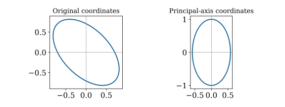

# Course Map {.deck-course-map}

::: {.columns}
::: {.column width="38%"}
<h3>Course decks</h3>

::: {style="font-size: 0.86em;"}
- [Why Linear Algebra?]()
- [Systems and Matrices]()
- [Inverses]()
- [Matrix Transformations]()
- [Determinants]()
- [Euclidean Spaces]()
- [Vector Spaces and Span]()
- [Bases and Coordinates]()
- [Matrix Spaces and Rank]()
- [Eigenvalues]()
- [Inner Products]()
- [Special Topics](){.current-deck aria-current="page"}
:::
:::

::: {.column width="4%"}
:::

::: {.column width="58%"}
<h3>In this deck</h3>

::: {.key-point}
Explore further applications of coordinates and structure
:::

- [Quadratic Forms and Principal Axes](#quadratic-forms-and-principal-axes)
- [Fourier Coordinates and the FFT](#fourier-coordinates-and-the-fft)
- [Networks and Iterative Eigenvectors](#networks-and-iterative-eigenvectors)
- [Product Bases and Frames](#product-bases-and-frames)
- [Big Ideas](#big-ideas)

:::
:::

::: {.notes}
Instructor draft: all sections are optional and may be skipped this semester.
SVD, low-rank approximation, pseudoinverses, sensitivity and regularization
now belong to Inner Product Spaces; this deck preserves the extensions.
For FFT, teach the complex-inner-product foundation in Inner Product Spaces
first. Tensors remain one optional two-minute product-bases/frames slide;
the deliberately short section is the entire tensor scope, with no separate
unit or demonstration. Optional FFT and network demonstrations have not been built.
:::

## Which topics would you like to explore? {#class-topic-preferences}

[SVD and regression](#singular-value-decomposition) are in 

Rank your next two choices and give a question or application you want to explore

- Quadratic forms and principal axes
- Fourier transforms and FFT
- Power iteration and PageRank
- Graph Laplacians and networks
- A brief product-bases and frames connection

Selections depend on class interest and remaining time

::: {.notes}
Ask for an informal show of hands or a short ranked response in class. No external poll has been created. Treat preferences as guidance for optional coverage, not a promise to cover everything.
:::

# Quadratic Forms and Principal Axes {#quadratic-forms-and-principal-axes}

- [Symmetry gives orthogonal eigenvectors](#symmetry-gives-orthogonal-eigenvectors)
- [A tilted ellipse becomes an axis-aligned ellipse](#a-tilted-ellipse-becomes-an-axis-aligned-ellipse)
- [See the principal axes](#principal-axis-geometry)
- [Signs distinguish bowls from saddles](#signs-distinguish-bowls-from-saddles)
- [Practice finding the principal directions](#practice-finding-the-principal-directions)

## Symmetry gives orthogonal eigenvectors {#symmetry-gives-orthogonal-eigenvectors}

For a real symmetric matrix:
\begin{gather*}
\mat{A}=\mat{Q}\mat{\Lambda}\mat{Q}^\top,\qquad
\mat{Q}^\top\mat{Q}=\mat{I}\\
\vct{x}=\mat{Q}\vct{y}\implies
\vct{x}^\top\mat{A}\vct{x}=\sum_j\lambda_j y_j^2
\end{gather*}

The real symmetric spectral theorem: an orthonormal eigenbasis always exists

Principal-axis coordinates remove mixed terms

::: {.notes}
Distinct eigenvalues yield perpendicular eigenvectors; repeated eigenspaces admit orthonormal bases. State the spectral theorem without a full proof at this introductory level.
:::

## A tilted ellipse becomes an axis-aligned ellipse {#a-tilted-ellipse-becomes-an-axis-aligned-ellipse}

\begin{gather*}
\mat{A}=\begin{bmatrix}2&1\\1&2\end{bmatrix},\quad
\mat{Q}=\frac1{\sqrt2}\begin{bmatrix}1&1\\1&-1\end{bmatrix},\quad
\mat{\Lambda}=\begin{bmatrix}3&0\\0&1\end{bmatrix}\\
2x_1^2+2x_1x_2+2x_2^2=1
\quad\longleftrightarrow\quad 3y_1^2+y_2^2=1
\end{gather*}

Semiaxis lengths: $1/\sqrt3$ and $1$

::: {.key-point}
Eigenvectors give the axes; eigenvalues set the quadratic scale
:::

## See the principal axes {#principal-axis-geometry}

::: {style="text-align: center;"}
{fig-alt="A tilted ellipse in original coordinates becomes axis aligned in orthonormal eigenvector coordinates" width="90%" .nostretch}
:::

## Signs distinguish bowls from saddles {#signs-distinguish-bowls-from-saddles}

For symmetric $\mat{A}$:

| Eigenvalues | Quadratic form $\vct{x}^\top\mat{A}\vct{x}$ |
|---|---|
| All positive | positive definite: positive for every $\vct{x}\ne\vct{0}$ |
| All nonnegative | positive semidefinite: never negative |
| Positive and negative | indefinite: changes sign |

Least-squares curvature: $\mat{A}^\top\mat{A}$

Ridge curvature: $\mat{A}^\top\mat{A}+\lambda\mat{I}$, positive definite for $\lambda>0$

## Practice finding the principal directions {#practice-finding-the-principal-directions}

::: {.exitem}
$\exstar$
Find orthonormal eigenvectors of $\begin{bmatrix}2&-1\\-1&2\end{bmatrix}$ Use them to rewrite $2x_1^2-2x_1x_2+2x_2^2$ Is this form positive definite?
:::

::: {.notes}
The vector [1,1]^T/sqrt(2) has eigenvalue 1; [1,-1]^T/sqrt(2) has eigenvalue 3. In that ordered eigenbasis the form is y_1^2+3y_2^2, hence positive definite.
:::

# Fourier Coordinates and the FFT {#fourier-coordinates-and-the-fft}

- [Sampled signals are vectors](#sampled-signals-are-vectors)
- [Fourier directions are orthogonal over the complex field](#fourier-directions-are-orthogonal-over-the-complex-field)
- [Four samples give a concrete Fourier calculation](#four-samples-give-a-concrete-fourier-calculation)
- [The FFT reuses the even and odd calculations](#the-fft-reuses-the-even-and-odd-calculations)
- [Convolution becomes componentwise multiplication](#convolution-becomes-componentwise-multiplication)
- [Practice recognizing frequency directions](#practice-recognizing-frequency-directions)

## Sampled signals are vectors {#sampled-signals-are-vectors}

A signal sampled at $n$ equally spaced points becomes $\vct{x}\in\mathbb{C}^n$

Index samples and frequencies by $0,\ldots,n-1$
\begin{gather*}
\omega_n=e^{-2\pi\sqrt{-1}/n},\qquad
(\mat{F}_n)_{kj}=\omega_n^{kj}\\
\vct{X}=\mat{F}_n\vct{x},\qquad
\vct{x}=\frac1n\mat{F}_n^*\vct{X}
\end{gather*}

$\mat{B}^*=\overline{\mat{B}}^\top$ denotes the conjugate transpose

Frequency coordinates reveal oscillations hidden in the sample values

## Fourier directions are orthogonal over the complex field {#fourier-directions-are-orthogonal-over-the-complex-field}

Use $\langle\vct{u},\vct{v}\rangle=\vct{u}^*\vct{v}$
\begin{equation*}
\sum_{j=0}^{n-1}\omega_n^{(k-\ell)j}
=\begin{cases}n,&k=\ell\\0,&k\ne\ell\end{cases}
\end{equation*}

Thus $\mat{F}_n^*\mat{F}_n=n\mat{I}_n$ and $\mat{F}_n/\sqrt n$ is unitary

The DFT is a scaled change to an orthonormal basis

::: {.notes}
Frequency indices are in 0,...,n-1. For unequal indices, use the finite geometric series; omega_n^(k-l) is not 1. The inverse basis vectors use positive exponents, consistent with the earlier continuous Fourier convention. Distinguish a complex inner product from an ordinary transpose product.
:::

## Four samples give a concrete Fourier calculation {#four-samples-give-a-concrete-fourier-calculation}

\begin{gather*}
\mat{F}_4=\begin{bmatrix}
1&1&1&1\\1&-\sqrt{-1}&-1&\sqrt{-1}\\
1&-1&1&-1\\1&\sqrt{-1}&-1&-\sqrt{-1}
\end{bmatrix}\\
\vct{x}=\begin{bmatrix}1\\0\\-1\\0\end{bmatrix}
\implies\vct{X}=\begin{bmatrix}0\\2\\0\\2\end{bmatrix}
\end{gather*}

A real cosine uses a pair of opposite frequency directions

::: {.notes}
For real data X_(n-k) is the conjugate of X_k, with indices modulo n. The frequencies 1 and 3 for n=4 correspond to +1 and -1 cycles per record, not two unrelated physical oscillations.
:::

## The FFT reuses the even and odd calculations {#the-fft-reuses-the-even-and-odd-calculations}

For even $n$, split $x_0,x_2,\ldots$ from $x_1,x_3,\ldots$

Let $E_k$ and $O_k$ be their length-$n/2$ DFTs
\begin{align*}
X_k&=E_k+\omega_n^k O_k\\
X_{k+n/2}&=E_k-\omega_n^k O_k,\qquad 0\le k<n/2
\end{align*}

For $n=2^p$, repeat the split down to one-sample transforms
\begin{equation*}
T(n)=2T(n/2)+O(n)=O(n\log n)
\end{equation*}

::: {.key-point}
The FFT computes the same DFT through a sparse recursive factorization
:::

## Convolution becomes componentwise multiplication {#convolution-becomes-componentwise-multiplication}

Circular convolution of length-$n$ vectors:
\begin{gather*}
y_j=\sum_{\ell=0}^{n-1}h_\ell x_{(j-\ell)\bmod n}\\
\mat{F}_n\vct{y}=(\mat{F}_n\vct{h})\odot(\mat{F}_n\vct{x})
\end{gather*}

$\odot$: multiply matching coordinates

A circulant filter is diagonal in Fourier coordinates

Zero-pad to at least $n_x+n_h-1$ samples to compute ordinary finite linear convolution

::: {.notes}
Interpret boundary assumptions: circular convolution wraps the signal. Arbitrary frequency truncation may cause ringing; the purpose here is to show the linear algebra, not promise universal denoising.
:::

## Practice recognizing frequency directions {#practice-recognizing-frequency-directions}

::: {.exitem}
$\exstar$
Compute the DFT of $[1,1,1,1]^\top$ and $[1,-1,1,-1]^\top$ Which is constant and which alternates? Why does the FFT leave these answers unchanged?
:::

::: {.notes}
Answers: [4,0,0,0]^T and [0,0,4,0]^T. Frequencies 0 and 2. FFT changes the computation, not the linear transformation.
:::

# Networks and Iterative Eigenvectors {#networks-and-iterative-eigenvectors}

- [Power iteration finds a dominant direction](#power-iteration-finds-a-dominant-direction)
- [PageRank makes a random walk converge](#pagerank-makes-a-random-walk-converge)
- [A graph Laplacian measures disagreement](#a-graph-laplacian-measures-disagreement)
- [Practice connecting networks to null spaces](#practice-connecting-networks-to-null-spaces)

## Power iteration finds a dominant direction {#power-iteration-finds-a-dominant-direction}

Choose a nonzero $\vct{x}_0$ and repeat
\begin{equation*}
\vct{x}_{k+1}=\frac{\mat{A}\vct{x}_k}{\|\mat{A}\vct{x}_k\|}
\end{equation*}

For a real diagonalizable matrix with $|\lambda_1|>|\lambda_2|$ and a nonzero dominant component:

- Direction approaches the dominant eigenspace
- Typical asymptotic factor: $|\lambda_2/\lambda_1|$
- A negative dominant eigenvalue can alternate the sign

::: {.notes}
Require a simple unique eigenvalue of maximal modulus and a starting vector with nonzero coefficient in that eigenvector in an eigenbasis. The normalization denominator must not vanish. Equal maximal moduli or a missing dominant component can prevent the intended convergence. This is a theorem under stated assumptions, not a guarantee for every matrix.
:::

## PageRank makes a random walk converge {#pagerank-makes-a-random-walk-converge}

Let $\mat{P}$ be column stochastic, with dangling columns replaced by probability vectors
\begin{gather*}
\mat{G}=\alpha\mat{P}+(1-\alpha)\vct{v}\vct{1}^\top,\qquad
0<\alpha<1,\quad v_i>0,\quad\vct{1}^\top\vct{v}=1\\
\vct{p}_{k+1}=\mat{G}\vct{p}_k,\qquad
\mat{G}\vct{p}=\vct{p},\quad\vct{1}^\top\vct{p}=1
\end{gather*}

Follow a link with probability $\alpha$; restart with probability $1-\alpha$

Positivity gives a unique stationary distribution and convergence from any probability vector

::: {.notes}
Present PageRank as the classical mathematical model, not a description of a current search engine's complete ranking system. With column-stochastic convention, probability vectors are columns and transition columns sum to one.
:::

## A graph Laplacian measures disagreement {#a-graph-laplacian-measures-disagreement}

For an undirected graph, choose an orientation and let $\mat{D}$ have one row per edge

An edge $i\to j$ has $-1$ in column $i$ and $+1$ in column $j$
\begin{gather*}
\mat{L}=\mat{D}^\top\mat{D},\qquad
\vct{x}^\top\mat{L}\vct{x}
=\sum_{\{i,j\}\text{ edge}}(x_i-x_j)^2
\end{gather*}

- $\mat{L}$ is symmetric positive semidefinite
- Its null vectors are constant on each connected component
- Nullity counts connected components, including isolated vertices

## Practice connecting networks to null spaces {#practice-connecting-networks-to-null-spaces}

::: {.exitem}
$\exstar$
A graph has edges $\{1,2\}$ and $\{2,3\}$ and isolated vertex $4$ Build its incidence matrix and Laplacian Find a basis for the Laplacian null space
:::

::: {.notes}
D=[[-1,1,0,0],[0,-1,1,0]]. L=[[1,-1,0,0],[-1,2,-1,0],[0,-1,1,0],[0,0,0,0]]. A null-space basis is [1,1,1,0]^T and [0,0,0,1]^T. Nullity two matches two connected components.
:::

# Product Bases and Frames {#product-bases-and-frames}

- [A tensor glimpse: product bases and frames](#a-tensor-has-coordinates-after-choosing-bases)

## A tensor glimpse: product bases and frames {#a-tensor-has-coordinates-after-choosing-bases}

[Optional · two minutes]{.alert}: combine one direction from each space

[Recall SVD outer products](#a-matrix-is-a-sum-of-rank-one-maps)

In real Euclidean coordinates, $\vct{u}\otimes\vct{v}$ has array $\vct{u}\vct{v}^\top$; for example
\begin{equation*}
\begin{bmatrix}1\\2\end{bmatrix}\begin{bmatrix}3&4\end{bmatrix}
=\begin{bmatrix}3&4\\6&8\end{bmatrix}
\end{equation*}

Bases $\{\vct{b}_i\}_{i=1}^m$ of $\reals^m$ and $\{\vct{c}_j\}_{j=1}^n$ of $\reals^n$ give
\begin{equation*}
\mat{X}=\sum_{i=1}^m\sum_{j=1}^n z_{ij}\vct{b}_i\vct{c}_j^\top
\end{equation*}

- Product basis: $mn$ matrix patterns, unique coefficients $z_{ij}$
- Finite [frames](#a-frame-can-keep-redundant-generators) in both spaces: products still span; redundancy gives nonunique coefficients

::: {.notes}
This is the entire tensor coverage, an optional two-minute connection to the SVD outer products in Inner Product Spaces and the earlier finite-frame preview. A single outer product need not represent a general matrix; sums of product patterns do. Under the standard coordinate identification R^m tensor R^n with m-by-n arrays, elementary tensors have the displayed outer-product arrays. General abstract tensors are not canonically linear maps W to V; that interpretation uses a dual space or a chosen inner product.
For basis matrices B and C, X=B Z C^T and Z=B^{-1} X C^{-T}, so all mn coefficients are unique. Finite frames are finite spanning lists in these Euclidean spaces. Their pairwise products span the matrix space because each standard coordinate vector is a linear combination of the corresponding list. If a factor list is redundant and the other space is nonzero, multiply its nontrivial zero relation by any nonzero vector from the other list to obtain a product dependence. Do not add Kronecker maps, contractions, higher-order tensor ranks, or a separate tensor notebook this semester.
:::

# Big Ideas {#big-ideas data-state="goldborder"}

- [Principal axes]{.alert}: diagonal coordinates reveal quadratic geometry
- [FFT]{.alert}: exploit structure to compute Fourier coordinates efficiently
- [Optional tensor glimpse]{.alert}: product bases and frames build matrix patterns
- [Networks]{.alert}: eigenvectors and null spaces explain global behavior

# How Far We Have Come

[Optional extensions build on the eigenvalue, inner-product, and SVD core]{.alert}

::: {.columns}
::: {.column width="47%"}
- [](#inconsistent-systems-still-have-a-best-fit) — regression finds best fits; QR solves them in orthogonal coordinates
- [: SVD](#the-svd-separates-directions-from-scale) — orthonormal directions and stretches reveal rank and low-rank approximations
- [: minimum-norm fit](#the-pseudoinverse-reverses-the-nonzero-stretches) — $\mat{A}^{\dagger}\vct{b}$ selects the shortest least-squares coefficient vector
:::

::: {.column width="6%"}
:::

::: {.column width="47%"}
- [Principal axes](#symmetry-gives-orthogonal-eigenvectors) — real symmetric matrices have orthonormal eigenvectors; eigenvalue signs classify shape
- [Fourier coordinates](#the-fft-reuses-the-even-and-odd-calculations) — FFT reuses smaller DFTs to compute frequency coordinates
- [Optional tensor glimpse](#a-tensor-has-coordinates-after-choosing-bases) — products of basis vectors give unique matrix coefficients; redundant frames give alternatives
- [Networks](#networks-and-iterative-eigenvectors) — repeated actions drive power iteration/PageRank; undirected Laplacian nullity counts components
:::
:::

::: {.key-point}
Choose bases and factorizations to reveal attainable outputs, lost directions, and useful structure
:::

::: {.notes}
This is a modular recap for optional coverage. SVD/regression is developed
in Inner Product Spaces; retain principal-axis, Fourier, tensor and network
bullets for extensions actually selected with the class. Power-iteration
convergence requires the assumptions stated in its own slide. The graph
component statement is for the undirected combinatorial Laplacian used here.
:::

# What Comes Next

Choose an application and identify:

- The input and output spaces
- The basis or factorization that exposes its structure
- The assumptions behind the calculation
- The error, sensitivity, and cost that matter

[Revisit inner products]()

[Revisit SVD and regression](#singular-value-decomposition)

# Terms to Know {#terms-to-know}

- [Quadratic form; principal axes](#symmetry-gives-orthogonal-eigenvectors)
- [DFT; conjugate transpose](#sampled-signals-are-vectors)
- [FFT](#the-fft-reuses-the-even-and-odd-calculations)
- [Circular convolution](#convolution-becomes-componentwise-multiplication)
- [Tensor product](#a-tensor-has-coordinates-after-choosing-bases)
- [Power iteration](#power-iteration-finds-a-dominant-direction)
- [PageRank](#pagerank-makes-a-random-walk-converge)
- [Graph Laplacian](#a-graph-laplacian-measures-disagreement)

## Reading and exploration

Selected Anton Chapters 7–10: quadratic forms, iterative methods, and networks

Supplementary Fourier and tensor material:
[Strang's Lecture Notes for Linear Algebra](https://math.mit.edu/~gs/LectureNotes/), Parts 7, 9, and 10

::: {.notes}
Anton 12th Applications crosswalk: §§7.1–7.4 orthogonal matrices, orthogonal
diagonalization, quadratic forms and optimization; §§8.4–8.5 coordinate
concepts; §9.2 power method; §§10.4–10.5 Markov chains and graph theory,
§10.19 search engines. SVD/compression (§§9.4–9.5) now belongs to Inner
Product Spaces. DFT/FFT and tensor products are supplementary. Verify reading
selections against the instructor's live textbook before assigning exercises.
FFT filtering, PageRank and disconnected-graph Laplacian demonstrations remain
optional future work.
:::
